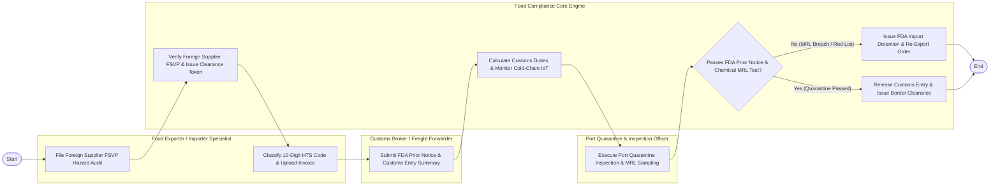

# Swimlane Diagram — Food Export & Import Compliance System

## Mermaid Code

## Flow Description | Mo ta luong

| Lane | Actor | Role in Flow |
|------|-------|-------------|
| **Lane 1** | Food Exporter / Importer Specialist | Files Foreign Supplier Verification Program (FSVP) hazard audits, classifies food under 10-digit HTS tariff codes, and uploads commercial invoices. |
| **Lane 2** | Customs Broker / Freight Forwarder | Submits electronic FDA Prior Notice (PNC) filings, links Bill of Lading manifests, and prepares Customs Entry Summaries (CBP Form 7501). |
| **Lane 3** | Port Quarantine & Inspection Officer | Conducts physical port agriculture inspections, extracts food samples for MRL pesticide residue testing, and verifies ePhyto health certificates. |
| **Lane 4** | Food Compliance Core Engine | Verifies FSVP clearance tokens, calculates customs tariffs (MPF/HMF/ADD), monitors container reefer temps, ingests FDA ACE webhooks, and issues border clearance. |

### Process Execution Steps | Cac buoc thuc hien quy trinh

1. **FSVP Audit & Classification**: Food Importer files FSVP hazard audit for foreign supplier (`C1`). Core Engine verifies audit and issues FSVP clearance token (`S1`). Importer classifies 10-digit HTS codes (`C2`).
2. **Prior Notice & Duty Calculation**: Customs Broker submits electronic FDA Prior Notice and Customs Entry Summary (`B1`). Core Engine calculates customs tariffs, fees, and anti-dumping duties while tracking reefer container IoT temps (`S4`).
3. **Port Inspection & Testing**: Port Quarantine Officer inspects shipment and tests MRL chemical residues (`I1`). Core Engine evaluates compliance status (`S2`).
   - If **No (MRL Breach / Red List)**: Core Engine issues FDA Import Detention and Re-Export/Destruction order (`S3`).
   - If **Yes (Quarantine Passed)**: Core Engine releases customs entry and issues final border clearance token (`S5`), completing execution (`Finish`).
