# Action Tree — Food Export & Import Compliance System

## Mermaid Code

```mermaid
graph TD
    Root["Food Export & Import Compliance System"]

    Root --> M1["Foreign Supplier Verification FSVP & Audit Management"]
    Root --> M2["Harmonized Tariff HS Classification & Duty Calculations"]
    Root --> M3["Health Phytosanitary & Veterinary Documentation"]
    Root --> M4["Border Declarations & FDA Prior Notice Filings"]
    Root --> M5["Cold-Chain Container IoT & Port Quarantine Inspections"]
    Root --> M6["Chemical MRL Screenings & Customs Brokerage"]
    Root --> M7["Global Trade Analytics & System Administration"]

    M1 --> A11["Verify Foreign Supplier HACCP and Hazard Analysis Files"]
    M1 --> A12["File FDA Foreign Supplier Verification Program FSVP Audits"]
    M1 --> A13["Issue Verified FSVP Importer Clearance Tokens"]
    M1 --> A14["Monitor FDA Import Alert Red List Supplier Warnings"]

    M2 --> A21["Classify Food Products under 10-Digit HTS Tariff Codes"]
    M2 --> A22["Calculate Ad Valorem Duties MPF and HMF Customs Fees"]
    M2 --> A23["Apply Countervailing and Anti-Dumping Duty Orders"]
    M2 --> A24["Verify Free Trade Agreement USMCA Certificate of Origin"]

    M3 --> A31["Generate Official Electronic ePhyto Plant Health Certificates"]
    M3 --> A32["Verify USDA FSIS Veterinary Health Export Stamps"]
    M3 --> A33["Transmit Digital ePhyto XML Payloads to MAFF Portals"]
    M3 --> A34["Audit Pre-Export Agricultural Pest Inspection Reports"]

    M4 --> A41["Submit FDA Prior Notice Filings via ACE Government Portal"]
    M4 --> A42["Receive FDA Prior Notice Confirmation PNC Numbers"]
    M4 --> A43["File EU TRACES Common Health Entry Document CHED-P"]
    M4 --> A44["Validate Minimum Advance Notice Filing Time Window Rules"]

    M5 --> A51["Monitor Maritime Reefer Container Temperature Telemetry"]
    M5 --> A52["Track Port Agriculture Quarantine Inspection Holds"]
    M5 --> A53["Log Cold-Chain Temperature Breach Threshold Alerts"]
    M5 --> A54["Assign Physical Inspection Sampling Queues at Seaports"]

    M6 --> A61["Evaluate Laboratory Chemical Maximum Residue Limits MRL"]
    M6 --> A62["Reconcile Rejected Customs Detentions and Re-Export Orders"]
    M6 --> A63["Transmit Entry Summary CBP Form 7501 to Customs Brokers"]
    M6 --> A64["Manage Supervised Port Destruction and Refusal Manifests"]

    M7 --> A71["Monitor Total Import Export TEUs Volume and Duty Expenditures"]
    M7 --> A72["Analyze Port Customs Clearance Speed and Audit Pass Rates"]
    M7 --> A73["Manage Security Roles Trader Broker Inspector Admin"]
    M7 --> A74["Manage International CODEX Food Rule Sets and API Keys"]
```

## Module Description | Mo ta Module

| # | Module | Description | Actions |
|---|--------|-------------|---------|
| 1 | Foreign Supplier Verification FSVP & Audit Management | Manages foreign supplier HACCP hazard analyses, annual FSVP verification audits, FDA Import Alert Red List screening, and supplier clearance tokens. | Verify Foreign Supplier HACCP and Hazard Analysis Files, File FDA Foreign Supplier Verification Program FSVP Audits, Issue Verified FSVP Importer Clearance Tokens, Monitor FDA Import Alert Red List Supplier Warnings |
| 2 | Harmonized Tariff HS Classification & Duty Calculations | Classifies food under 10-digit HTS codes, calculates import duties, MPF/HMF fees, anti-dumping duties (ADD), and verifies Free Trade Agreements. | Classify Food Products under 10-Digit HTS Tariff Codes, Calculate Ad Valorem Duties MPF and HMF Customs Fees, Apply Countervailing and Anti-Dumping Duty Orders, Verify Free Trade Agreement USMCA Certificate of Origin |
| 3 | Health Phytosanitary & Veterinary Documentation | Generates electronic ePhyto plant certificates, USDA FSIS veterinary export stamps, ePhyto XML hub transmissions, and pest inspection reports. | Generate Official Electronic ePhyto Plant Health Certificates, Verify USDA FSIS Veterinary Health Export Stamps, Transmit Digital ePhyto XML Payloads to MAFF Portals, Audit Pre-Export Agricultural Pest Inspection Reports |
| 4 | Border Declarations & FDA Prior Notice Filings | Submits electronic FDA Prior Notice XML filings via US Customs ACE portal, receives PNC confirmation numbers, and files EU TRACES CHED-P. | Submit FDA Prior Notice Filings via ACE Government Portal, Receive FDA Prior Notice Confirmation PNC Numbers, File EU TRACES Common Health Entry Document CHED-P, Validate Minimum Advance Notice Filing Time Window Rules |
| 5 | Cold-Chain Container IoT & Port Quarantine Inspections | Monitors maritime reefer container temperature telemetry (°C), tracks port customs holds, logs temperature breaches, and manages quarantine queues. | Monitor Maritime Reefer Container Temperature Telemetry, Track Port Agriculture Quarantine Inspection Holds, Log Cold-Chain Temperature Breach Threshold Alerts, Assign Physical Inspection Sampling Queues at Seaports |
| 6 | Chemical MRL Screenings & Customs Brokerage | Evaluates chemical MRL lab tests, manages FDA detentions/re-export orders, transmits CBP Form 7501 to brokers, and logs port destruction orders. | Evaluate Laboratory Chemical Maximum Residue Limits MRL, Reconcile Rejected Customs Detentions and Re-Export Orders, Transmit Entry Summary CBP Form 7501 to Customs Brokers, Manage Supervised Port Destruction and Refusal Manifests |
| 7 | Global Trade Analytics & System Administration | Displays executive dashboards on trade TEU volume, customs duty expenditures, clearance speed, audit pass rates, security roles, and APIs. | Monitor Total Import Export TEUs Volume and Duty Expenditures, Analyze Port Customs Clearance Speed and Audit Pass Rates, Manage Security Roles Trader Broker Inspector Admin, Manage International CODEX Food Rule Sets and API Keys |
