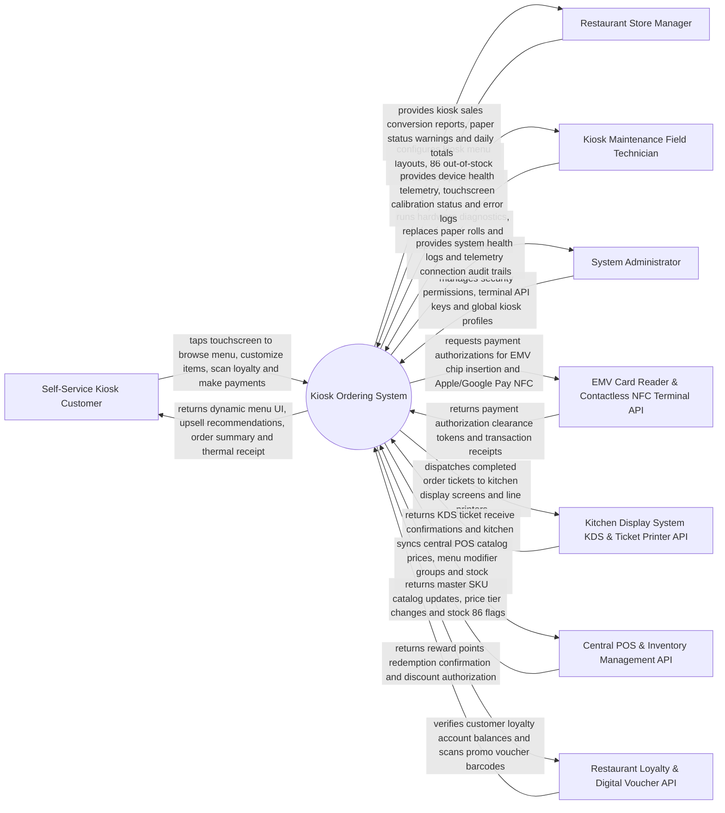

# Context Diagram — Kiosk Ordering System

## Mermaid Code

## Actor & Interaction Table | Bang Actor & Tuong tac

| # | Actor | Actor Type | Data Sent TO System | Data Received FROM System | Notes |
|---|-------|------------|---------------------|---------------------------|-------|
| 1 | Self-Service Kiosk Customer | Primary | Touchscreen menu selections, item modifier choices, loyalty account phone #, card payment taps | Interactive menu UI, AI upsell prompts, order order summary, printed thermal receipt | Restaurant diner using self-service ordering touchscreen kiosks. |
| 2 | Restaurant Store Manager | Primary | Kiosk menu layout selections, 86 out-of-stock item toggles, daily store mode settings | Kiosk sales conversion analytics, receipt paper low alerts, daily terminal revenue | Store manager supervising restaurant floor and kiosk operation. |
| 3 | Kiosk Maintenance Field Technician | Primary | Hardware test commands, touchscreen calibration inputs, paper roll replacement confirmations | Hardware diagnostic reports, thermal printer status, barcode scanner logs | Field technician servicing kiosk hardware, screens, and printers. |
| 4 | System Administrator | Primary | User credentials, security role policies, terminal API keys, kiosk fleet parameters | Fleet uptime telemetry, hardware diagnostic logs, security audit trails | Oversees corporate kiosk fleet infrastructure and software updates. |
| 5 | EMV Card Reader & NFC Terminal API | Supporting | EMV chip card insertions, Apple Pay / Google Pay contactless NFC taps, PIN entry | Payment clearance tokens, transaction approval receipts, card decline codes | Integrated payment terminal hardware (Verifone, Ingenico, PAX) processing payments. |
| 6 | Kitchen Display System KDS API | Supporting | KDS ticket bump events, kitchen prep time updates, station line status | Order ticket dispatch payloads, order number token print jobs | Kitchen display screens and order expediter printers receiving kiosk orders. |
| 7 | Central POS & Inventory API | Supporting | Real-time kiosk order injections, stock depletion counts, end-of-day sales totals | Central master menu catalog, price tier overrides, 86 out-of-stock item sync | Enterprise POS backend (Toast, NCR Aloha, Oracle MICROS) syncing catalog data. |
| 8 | Restaurant Loyalty & Voucher API | Supporting | Loyalty QR code barcode scans, phone number lookups, voucher redemption codes | Loyalty point balance, reward discount authorizations, personalized offers | Customer loyalty platform managing points and digital coupons. |

## System Boundary Description | Mo ta Pham vi He thong

The **Kiosk Ordering System** manages self-service ordering touchscreens, interactive menu browsing, item modifier customization, AI-driven dynamic upselling, EMV chip/NFC contactless payment processing, KDS ticket injection, thermal receipt printing, multi-language/ADA accessibility modes, and offline order queueing. Inside its boundary, the system handles touchscreen UI rendering, meal combo builder logic, dynamic upsell recommendation prompts, EMV payment terminal communication, barcode scanner processing, loyalty discount redemption, thermal receipt printing, session idle timeout resets, and offline transaction buffering.

The system boundary excludes physical cooking of food in the kitchen, physical manufacturing of kiosk metal enclosures, and raw credit card processing (handled by EMV Payment Gateways).
