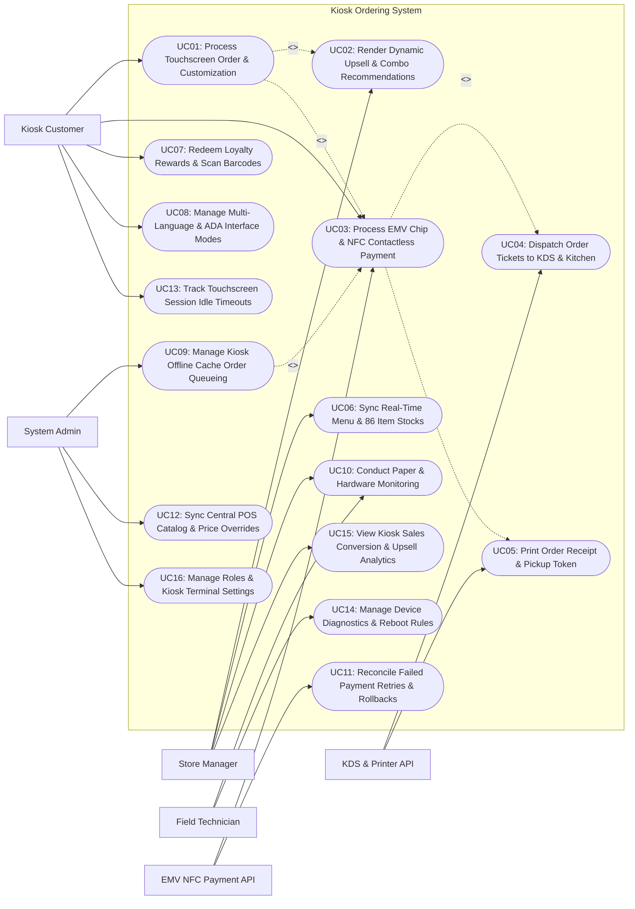

# Use Case Diagram — Kiosk Ordering System

## Mermaid Code

## Actor Table | Bang Actor

| # | Actor | Actor Type | Role Description | Related Use Cases |
|---|-------|------------|------------------|-------------------|
| 1 | EMV NFC Payment API | Secondary System | Payment terminal hardware API handling EMV chip cards, Apple Pay, Google Pay, and contactless cards. | UC03, UC11 |
| 2 | KDS & Printer API | Secondary System | Kitchen Display System and thermal receipt printer hardware API receiving order tickets and printing receipts. | UC04, UC05 |
| 3 | Kiosk Customer | Primary | Restaurant diner interacting with self-service touchscreen kiosk to order food, customize items, and pay. | UC01, UC03, UC07, UC08, UC13 |
| 4 | Store Manager | Primary | Restaurant manager configuring kiosk menus, toggling 86 out-of-stock items, monitoring paper rolls, and viewing analytics. | UC02, UC06, UC10, UC15 |
| 5 | Field Technician | Primary | Maintenance technician performing hardware diagnostics, touchscreen calibration, and paper roll replacements. | UC10, UC14 |
| 6 | System Administrator | Primary | Technical manager configuring kiosk fleet profiles, POS integration keys, offline queue parameters, and security roles. | UC09, UC12, UC16 |

## Use Case Table | Bang Use Case

| # | UC ID | Use Case Name | Primary Actor | Secondary Actor | Description | Priority |
|---|-------|---------------|---------------|-----------------|-------------|----------|
| 1 | UC01 | Process Touchscreen Order & Customization | Kiosk Customer | None | Enables customers to browse interactive visual menus, select meal items, and customize ingredients (No Onions, Extra Cheese). | High |
| 2 | UC02 | Render Dynamic Upsell & Combo Recommendations | Store Manager | None | Displays AI-driven upsell prompts (e.g., "Make it a Meal for $2.50", "Add Dessert") based on items in cart. | High |
| 3 | UC03 | Process EMV Chip & NFC Contactless Payment | Kiosk Customer | EMV NFC Payment API | Processes card payments via integrated EMV chip insertion, Apple Pay, Google Pay, or contactless NFC taps. | High |
| 4 | UC04 | Dispatch Order Tickets to KDS & Kitchen | System | KDS & Printer API | Injects paid kiosk orders directly into the kitchen display system (KDS) and station line printers within 1 second. | High |
| 5 | UC05 | Print Order Receipt & Pickup Token | System | KDS & Printer API | Prints thermal customer receipt containing itemized charges, tax, payment verification, and large pickup order number token. | High |
| 6 | UC06 | Sync Real-Time Menu & 86 Item Stocks | Store Manager | None | Synchronizes menu item availability with POS inventory, automatically grays out 86 out-of-stock items on kiosk screens. | High |
| 7 | UC07 | Redeem Loyalty Rewards & Scan Barcodes | Kiosk Customer | None | Scans customer mobile app barcodes or inputs phone numbers to redeem loyalty points and apply promotional coupon vouchers. | High |
| 8 | UC08 | Manage Multi-Language & ADA Interface Modes | Kiosk Customer | None | Offers multi-language switching (English, Spanish, French, Vietnamese) and ADA wheel-chair accessible screen height adjustment modes. | High |
| 9 | UC09 | Manage Kiosk Offline Cache Order Queueing | System Admin | None | Caches order transactions locally during internet outages, auto-syncing queued orders to POS when connection restores. | High |
| 10 | UC10 | Conduct Paper & Hardware Monitoring | Field Technician | Store Manager | Monitors thermal receipt paper roll status (Paper Low / Out), barcode scanner health, and payment terminal connectivity. | High |
| 11 | UC11 | Reconcile Failed Payment Retries & Rollbacks | System | EMV NFC Payment API | Handles payment declines, chip read errors, and card timeouts, executing order cart rollbacks to prevent un-paid kitchen tickets. | High |
| 12 | UC12 | Sync Central POS Catalog & Price Overrides | System Admin | None | Synchronizes master product SKUs, modifier groups, tax rates, and store-specific price tier overrides from central POS. | High |
| 13 | UC13 | Track Touchscreen Session Idle Timeouts | Kiosk Customer | None | Tracks customer inactivity timers (e.g., 45 seconds idle), prompting "Are you still there?" and clearing abandoned carts. | Medium |
| 14 | UC14 | Manage Device Diagnostics & Reboot Rules | Field Technician | None | Executes automated nightly reboots, touchscreen touch-grid calibration, and remote diagnostic health checks. | Medium |
| 15 | UC15 | View Kiosk Sales Conversion & Upsell Analytics | Store Manager | None | Displays analytical dashboards on kiosk average order value (AOV), upsell conversion success %, peak ordering hours, and revenue. | High |
| 16 | UC16 | Manage Roles & Kiosk Terminal Settings | System Admin | None | Configures user security access roles, kiosk terminal ID registration, payment gateway keys, and system audit logs. | High |

## Use Case Specification | Dac ta Use Case

---

### UC01 — Process Touchscreen Order & Customization

| Field | Detail |
|-------|--------|
| **UC ID** | UC01 |
| **Use Case Name** | Process Touchscreen Order & Customization |
| **Actor(s)** | Primary: Kiosk Customer   Secondary: None |
| **Description** | Enables a restaurant diner to interact with a high-definition self-service touchscreen kiosk, browsing visual food categories, selecting menu items, configuring ingredient modifiers, and building an order cart. |
| **Precondition** | 1. Kiosk terminal is active in "Ready to Order" customer screen state.   2. Kiosk menu catalog (UC06) is loaded. |
| **Main Flow** | 1. Customer taps "Start Order" on 32-inch touchscreen display.   2. System prompts Order Type: `Eat In` or `Take Out`.   3. Customer selects `Eat In`.   4. System presents visual category navigation: `Burgers & Sandwiches`, `Sides & Snacks`, `Cold Beverages`, `Desserts`, `Value Combos`.   5. Customer selects `Burgers & Sandwiches` category -> taps `Double Bacon Cheeseburger ($8.99)`.   6. System opens "Item Customization Modal":      - Bun Selection: `Brioche Bun (Default)`      - Cheese: `Double American Cheese`      - Toppings: `Add Pickles`, `No Onions (Subtracted)`, `Extra Bacon (+$1.50)`      - Sauce: `Extra Special House Sauce (+$0.50)`.   7. Customer taps "Add Custom Burger to Order ($10.99)".   8. System triggers Dynamic Upsell & Combo Recommendations (UC02) (e.g., "Make it a Combo with Fries & Drink for $3.00 more?").   9. Customer selects "Upgrade to Meal Combo (Add Large Waffle Fries & Large Iced Tea)".   10. System updates cart total ($13.99), displays itemized cart summary on right sidebar, and enables "Proceed to Payment" button (UC03). |
| **Alternative Flow** | **AF1** — Direct combo meal builder:   1. Customer selects "Value Combos" category directly.   2. System guides customer step-by-step through Main Entrée, Side, and Drink selection. |
| **Exception Flow** | **EX1** — Item sold out mid-customization (UC06 sync):   1. Waffle Fries are marked 86 out-of-stock by store manager while customer is customizing.   2. System grays out Waffle Fries option with notification "Waffle Fries just sold out! Selected Regular Cut Fries instead." |
| **Postcondition** | Customer selects items, applies ingredient customizations, upgrades to meal combo, and adds items to order cart. |
| **Business Rule** | **BR1**: All customizable food items MUST display high-resolution food imagery and clear incremental pricing for add-on modifiers.   **BR2**: Touchscreen response latency for category switching and modifier toggling MUST NOT exceed 100 milliseconds. |

---

### UC02 — Render Dynamic Upsell & Combo Recommendations

| Field | Detail |
|-------|--------|
| **UC ID** | UC02 |
| **Use Case Name** | Render Dynamic Upsell & Combo Recommendations |
| **Actor(s)** | Primary: Store Manager   Secondary: None |
| **Description** | Renders intelligent AI-driven upselling prompts during ordering and checkout, suggesting relevant side items, beverage upgrades, dessert add-ons, or combo meal conversions to maximize Average Order Value (AOV). |
| **Precondition** | 1. Customer has added at least 1 item to cart (UC01).   2. Upsell recommendation rules are configured in system backend. |
| **Main Flow** | 1. Customer adds a single entree item (`Classic Cheeseburger — $6.99`) to order cart.   2. System AI Upsell Engine analyzes cart contents and evaluates active recommendation rules:      - Rule 1: Single Burger in cart -> Prompt: `Make it a Meal (Add Fries & Drink) for +$2.50`      - Rule 2: Burger in cart -> Prompt: `Add 6-Piece Mozzarella Sticks for +$3.99`      - Rule 3: Beverage in cart -> Prompt: `Upgrade Medium Drink to Large Shake for +$1.25`.   3. System presents high-impact visual pop-up modal: **Complete Your Meal! Add Seasoned Curly Fries & Medium Shake for just $3.50 more?** featuring large "Yes, Add to Meal" and "No Thanks" buttons.   4. Customer taps "Yes, Add to Meal ($3.50)".   5. System automatically updates cart items: converts single burger to meal combo, adds fries and shake, and calculates savings badge: `Saved $1.50 with Combo Upgrade!`.   6. At final checkout screen, System presents secondary micro-upsell: **Add Warm Chocolate Chip Cookie for $1.00?**.   7. Customer taps "Add Cookie", increasing final ticket revenue from $6.99 to $11.49 (+64.3% AOV increase). |
| **Alternative Flow** | **AF1** — Customer declines upsell recommendations:   1. Customer taps "No Thanks, Continue to Checkout".   2. System immediately closes pop-up modal and routes customer directly to payment screen (UC03). |
| **Exception Flow** | **EX1** — Upsell item out-of-stock:   1. Seasoned Curly Fries are 86 out-of-stock.   2. System automatically suppresses Curly Fries upsell prompt and presents alternative Onion Rings recommendation. |
| **Postcondition** | Relevant upsell recommendations are displayed, customer accepts or declines, and cart total updates dynamically. |
| **Business Rule** | **BR1**: Upsell pop-up prompts MUST NOT exceed 2 modal screens per transaction to prevent customer order frustration.   **BR2**: Upsell recommendations MUST strictly filter out items currently flagged as 86 out-of-stock in POS inventory. |

---

### UC03 — Process EMV Chip & NFC Contactless Payment

| Field | Detail |
|-------|--------|
| **UC ID** | UC03 |
| **Use Case Name** | Process EMV Chip & NFC Contactless Payment |
| **Actor(s)** | Primary: Kiosk Customer   Secondary: EMV NFC Payment API |
| **Description** | Communicates with the integrated payment terminal to process secure card payments via EMV chip insertion, Apple Pay / Google Pay contactless NFC taps, or contactless credit cards. |
| **Precondition** | 1. Customer taps "Pay Now" on order review screen ($14.99 Total).   2. Payment terminal hardware (Verifone/Ingenico) is connected and online. |
| **Main Flow** | 1. System transitions kiosk screen to Payment State: **Please Pay $14.99 Below — Insert Chip, Tap Contactless, or Scan Digital Wallet**.   2. System dispatches payment authorization payload to EMV NFC Payment API: `Amount: $14.99 USD | Transaction Type: Sale | Terminal ID: #KIOSK-02`.   3. Payment terminal hardware lights up NFC reader LEDs and displays prompt: `Insert Card or Tap Phone`.   4. Customer taps iPhone (Apple Pay) against payment terminal NFC reader pad.   5. Payment terminal reads contactless token, processes biometric FaceID authorization, and sends encrypted cryptogram to Payment Gateway.   6. Payment Gateway validates transaction and returns HTTP 200 OK Response: `Status: APPROVED | Auth Code: #AUTH-902288 | Card Type: Visa ending in 4242`.   7. Payment terminal beeps green success chime and displays `Approved!`.   8. System receives payment clearance token, transitions kiosk screen to **Payment Success!**, triggers KDS order dispatch (UC04), and prints customer receipt token (UC05). |
| **Alternative Flow** | **AF1** — EMV Chip insertion payment:   1. Customer inserts physical Visa Chip card into terminal slot.   2. Terminal reads chip, processes authorization, and prompts customer "Remove Card". |
| **Exception Flow** | **EX1** — Card declined / insufficient funds (UC11):   1. Payment Gateway returns `DECLINED: INSUFFICIENT FUNDS`.   2. Payment terminal beeps error tone; Kiosk screen displays **Payment Declined: Please try another card or payment method**, preserving cart items. |
| **Postcondition** | Payment is authorized, payment clearance token is received, order transitions to paid status, and receipt prints. |
| **Business Rule** | **BR1**: Payment transactions MUST be encrypted end-to-end (P2PE) and comply with PCI-DSS Security Standards.   **BR2**: Kiosk order tickets MUST NOT be dispatched to the kitchen KDS until payment authorization is 100% confirmed. |

---

### UC04 — Dispatch Order Tickets to KDS & Kitchen

| Field | Detail |
|-------|--------|
| **UC ID** | UC04 |
| **Use Case Name** | Dispatch Order Tickets to KDS & Kitchen |
| **Actor(s)** | Primary: System   Secondary: KDS & Printer API |
| **Description** | Injects confirmed paid kiosk orders directly into the Kitchen Display System (KDS) prep screens and station line printers within 1 second of payment clearance. |
| **Precondition** | 1. Payment authorization clearance token (UC03) is received.   2. KDS API integration is connected. |
| **Main Flow** | 1. System receives payment clearance confirmation for Order `#KSK-2026-9022` (Order Type: `Eat In` | Total: `$14.99`).   2. System constructs normalized KDS Order Ticket Payload:      - Header: **Order #9022 (Kiosk — Eat In)**      - Source: `Kiosk Terminal #02`      - Items:        - 1x Double Bacon Cheeseburger (**NO Onions** | **EXTRA Bacon**)        - 1x Large Seasoned Waffle Fries        - 1x Large Iced Tea      - Timestamp: `July 22, 2026 at 17:35:12`.   3. System sends TCP/IP socket payload to KDS & Printer API.   4. KDS Master Server parses payload and routes order items to designated cooking prep screens:      - Grill KDS Screen: Displays `1x Double Bacon Burger (NO Onions, EXTRA Bacon)`      - Fryer KDS Screen: Displays `1x Large Waffle Fries`      - Beverage Station Printer: Prints `1x Large Iced Tea` sticker label.   5. KDS screen plays audio chime, highlighting new ticket in green (Order #9022).   6. KDS API sends confirmation webhook back to System; System logs `DISPATCH_SUCCESSFUL` status. |
| **Alternative Flow** | **AF1** — Direct packaging printer routing for grab-and-go items:   1. Order consists solely of packaged bottled beverages and chips.   2. System routes ticket directly to expediter bagging station, bypassing hot prep KDS screens. |
| **Exception Flow** | **EX1** — KDS network connection failure:   1. KDS server loses Wi-Fi connection during dispatch attempt.   2. System retries dispatch 3 times over local LAN, falls back to direct IP thermal printer output, and flags manager alert. |
| **Postcondition** | Order ticket is injected into kitchen KDS prep screens, station line printers output tickets, and kitchen prep begins. |
| **Business Rule** | **BR1**: Paid kiosk orders MUST be injected into the kitchen KDS within 1.0 second of payment authorization.   **BR2**: Kiosk order tickets MUST clearly display the order source ("KIOSK #02") and high-visibility modifier callouts (e.g., "NO ONIONS"). |

---

### UC06 — Sync Real-Time Menu & 86 Item Stocks

| Field | Detail |
|-------|--------|
| **UC ID** | UC06 |
| **Use Case Name** | Sync Real-Time Menu & 86 Item Stocks |
| **Actor(s)** | Primary: Store Manager   Secondary: None |
| **Description** | Synchronizes kiosk menu catalog, pricing tiers, and stock availability with the central POS system in real time, automatically graying out 86 out-of-stock items to prevent unfulfillable customer orders. |
| **Precondition** | 1. Kiosk is connected to central POS API network.   2. Store Manager triggers an 86 out-of-stock toggle on POS terminal or kiosk manager menu. |
| **Main Flow** | 1. Store Manager marks `Avocado Slice` and `Strawberry Shake` as "86 Out-of-Stock" on POS manager terminal.   2. POS API sends real-time inventory event webhook push to Kiosk System: `EVENT: STOCK_DEPLETED | Item IDs: [SKU-AVOCADO, SKU-SHAKE-STRAWBERRY]`.   3. Kiosk System receives webhook and updates local menu cache memory within 500 milliseconds.   4. Kiosk System updates active touchscreen UI screens across all kiosks in the restaurant:      - `Strawberry Shake` menu card is grayed out with "Sold Out" overlay badge      - `Avocado Slice` modifier checkbox is disabled and marked "Sold Out"      - Item selection buttons are locked from touch inputs.   5. If a customer currently has Avocado Slices in an active un-paid cart, System displays notification pop-up: "Avocado Slices just sold out! We removed this item from your cart."   6. System logs 86 sync event and maintains real-time catalog alignment with store POS inventory. |
| **Alternative Flow** | **AF1** — Restocking item back to available:   1. Store receives fresh supply delivery; Manager toggles Avocado back to "In Stock".   2. Kiosk screens remove "Sold Out" badges and re-enable item selection within 500ms. |
| **Exception Flow** | **EX1** — POS API sync disconnection:   1. Network disconnects during inventory push.   2. Kiosk relies on local cached menu and executes polling ping every 30 seconds until connection is restored. |
| **Postcondition** | Out-of-stock items are marked "Sold Out" on kiosk touchscreens within 500ms, preventing unfulfillable customer orders. |
| **Business Rule** | **BR1**: Kiosk touchscreen menus MUST synchronize 86 out-of-stock updates from POS inventory within 1 second of occurrence.   **BR2**: Out-of-stock items MUST be visually grayed out with "Sold Out" overlays and locked from touch selection. |
