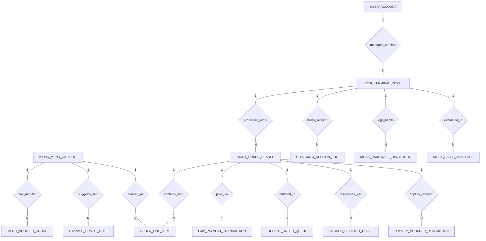

# Conceptual ERD — Kiosk Ordering System

## Mermaid Code

## Entity Description Table | Bang mo ta Entity

| # | Entity Name | Vietnamese Name | Description | Key Attributes | Main Relationships |
|---|-------------|-----------------|-------------|----------------|-------------------|
| 1 | KIOSK_TERMINAL_DEVICE | Thiet bi cay kiosk tu phuc vu | Physical kiosk hardware device record, terminal code, name, IP address, screen resolution, status, and active boolean. | terminal_id, terminal_code, terminal_name, ip_address, terminal_status, is_active | One-to-Many with KIOSK_ORDER_HEADER, CUSTOMER_SESSION_LOG, KIOSK_HARDWARE_DIAGNOSTIC, KIOSK_SALES_ANALYTICS; Belongs to USER_ACCOUNT |
| 2 | KIOSK_MENU_CATALOG | Danh muc thuc don kiosk | Master kiosk menu catalog item, SKU code, item name, category name, base price, image URL, and 86 out-of-stock boolean. | item_id, sku_code, item_name, category_name, base_price, is_86_out_of_stock | One-to-Many with MENU_MODIFIER_GROUP, ORDER_LINE_ITEM, DYNAMIC_UPSELL_RULE |
| 3 | MENU_MODIFIER_GROUP | Nhom tuy chon gia vi va topping | Item ingredient modifier choice, modifier name, additional price $, default boolean, and availability boolean. | modifier_id, item_id, modifier_name, additional_price, is_default, is_available | Belongs to KIOSK_MENU_CATALOG |
| 4 | KIOSK_ORDER_HEADER | Don hang master kiosk | Kiosk order header record, terminal ID, pickup order number token (#9022), order type (Eat In/Take Out), timestamps, subtotal, tax, total, and status. | order_id, terminal_id, order_number_token, order_type, subtotal_amount, tax_amount, total_amount, order_status | Belongs to KIOSK_TERMINAL_DEVICE; One-to-Many with ORDER_LINE_ITEM, KITCHEN_DISPATCH_TICKET, LOYALTY_VOUCHER_REDEMPTION; One-to-One with EMV_PAYMENT_TRANSACTION, OFFLINE_ORDER_QUEUE |
| 5 | ORDER_LINE_ITEM | Chi tiet mon trong don kiosk | Line item in a kiosk order specifying item ID, quantity, unit price, line subtotal, and modifier selection summary. | line_id, order_id, item_id, quantity, unit_price, line_total, modifier_selection_summary | Belongs to KIOSK_ORDER_HEADER, KIOSK_MENU_CATALOG |
| 6 | EMV_PAYMENT_TRANSACTION | Giao dich thanh toan EMV/NFC | Payment transaction record, order ID, auth code, payment method (EMV/NFC/ApplePay), card type, masked PAN, amount paid, and status. | payment_id, order_id, transaction_auth_code, payment_method, card_type, masked_pan, amount_paid, payment_status | One-to-One with KIOSK_ORDER_HEADER |
| 7 | DYNAMIC_UPSELL_RULE | Quy tac goi y ban kem AI | AI dynamic upselling recommendation rule, rule name, trigger category, suggested item ID, combo discount amount, and active boolean. | rule_id, rule_name, trigger_category, suggested_item_id, combo_discount_amount, is_active | Belongs to KIOSK_MENU_CATALOG |
| 8 | KITCHEN_DISPATCH_TICKET | Phieu truyen tin den bep KDS | KDS ticket dispatch log, order ID, dispatched timestamp, KDS station code, and dispatch status. | ticket_id, order_id, dispatched_at, kds_station_code, dispatch_status | Belongs to KIOSK_ORDER_HEADER |
| 9 | CUSTOMER_SESSION_LOG | Nhat ky phien su dung khach | Customer touchscreen interactive session log, terminal ID, start/end timestamps, idle timeout count, and abandoned boolean. | session_id, terminal_id, session_start_time, session_end_time, idle_timeout_count, is_abandoned | Belongs to KIOSK_TERMINAL_DEVICE |
| 10 | LOYALTY_VOUCHER_REDEMPTION | Nhat ky doi thuong khuyen mai | Customer loyalty reward or promotional voucher redemption record, order ID, loyalty account #, voucher code, discount amount, and timestamp. | redemption_id, order_id, loyalty_account_no, voucher_code, discount_amount_applied, redeemed_at | Belongs to KIOSK_ORDER_HEADER |
| 11 | KIOSK_HARDWARE_DIAGNOSTIC | Nhat ky chan doan phan cung | Hardware diagnostic telemetry log, terminal ID, thermal printer paper status, EMV reader status, barcode scanner status, and timestamp. | diagnostic_id, terminal_id, printer_paper_status, emv_reader_status, scanner_status, checked_at | Belongs to KIOSK_TERMINAL_DEVICE |
| 12 | OFFLINE_ORDER_QUEUE | Hang doi don hang khi mat mang | Offline order cache queue record buffering orders locally during internet outages, encrypted JSON payload, queued/synced timestamps, and status. | queue_id, order_id, encrypted_payload_json, queued_at, synced_at, is_synced | One-to-One with KIOSK_ORDER_HEADER |
| 13 | USER_ACCOUNT | Tai khoan he thong | Core security authentication account holding credentials, password hashes, and user role definitions. | user_id, username, password_hash, role_name | One-to-Many with KIOSK_TERMINAL_DEVICE |
| 14 | KIOSK_SALES_ANALYTICS | Thong ke doanh thu thiet bi kiosk | Executive daily analytics tracking total kiosk sales $, Average Order Value (AOV), upsell conversion %, and total orders count per terminal. | analytics_id, metric_date, terminal_id, total_kiosk_sales, average_order_value, upsell_conversion_pct, total_orders_count | Belongs to KIOSK_TERMINAL_DEVICE |

## Relationship Description | Mo ta Quan he

| # | From Entity | Cardinality | To Entity | Relationship Label | Business Explanation |
|---|-------------|-------------|-----------|-------------------|----------------------|
| 1 | KIOSK_TERMINAL_DEVICE | One-to-Many | KIOSK_ORDER_HEADER | processes_order | Thiet bi kiosk tu phuc vu thuc hien xu ly cac don hang cua khach. |
| 2 | KIOSK_TERMINAL_DEVICE | One-to-Many | CUSTOMER_SESSION_LOG | hosts_session | Thiet bi kiosk ghi nhan cac phien tuong tac tuong ung cua khach hang. |
| 3 | KIOSK_TERMINAL_DEVICE | One-to-Many | KIOSK_HARDWARE_DIAGNOSTIC | logs_health | Thiet bi kiosk ghi nhan nhat ky chan doan suc khoe phan cung (may in, dau doc the). |
| 4 | KIOSK_MENU_CATALOG | One-to-Many | MENU_MODIFIER_GROUP | has_modifier | Mon an trong thuc don co cac nhom tuy chon gia vi, topping di kem. |
| 5 | KIOSK_ORDER_HEADER | One-to-Many | ORDER_LINE_ITEM | contains_item | Don hang master kiosk chua nhieu dong chi tiet cac mon an duoc chon. |
| 6 | KIOSK_MENU_CATALOG | One-to-Many | ORDER_LINE_ITEM | ordered_as | Mon an trong danh muc duoc chon va ban duoi dang dong chi tiet don hang. |
| 7 | KIOSK_ORDER_HEADER | One-to-One | EMV_PAYMENT_TRANSACTION | paid_via | Don hang đuoc thanh toan qua giao dich the EMV hoac contactless NFC. |
| 8 | KIOSK_MENU_CATALOG | One-to-Many | DYNAMIC_UPSELL_RULE | suggests_item | Thuc don co cac quy tac AI goi y ban kem cac mon side/dessert/combo. |
| 9 | KIOSK_ORDER_HEADER | One-to-Many | KITCHEN_DISPATCH_TICKET | dispatches_kds | Don hang thanh toan thanh cong duoc truyen den man hinh bep KDS. |
| 10 | KIOSK_ORDER_HEADER | One-to-Many | LOYALTY_VOUCHER_REDEMPTION | applies_discount | Don hang duoc ap dung ma giam gia khuyen mai hoac diem tich luy loyalty. |
| 11 | KIOSK_ORDER_HEADER | One-to-One | OFFLINE_ORDER_QUEUE | buffered_in | Don hang duoc luu tam vao hang doi ngoai tuyen neu kiosk bi mat ket noi mang. |
| 12 | USER_ACCOUNT | One-to-Many | KIOSK_TERMINAL_DEVICE | manages_terminal | Quan ly hoac ky thuat vien dung tai khoan he thong de quan ly cay kiosk. |
| 13 | KIOSK_TERMINAL_DEVICE | One-to-Many | KIOSK_SALES_ANALYTICS | evaluated_in | Thiet bi kiosk duoc thong ke doanh thu, AOV va ty le chuyen doi upsell hang ngay. |
