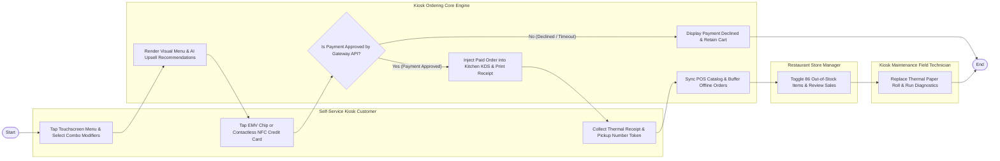

# Swimlane Diagram — Kiosk Ordering System

## Mermaid Code

## Flow Description | Mo ta luong

| Lane | Actor | Role in Flow |
|------|-------|-------------|
| **Lane 1** | Self-Service Kiosk Customer | Taps touchscreen to select menu items, customizes modifiers, accepts combo upsells, taps card for EMV/NFC payment, and collects receipts. |
| **Lane 2** | Restaurant Store Manager | Toggles 86 out-of-stock items, configures kiosk menu layouts, monitors receipt paper status, and reviews sales analytics. |
| **Lane 3** | Kiosk Maintenance Field Technician | Performs hardware diagnostics, calibrates touchscreen touch grid, replaces thermal receipt paper rolls, and updates firmware. |
| **Lane 4** | Kiosk Ordering Core Engine | Renders visual UI, generates AI upsell prompts, processes EMV payment authorizations, injects orders into KDS screens, and buffers offline queues. |

### Process Execution Steps | Cac buoc thuc hien quy trinh

1. **Menu Browsing & Upsell Rendering**: Customer taps touchscreen menu and configures item modifiers (`C1`). Core Engine renders high-res visual UI and presents AI combo upsell prompts (`S1`).
2. **Payment Authorization**: Customer inserts EMV chip card or taps Apple/Google Pay NFC (`C2`). Core Engine communicates with Payment Gateway (`S2`).
   - If **No (Declined / Timeout)**: Core Engine displays decline message and retains cart items (`S3`).
   - If **Yes (Payment Approved)**: Core Engine injects order ticket into kitchen KDS screens within 1 second and triggers receipt print job (`S4`).
3. **Receipt & Pickup Token**: Customer receives printed thermal receipt containing order summary and large pickup token number (`C3`).
4. **POS Inventory Sync & Hardware Check**: Core Engine syncs stock depletion counts with POS catalog (`S5`). Store Manager monitors stock 86 status (`M1`), and Technician runs hardware maintenance diagnostics (`T1`), completing execution (`Finish`).
