# Action Tree — Kiosk Ordering System

## Mermaid Code

```mermaid
graph TD
    Root["Kiosk Ordering System"]

    Root --> M1["Touchscreen Menu Catalog & Modifier Customization"]
    Root --> M2["AI Dynamic Upselling & Combo Recommendations"]
    Root --> M3["EMV Chip, NFC Contactless & Mobile Payment Processing"]
    Root --> M4["KDS Ticket Dispatch & Thermal Receipt Printing"]
    Root --> M5["Multi-Language, ADA Accessibility & Session Management"]
    Root --> M6["Offline Queueing & Hardware Device Diagnostics"]
    Root --> M7["Kiosk Analytics & System Administration"]

    M1 --> A11["Render Interactive Visual Touchscreen Category Navigation"]
    M1 --> A12["Configure Item Ingredient Modifiers Addons and Subtractions"]
    M1 --> A13["Build Step-by-Step Value Meal Combos and Beverages"]
    M1 --> A14["Display High-Resolution Food Product Imagery and Pricing"]

    M2 --> A21["Render AI-Driven Meal Combo Upgrade Prompts in Cart"]
    M2 --> A22["Prompt High-Margin Side Items and Dessert Add-Ons at Checkout"]
    M2 --> A23["Calculate Combo Bundle Discount Savings Badges"]
    M2 --> A24["Suppress Upsell Prompts for 86 Out-of-Stock Items"]

    M3 --> A31["Process EMV Chip Card Insertion Transactions"]
    M3 --> A32["Process Apple Pay and Google Pay Contactless NFC Taps"]
    M3 --> A33["Redeem Loyalty Reward Points and Scan QR Voucher Barcodes"]
    M3 --> A34["Handle Payment Authorization Declines and Cart Rollbacks"]

    M4 --> A41["Inject Paid Orders to Kitchen KDS Screens within 1 Second"]
    M4 --> A42["Print Customer Thermal Receipts with Pickup Order Tokens"]
    M4 --> A43["Route Specific Items to Station Line Printers"]
    M4 --> A44["Highlight High-Visibility Dietary Modification Callouts"]

    M5 --> A51["Toggle Multi-Language Interfaces English Spanish French Vietnamese"]
    M5 --> A52["Enable ADA Wheel-Chair Height Adjustment UI Screen Mode"]
    M5 --> A53["Track Touchscreen Customer Session Inactivity Timeouts"]
    M5 --> A54["Clear Abandoned Cart Items upon Session Timeout Reset"]

    M6 --> A61["Buffer Encrypted Order Payloads During Internet Outages"]
    M6 --> A62["Auto-Sync Queued Offline Orders to Central POS on Reconnect"]
    M6 --> A63["Monitor Thermal Receipt Printer Paper Low and Out Status"]
    M6 --> A64["Execute Remote Hardware Diagnostics and Nightly Reboots"]

    M7 --> A71["Monitor Kiosk Average Order Value AOV and Total Revenue"]
    M7 --> A72["Analyze Dynamic Upsell Conversion Success Percentages"]
    M7 --> A73["Manage Security Roles Manager Technician Admin"]
    M7 --> A74["Manage Terminal Device Registration and Payment API Keys"]
```

## Module Description | Mo ta Module

| # | Module | Description | Actions |
|---|--------|-------------|---------|
| 1 | Touchscreen Menu Catalog & Modifier Customization | Controls high-definition visual category navigation, ingredient modifier customization, meal combo builders, and imagery. | Render Interactive Visual Touchscreen Category Navigation, Configure Item Ingredient Modifiers Addons and Subtractions, Build Step-by-Step Value Meal Combos and Beverages, Display High-Resolution Food Product Imagery and Pricing |
| 2 | AI Dynamic Upselling & Combo Recommendations | Renders intelligent AI upsell prompts ("Make it a Meal"), suggests high-margin desserts, calculates savings badges, and filters 86 items. | Render AI-Driven Meal Combo Upgrade Prompts in Cart, Prompt High-Margin Side Items and Dessert Add-Ons at Checkout, Calculate Combo Bundle Discount Savings Badges, Suppress Upsell Prompts for 86 Out-of-Stock Items |
| 3 | EMV Chip, NFC Contactless & Mobile Payment Processing | Processes EMV chip card insertions, Apple/Google Pay NFC taps, scans loyalty QR codes/vouchers, and handles card declines. | Process EMV Chip Card Insertion Transactions, Process Apple Pay and Google Pay Contactless NFC Taps, Redeem Loyalty Reward Points and Scan QR Voucher Barcodes, Handle Payment Authorization Declines and Cart Rollbacks |
| 4 | KDS Ticket Dispatch & Thermal Receipt Printing | Injects paid orders into kitchen KDS screens within 1s, prints customer receipts with pickup tokens, and routes tickets to station line printers. | Inject Paid Orders to Kitchen KDS Screens within 1 Second, Print Customer Thermal Receipts with Pickup Order Tokens, Route Specific Items to Station Line Printers, Highlight High-Visibility Dietary Modification Callouts |
| 5 | Multi-Language, ADA Accessibility & Session Management | Offers multi-language switching (EN/ES/FR/VI), ADA wheel-chair screen height adjustments, idle session timeout resets, and cart clearing. | Toggle Multi-Language Interfaces English Spanish French Vietnamese, Enable ADA Wheel-Chair Height Adjustment UI Screen Mode, Track Touchscreen Customer Session Inactivity Timeouts, Clear Abandoned Cart Items upon Session Timeout Reset |
| 6 | Offline Queueing & Hardware Device Diagnostics | Buffers order payloads during internet outages, auto-syncs queued orders upon reconnect, monitors paper status, and executes remote reboots. | Buffer Encrypted Order Payloads During Internet Outages, Auto-Sync Queued Offline Orders to Central POS on Reconnect, Monitor Thermal Receipt Printer Paper Low and Out Status, Execute Remote Hardware Diagnostics and Nightly Reboots |
| 7 | Kiosk Analytics & System Administration | Displays executive dashboards on Average Order Value (AOV), upsell conversion %, terminal registration, payment API keys, and security roles. | Monitor Kiosk Average Order Value AOV and Total Revenue, Analyze Dynamic Upsell Conversion Success Percentages, Manage Security Roles Manager Technician Admin, Manage Terminal Device Registration and Payment API Keys |
