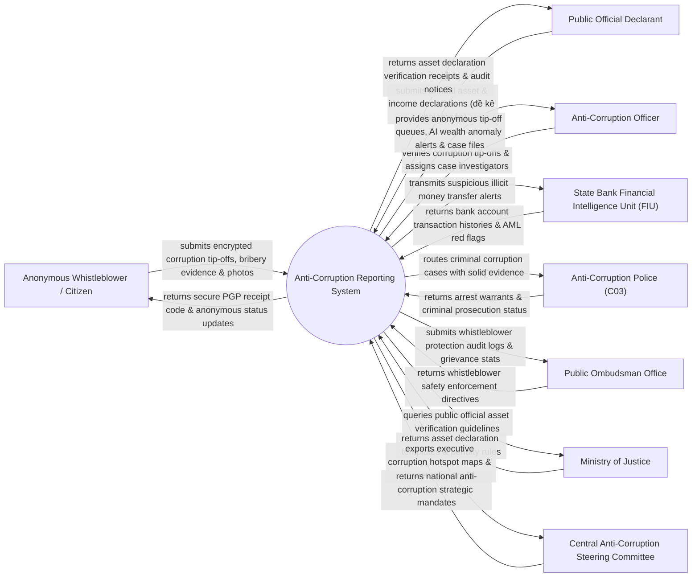

# Context Diagram — Anti-Corruption Reporting System

## Mermaid Code

## Actor & Interaction Table | Bảng Actor & Tương tác

| # | Actor | Actor Type | Data Sent TO System | Data Received FROM System | Notes |
|---|-------|------------|---------------------|---------------------------|-------|
| 1 | Anonymous Whistleblower / Citizen | Primary | Encrypted corruption tip-offs, bribery audio/video evidence, photos | Secure PGP receipt code, anonymous investigation status updates | Công dân / Người tố cáo hành vi tham nhũng, nhận hối lộ, nhũng nhiễu |
| 2 | Public Official Declarant | Primary | Annual asset and income declarations (kê khai tài sản, thu nhập), house/land data | Asset declaration verification receipts, audit notices | Cán bộ, công chức, viên chức thuộc diện bắt buộc kê khai tài sản |
| 3 | Anti-Corruption Officer | Primary | Tip-off verification notes, assigned case specialist IDs, audit sign-offs | Anonymous tip-off queues, AI wealth anomaly alerts, case files | Cán bộ Cơ quan Kiểm tra Đảng / Thanh tra / Cục Phòng chống Tham nhũng |
| 4 | State Bank Financial Intelligence Unit (FIU) | Supporting | Bank account transaction histories, AML red flags, offshore transfers | Suspicious illicit money transfer alerts, account inquiry queries | Cục Phòng chống Rửa tiền (Ngân hàng Nhà nước) đối soát dòng tiền |
| 5 | Anti-Corruption Police (C03) | Supporting | Arrest warrants, criminal indictment files, prosecution status | Criminal corruption cases with solid evidence, asset freeze orders | Cục Cảnh sát Điều tra Tội phạm về Tham nhũng, Kinh tế, Buôn lậu |
| 6 | Public Ombudsman Office | Regulatory | Whistleblower safety enforcement directives, protection orders | Whistleblower protection audit logs, grievance stats | Ban Dân nguyện / Cơ quan bảo vệ người tố cáo tham nhũng |
| 7 | Ministry of Justice | Regulatory | Asset declaration templates, verification guidelines, penalty rules | National official asset declaration compliance statistics | Bộ Tư pháp quản lý quy định kiểm soát tài sản thu nhập |
| 8 | Central Anti-Corruption Steering Committee | Regulatory | National anti-corruption strategic mandates, priority case directives | Executive corruption hotspot maps, asset recovery BI dashboards | Ban Chỉ đạo Trung ương về Phòng chống Tham nhũng, Tiêu cực |

## System Boundary Description | Mô tả Phạm vi Hệ thống

Hệ thống Anti-Corruption Reporting System (Hệ thống Tiếp nhận Báo cáo và Kiểm soát Tài sản Phòng chống Tham nhũng) chịu trách nhiệm tự động hóa công tác phòng chống tham nhũng tiêu cực quốc gia: Tiếp nhận đơn tố cáo tham nhũng trực tuyến được mã hóa đầu-cuối PGP bảo vệ tuyệt đối danh tính người tố cáo, quản lý kê khai tài sản và thu nhập hàng năm của cán bộ công chức, sử dụng thuật toán AI phát hiện biến động tài sản bất minh (Unexplained Wealth), kết nối Cục Phòng chống Rửa tiền kiểm soát dòng tiền bất hợp pháp, ra lệnh phong tỏa tài khoản ngân hàng khẩn cấp và trích xuất báo cáo trình Ban Chỉ đạo Trung ương. Tuy nhiên, hệ thống KHÔNG trực tiếp thực hiện bắt giữ phạm nhân và KHÔNG thay thế việc xét xử của Tòa án.
