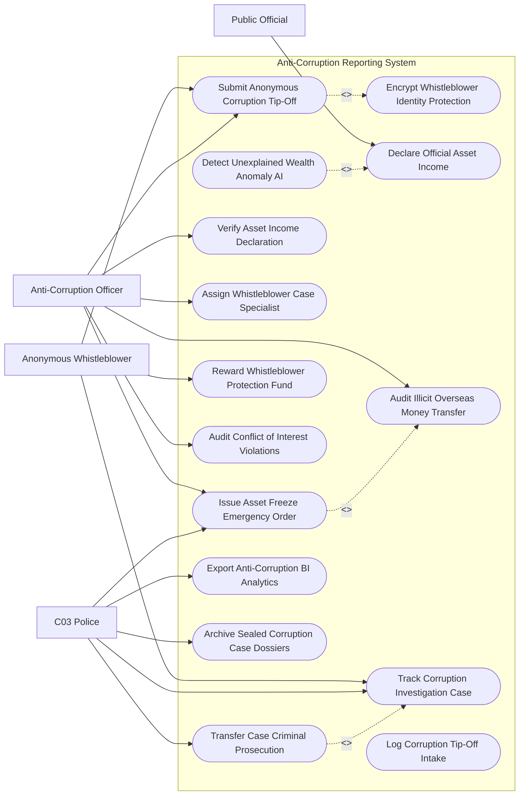

# Use Case Diagram — Anti-Corruption Reporting System

## Mermaid Code

## Actor Table | Bảng Actor

| # | Actor | Actor Type | Role Description | Related Use Cases |
|---|-------|------------|------------------|-------------------|
| 1 | Anonymous Whistleblower | Primary | Công dân/Người tố cáo nộp tin báo tham nhũng mã hóa, theo dõi tiến độ ẩn danh và nhận thưởng | UC01, UC09, UC10 |
| 2 | Public Official | Primary | Cán bộ công chức thực hiện kê khai tài sản, thu nhập hàng năm và giải trình nguồn gốc tài sản | UC03 |
| 3 | Anti-Corruption Officer | Primary | Cán bộ thanh tra kiểm tra kê khai tài sản, thụ lý tin báo, đối soát rửa tiền và đề xuất phong tỏa | UC01, UC05, UC06, UC07, UC08, UC12 |
| 4 | C03 Police | Secondary | Cảnh sát điều tra tội phạm tham nhũng thực hiện phong tỏa tài sản, thụ lý án hình sự và nộp C10 | UC08, UC09, UC13, UC14, UC15 |

## Use Case Table | Bảng Use Case

| # | UC ID | Use Case Name | Primary Actor | Secondary Actor | Description | Priority |
|---|-------|---------------|---------------|-----------------|-------------|----------|
| 1 | UC01 | Submit Anonymous Corruption Tip-Off | Whistleblower | Officer | Gửi thông tin tố cáo hành vi tham nhũng, nhũng nhiễu kèm file ghi âm, video chứng cứ | High |
| 2 | UC02 | Encrypt Whistleblower Identity Protection | System | Whistleblower | Mã hóa tuyệt đối PGP 4096-bit danh tính, địa chỉ IP và thông tin thiết bị người tố cáo | High |
| 3 | UC03 | Declare Official Asset Income | Official | MinistryJustice | Cán bộ công chức kê khai tài sản, thu nhập hàng năm (nhà đỗ, đất đai, tài khoản, kim khí quý) | High |
| 4 | UC04 | Detect Unexplained Wealth Anomaly AI | Officer, System | AI Engine | Thuật toán AI phân tích phát hiện cán bộ có tài sản tăng đột biến bất minh so với thu nhập | High |
| 5 | UC05 | Verify Asset Income Declaration | Officer | LandRegistry | Thẩm tra xác minh tính trung thực của bản kê khai tài sản vs CSDL Đất đai & Ngân hàng | High |
| 6 | UC06 | Assign Whistleblower Case Specialist | Officer | - | Phân công cán bộ chuyên trách xác minh tin báo tham nhũng theo đúng thẩm quyền | High |
| 7 | UC07 | Audit Illicit Overseas Money Transfer | Officer | FIU Bank | Kết nối Cục Phòng chống Rửa tiền đối soát các giao dịch chuyển tiền trái phép ra nước ngoài | High |
| 8 | UC08 | Issue Asset Freeze Emergency Order | Officer, Police | CommercialBank | Ra lệnh phong tỏa khẩn cấp tài khoản ngân hàng và tài sản đất đai để tẩu tán | High |
| 9 | UC09 | Track Corruption Investigation Case | Officer, Police | Whistleblower | Theo dõi tiến độ xác minh, điều tra vụ án tham nhũng theo các giai đoạn tố tụng | High |
| 10 | UC10 | Reward Whistleblower Protection Fund | Whistleblower | Ombudsman | Chi trả tiền thưởng trích từ Quỹ bảo vệ người tố cáo và thực hiện các biện pháp bảo vệ an toàn | Medium |
| 11 | UC11 | Log Corruption Tip-Off Intake | Officer | - | Đăng ký và cấp Mã số tin báo tham nhũng (Tip-Off Ticket Code) bảo mật | High |
| 12 | UC12 | Audit Conflict of Interest Violations | Officer | GovernmentHR | Phân tích mối quan hệ người thân kinh doanh trong lĩnh vực cán bộ phụ trách (Xung đột lợi ích) | High |
| 13 | UC13 | Transfer Case Criminal Prosecution | Police | Procuracy | Chuyển toàn bộ hồ sơ vụ việc có dấu hiệu tội phạm tham nhũng sang Viện Kiểm sát | High |
| 14 | UC14 | Export Anti-Corruption BI Analytics | Police | SteeringCommittee | Trích xuất bản đồ nhiệt điểm nóng tham nhũng nộp Ban Chỉ đạo Trung ương | Low |
| 15 | UC15 | Archive Sealed Corruption Case Dossiers | Police | Archives | Đóng gói niêm phong và lưu trữ vĩnh viễn hồ sơ vụ án tham nhũng theo cấp độ Tuyệt mật | Low |

## Use Case Specification | Đặc tả Use Case

---

### UC01 — Submit Anonymous Corruption Tip-Off

| Field | Detail |
|-------|--------|
| **UC ID** | UC01 |
| **Use Case Name** | Submit Anonymous Corruption Tip-Off |
| **Actor(s)** | Primary: Anonymous Whistleblower / Secondary: Anti-Corruption Officer |
| **Description** | Công dân nộp thông tin tố cáo hành vi tham nhũng, đòi hối lộ, nhũng nhiễu kèm tài liệu ghi âm, ghi hình chứng cứ. |
| **Precondition** | 1. Công dân truy cập Cổng Tiếp nhận Thông tin Tố cáo Tham nhũng Quốc gia. |
| **Main Flow** | 1. Whistleblower truy cập giao diện nộp đơn tố cáo bảo mật (kết nối qua mạng Tor / VPN).   2. Whistleblower chọn hình thức nộp: Tố cáo ẩn danh (không cung cấp nhân thân) hoặc Tố cáo có danh tính (được bảo vệ an toàn).   3. Whistleblower chọn cơ quan/cán bộ bị tố cáo và hành vi tham nhũng (Nhận hối lộ, Tham ô tài sản, Lạm quyền, Nhũng nhiễu).   4. Whistleblower nhập tóm tắt diễn biến vụ việc và số tiền hối lộ/thiệt hại ước tính.   5. Whistleblower tải lên các tệp chứng cứ đính kèm: Ghi âm cuộc gọi, video nhận tiền, tài liệu kế toán.   6. System kích hoạt Mã hóa danh tính PGP 4096-bit (UC02), xóa bỏ hoàn toàn địa chỉ IP, User-Agent và GPS Metadata của tệp.   7. System tự động tạo Mã biên nhận tố cáo bảo mật (Secure Case Receipt Token) và mật khẩu truy cập cho Whistleblower.   8. Whistleblower lưu Mã Token để theo dõi tiến độ xử lý ẩn danh (UC09). |
| **Alternative Flow** | **AF1** — Tố cáo qua Tổng đài đường dây nóng 115: Cán bộ trực bóc tách âm thanh, mã hóa giọng nói và nhập dữ liệu vào hệ thống. |
| **Exception Flow** | **EX1** — Đơn tố cáo vu khống/không có cứ liệu chứng cứ: System tự động đưa vào danh mục "Đơn không đủ điều kiện xử lý" và lưu sổ đơn trùng lặp. |
| **Postcondition** | Tin báo tham nhũng được ghi nhận bảo mật 100%, sẵn sàng cho cán bộ thụ lý xác minh (UC06). |
| **Business Rule** | **BR1**: Tuyệt đối không lưu trữ địa chỉ IP, thông tin thiết bị hoặc dữ liệu nhận dạng của người nộp đơn tố cáo ẩn danh. |

---

### UC02 — Encrypt Whistleblower Identity Protection

| Field | Detail |
|-------|--------|
| **UC ID** | UC02 |
| **Use Case Name** | Encrypt Whistleblower Identity Protection |
| **Actor(s)** | Primary: System Administrator / Secondary: Anonymous Whistleblower |
| **Description** | Mã hóa tuyệt đối danh tính, địa chỉ IP và thông tin thiết bị của người tố cáo tham nhũng để chống trả thù, trù dập. |
| **Precondition** | 1. Đơn tố cáo tham nhũng đang được gửi lên hệ thống (UC01). |
| **Main Flow** | 1. System trích xuất gói tin dữ liệu gửi từ thiết bị của Whistleblower.   2. System tự động cắt bỏ và đè đè dữ liệu (Zeroing) lên các trường: Client IP Address, Browser User-Agent, EXIF Metadata của ảnh/video.   3. System áp dụng thuật toán mã hóa bất đối xứng PGP RSA 4096-bit mã hóa toàn bộ nội dung tố cáo.   4. If Whistleblower chọn chế độ "Tố cáo có danh tính": System tách thông tin cá nhân (Họ tên, CCCD, Số điện thoại) lưu vào Kho khóa bảo vệ danh tính riêng (Vault Storage).   5. Khóa giải mã Vault Storage chỉ được mở khi có Quyết định của Trưởng Ban Chỉ đạo Trung ương về Phòng chống Tham nhũng.   6. Cán bộ thụ lý chỉ nhìn thấy mã định danh ẩn danh (Ví dụ: Whistleblower_#92831) khi xử lý vụ việc.   7. System tự động kích hoạt tiến trình bảo vệ người tố cáo nếu phát hiện có dấu hiệu bị đe dọa hoặc trả thù (UC10). |
| **Alternative Flow** | **AF1** — Người tố cáo xin bảo vệ khẩn cấp: System phát lệnh cho Công an địa phương triển khai lực lượng bảo vệ 24/7 cho người tố cáo và gia đình. |
| **Exception Flow** | **EX1** — Có hành vi can thiệp kỹ thuật nhằm truy vết người tố cáo: System bật báo động Đỏ "Tấn công an ninh mạng xâm phạm người tố cáo", tự động ngắt kết nối và niêm phong kho dữ liệu. |
| **Postcondition** | Danh tính người tố cáo được bảo vệ tuyệt đối trước pháp luật, phòng ngừa 100% rủi ro bị trù dập, trả thù. |
| **Business Rule** | **BR1**: Việc tiết lộ danh tính người tố cáo tham nhũng mà không có thẩm quyền là hành vi vi phạm pháp luật hình sự nghiêm trọng. |

---

### UC03 — Declare Official Asset Income

| Field | Detail |
|-------|--------|
| **UC ID** | UC03 |
| **Use Case Name** | Declare Official Asset Income |
| **Actor(s)** | Primary: Public Official Declarant / Secondary: Ministry of Justice |
| **Description** | Cán bộ, công chức thực hiện kê khai tài sản, thu nhập hàng năm (nhà đất, tiền tiết kiệm, cổ phiếu, kim khí quý) trực tuyến. |
| **Precondition** | 1. Cán bộ thuộc danh sách đối tượng có nghĩa vụ kê khai tài sản hàng năm theo Luật Phòng chống Tham nhũng. |
| **Main Flow** | 1. Official đăng nhập Phân hệ Kê khai Tài sản Thu nhập Công chức bằng VNeID mức 2.   2. Official chọn loại kê khai: Kê khai hàng năm, Kê khai bổ sung (khi có biến động $> 300\,triệu\,VND$), Kê khai phục vụ bổ nhiệm cán bộ.   3. Official nạp Bản kê khai tài sản thu nhập theo mẫu quy định (Mẫu số 01/NĐ-CP).   4. Official nhập chi tiết tài sản của bản thân, vợ/chồng và con chưa thành niên:   - Quyền sử dụng đất, nhà ở (Địa chỉ, diện tích, giá trị).   - Tiền mặt, tiền gửi ngân hàng, tiền ngoại tệ, vàng, kim khí quý ($> 50\,triệu\,VND$).   - Cổ phiếu, trái phiếu, vốn góp doanh nghiệp.   - Tổng thu nhập trong năm giữa 2 lần kê khai.   5. System tự động so sánh bản kê khai kỳ này vs Bản kê khai kỳ trước: Tính toán số tiền biến động ($Biến\_động = Tài\_sản_{kỳ\_này} - Tài\_sản_{kỳ\_trước}$).   6. Official ký số PKI xác nhận tính trung thực của bản kê khai.   7. System cấp Giấy xác nhận nộp bản kê khai tài sản điện tử và chuyển sang khâu Phân tích bất minh AI (UC04). |
| **Alternative Flow** | **AF1** — Cán bộ kê khai giải trình nguồn gốc tài sản biến động: Official tải lên hợp đồng bán đất, giấy tờ thừa kế, giấy vay ngân hàng để chứng minh nguồn gốc tài sản tăng thêm. |
| **Exception Flow** | **EX1** — Quá thời hạn kê khai tài sản (Quá ngày 31/12): System khóa quyền kê khai, tự động gửi báo cáo danh sách cán bộ chậm kê khai cho Ủy ban Kiểm tra Đảng. |
| **Postcondition** | Bản kê khai tài sản được lưu trữ chính thức, làm cơ sở kiểm soát biến động tài sản cán bộ (UC05). |
| **Business Rule** | **BR1**: Kê khai tài sản thu nhập không trung thực sẽ bị xử lý kỷ luật từ cảnh cáo đến buộc nghỉ việc hoặc không được bổ nhiệm. |

---

### UC04 — Detect Unexplained Wealth Anomaly AI

| Field | Detail |
|-------|--------|
| **UC ID** | UC04 |
| **Use Case Name** | Detect Unexplained Wealth Anomaly AI |
| **Actor(s)** | Primary: Anti-Corruption Officer, System / Secondary: AI Engine |
| **Description** | Thuật toán AI tự động đối soát bản kê khai tài sản cán bộ vs CSDL Đất đai, Ngân hàng, Xe cơ giới để phát hiện tài sản bất minh. |
| **Precondition** | 1. Bản kê khai tài sản (UC03) của cán bộ công chức đã được nộp lên hệ thống. |
| **Main Flow** | 1. AI Anomaly Engine tự động trích xuất dữ liệu bản kê khai tài sản của cán bộ.   2. AI kết nối CSDL Đăng ký Đất đai Quốc gia, CSDL Đăng ký Xe ô tô, CSDL Giao dịch Ngân hàng (FIU) để đối soát thực tế.   3. AI phát hiện các sai biệt bất thường:   - Cán bộ sở hữu bất động sản, xe sang đứng tên cá nhân/vợ/chồng/con nhưng KHÔNG kê khai trong bản kê khai.   - Cán bộ đứng tên tài sản đứng tên người thân (Bố mẹ, anh chị em) có giá trị cực lớn không tương xứng với thu nhập người thân.   - Tổng tài sản tăng thêm trong năm lớn hơn nhiều so với Tổng thu nhập kê khai ($Tài\_sản\_tăng > Thu\_nhập \times 3$).   4. If Phát hiện sai biệt bất minh ($Risk\_Score > 85\%$): AI bật cảnh báo Đỏ "Nghi vấn tài sản bất minh (Unexplained Wealth Alert)".   5. System xuất Báo cáo phân tích rủi ro tài sản cán bộ đính kèm danh sách tài sản nghi vấn giấu giếm.   6. CorruptionOfficer thụ lý hồ sơ, ra Quyết định xác minh tài sản thu nhập chính thức (UC05). |
| **Alternative Flow** | **AF1** — Cán bộ trúng số/được tặng cho tài sản: Officer kiểm tra chứng từ trúng số/hợp đồng tặng cho có công chứng, bấm "Giải tỏa cảnh báo AI". |
| **Exception Flow** | **EX1** — Cán bộ chuyển tiền bất hợp pháp ra nước ngoài (UC07): AI phát hiện dòng tiền chuyển sang các thiên đường thuế, tự động phát lệnh khẩn cấp phong tỏa tài sản (UC08). |
| **Postcondition** | Các hành vi che giấu tài sản tham nhũng bị phát hiện minh bạch, ngăn ngừa cán bộ tẩu tán tài sản bất hợp pháp. |
| **Business Rule** | **BR1**: Cán bộ không giải trình được hợp lý nguồn gốc tài sản tăng thêm sẽ bị xác minh làm rõ và xử lý theo Luật Phòng chống Tham nhũng. |

---

### UC08 — Issue Asset Freeze Emergency Order

| Field | Detail |
|-------|--------|
| **UC ID** | UC08 |
| **Use Case Name** | Issue Asset Freeze Emergency Order |
| **Actor(s)** | Primary: Anti-Corruption Officer, C03 Police / Secondary: Commercial Bank |
| **Description** | Ban hành Lệnh phong tỏa khẩn cấp tài khoản ngân hàng và kê biên nhà đất đối với đối tượng tham nhũng để ngăn chặn tẩu tán tài sản. |
| **Precondition** | 1. Phát hiện đối tượng tham nhũng có dấu hiệu tẩu tán tài sản, tẩu thoát ra nước ngoài (UC04, UC07, UC09). |
| **Main Flow** | 1. Officer/Police mở Phân hệ Phong tỏa Tài sản Khẩn cấp.   2. Officer/Police chọn đối tượng bị điều tra và danh sách tài sản cần phong tỏa (Tài khoản ngân hàng, Cổ phiếu, Bất động sản, Xe ô tô).   3. Thủ trưởng Cơ quan Cảnh sát Điều tra C03 / Cơ quan Thanh tra ký số Lệnh phong tỏa khẩn cấp (Emergency Asset Freeze Order).   4. System tự động truyền Lệnh phong tỏa qua kết nối API trực tiếp tới Hệ thống Ngân hàng Nhà nước và các Ngân hàng thương mại.   5. CommercialBank lập tức khóa chiều rút tiền/chuyển tiền trên toàn bộ các tài khoản thanh toán của đối tượng.   6. System tự động gửi Lệnh ngăn chặn giao dịch chuyển nhượng bất động sản tới CSDL Đăng ký Đất đai toàn quốc.   7. CommercialBank và Văn phòng Đăng ký Đất đai gửi xác nhận "Đã phong tỏa tài sản thành công" trong vòng 15 phút.   8. System cập nhật trạng thái tài sản thành "Đã phong tỏa - Chờ xử lý thu hồi tịch thu". |
| **Alternative Flow** | **AF1** — Giải tỏa phong tỏa do đối tượng chứng minh tài sản hợp pháp: Thủ trưởng ký Lệnh giải tỏa phong tỏa, System tự động gửi lệnh mở khóa tài khoản cho Ngân hàng. |
| **Exception Flow** | **EX1** — Ngân hàng chậm trễ phong tỏa làm tẩu tán tiền: System ghi nhận thời gian phản hồi, tự động lập biên bản xử lý trách nhiệm pháp lý đối với ngân hàng vi phạm. |
| **Postcondition** | Tài sản tham nhũng được phong tỏa 100% kịp thời, bảo đảm thu hồi triệt để tài sản cho Ngân sách Nhà nước. |
| **Business Rule** | **BR1**: Lệnh phong tỏa tài khoản ngân hàng khẩn cấp phải được các ngân hàng thực hiện gạch khóa ngay lập tức trong vòng không quá 15 phút. |
