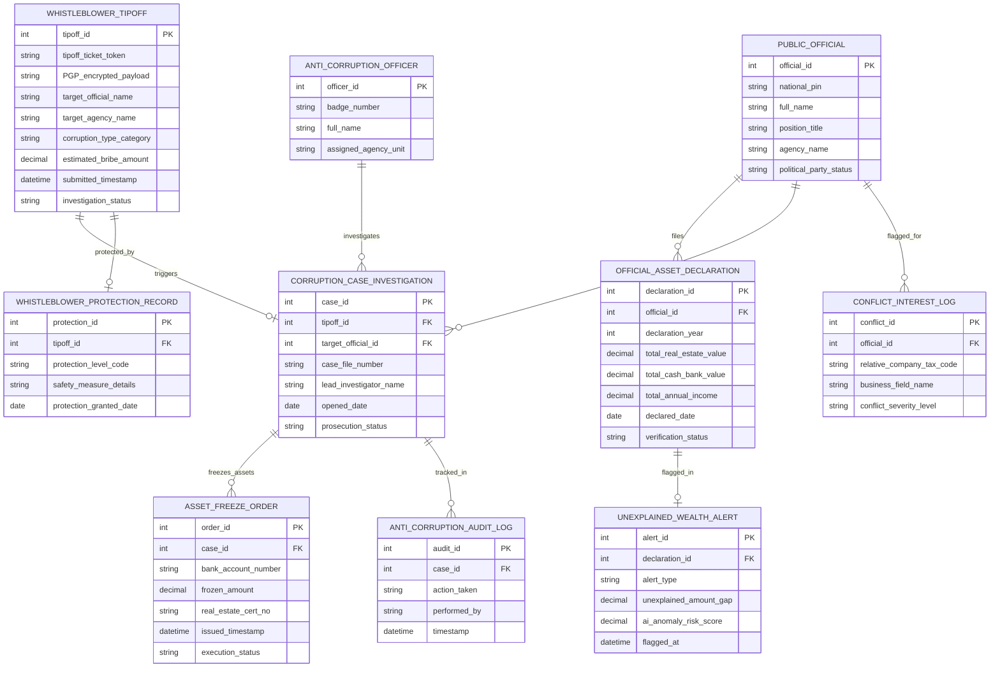

# Conceptual ERD — Anti-Corruption Reporting System

## Mermaid Code

## Entity Description Table | Bảng mô tả Entity

| # | Entity Name | Vietnamese Name | Description | Key Attributes | Full Relationships |
|---|-------------|-----------------|-------------|----------------|-------------------|
| 1 | WHISTLEBLOWER_TIPOFF | Đơn Tố cáo Tham nhũng | Đơn tố cáo mã hóa PGP đầu-cuối, mã Token truy cập bảo mật danh tính người nộp | tipoff_id, tipoff_ticket_token, PGP_encrypted_payload, corruption_type_category, investigation_status | Triggers CORRUPTION_CASE, protected by WHISTLEBLOWER_PROTECTION |
| 2 | PUBLIC_OFFICIAL | Cán bộ Công chức Kê khai | Thông tin cán bộ, công chức, viên chức thuộc diện có nghĩa vụ kê khai tài sản | official_id, national_pin, full_name, position_title, agency_name | Files OFFICIAL_ASSET_DECLARATION, investigated in CORRUPTION_CASE |
| 3 | OFFICIAL_ASSET_DECLARATION | Bản Kê khai Tài sản Thu nhập | Bản kê khai tài sản hàng năm (nhà đất, tiền gửi, cổ phiếu, thu nhập) của cán bộ | declaration_id, declaration_year, total_real_estate_value, total_annual_income, verification_status | Belongs to PUBLIC_OFFICIAL, flagged in UNEXPLAINED_WEALTH_ALERT |
| 4 | UNEXPLAINED_WEALTH_ALERT | Cảnh báo AI Tài sản Bất minh | Cảnh báo AI phát hiện tài sản tăng đột biến bất minh không giải trình được nguồn gốc | alert_id, alert_type, unexplained_amount_gap, ai_anomaly_risk_score | Flagged for OFFICIAL_ASSET_DECLARATION |
| 5 | CORRUPTION_CASE_INVESTIGATION | Hồ sơ Vụ án Tham nhũng | Hồ sơ theo dõi tiến độ xác minh, điều tra, khởi tố vụ án tham nhũng | case_id, case_file_number, lead_investigator_name, opened_date, prosecution_status | Belongs to TIPOFF, PUBLIC_OFFICIAL, freezes ASSET_FREEZE_ORDER |
| 6 | ASSET_FREEZE_ORDER | Lệnh Phong tỏa Tài sản | Lệnh phong tỏa khẩn cấp tài khoản ngân hàng và kê biên nhà đất chống tẩu tán | order_id, bank_account_number, frozen_amount, real_estate_cert_no, execution_status | Belongs to CORRUPTION_CASE_INVESTIGATION |
| 7 | WHISTLEBLOWER_PROTECTION_RECORD | Hồ sơ Bảo vệ Người Tố cáo | Hồ sơ ghi nhận các biện pháp bảo vệ an toàn tính mạng, tài sản người tố cáo | protection_id, protection_level_code, safety_measure_details, protection_granted_date | Protects WHISTLEBLOWER_TIPOFF |
| 8 | CONFLICT_INTEREST_LOG | Nhật ký Xung đột Lợi ích | Nhật ký ghi nhận mối quan hệ người thân cán bộ sở hữu doanh nghiệp trong ngành | conflict_id, relative_company_tax_code, business_field_name, conflict_severity_level | Belongs to PUBLIC_OFFICIAL |
| 9 | ANTI_CORRUPTION_OFFICER | Cán bộ Cục Chống Tham nhũng | Thông tin cán bộ thanh tra, điều tra viên chuyên trách phòng chống tham nhũng | officer_id, badge_number, full_name, assigned_agency_unit | Investigates CORRUPTION_CASE_INVESTIGATION |
| 10 | ANTI_CORRUPTION_AUDIT_LOG | Nhật ký Kiểm toán Bảo mật | Lưu toàn bộ vết tiếp nhận tin báo, mã hóa PGP, kê khai tài sản và lệnh phong tỏa | audit_id, action_taken, performed_by, timestamp | Belongs to CORRUPTION_CASE_INVESTIGATION |

## Relationship Description | Mô tả Quan hệ

| # | From Entity | Cardinality | To Entity | Relationship Label | Business Explanation |
|---|-------------|-------------|-----------|-------------------|----------------------|
| 1 | WHISTLEBLOWER_TIPOFF | one-to-one | CORRUPTION_CASE_INVESTIGATION | triggers | Mỗi đơn tố cáo tham nhũng hợp lệ kích hoạt một Hồ sơ vụ án điều tra |
| 2 | PUBLIC_OFFICIAL | one-to-many | OFFICIAL_ASSET_DECLARATION | files | Một cán bộ nộp nhiều Bản kê khai tài sản thu nhập qua các năm công tác |
| 3 | OFFICIAL_ASSET_DECLARATION | one-to-one | UNEXPLAINED_WEALTH_ALERT | flagged_in | Bản kê khai bất thường bị thuật toán AI phát hiện một Cảnh báo tài sản bất minh |
| 4 | PUBLIC_OFFICIAL | one-to-many | CORRUPTION_CASE_INVESTIGATION | investigated_in | Một cán bộ có thể bị điều tra trong các hồ sơ vụ án tham nhũng |
| 5 | CORRUPTION_CASE_INVESTIGATION | one-to-many | ASSET_FREEZE_ORDER | freezes_assets | Một vụ án tham nhũng phát hành nhiều Lệnh phong tỏa tài khoản và nhà đất |
| 6 | WHISTLEBLOWER_TIPOFF | one-to-one | WHISTLEBLOWER_PROTECTION_RECORD | protected_by | Người nộp đơn tố cáo được bảo vệ bằng một Hồ sơ bảo vệ an toàn thân nhân |
| 7 | PUBLIC_OFFICIAL | one-to-many | CONFLICT_INTEREST_LOG | flagged_for | Một cán bộ được rà soát ghi nhận các nhật ký rủi ro xung đột lợi ích |
| 8 | ANTI_CORRUPTION_OFFICER | one-to-many | CORRUPTION_CASE_INVESTIGATION | investigates | Một cán bộ thanh tra thụ lý và điều tra nhiều hồ sơ vụ án tham nhũng |
| 9 | CORRUPTION_CASE_INVESTIGATION | one-to-many | ANTI_CORRUPTION_AUDIT_LOG | tracked_in | Mọi thao tác trên hồ sơ vụ án tham nhũng được ghi lại nhật ký kiểm toán bất biến |
