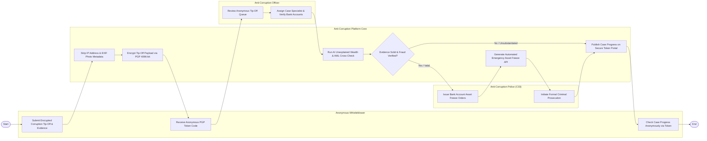

# Swimlane Diagram — Anti-Corruption Reporting System

## Mermaid Code

## Flow Description | Mô tả luồng

| Lane | Actor | Role in Flow |
|------|-------|-------------|
| 1 | Anonymous Whistleblower | Nộp đơn tố cáo tham nhũng kèm bằng chứng, nhận mã Token PGP ẩn danh và tra cứu tiến độ xử lý mà không lộ danh tính. |
| 2 | Anti-Corruption Platform Core | Xóa bỏ IP/Metadata, mã hóa PGP 4096-bit, chạy AI đối soát tài sản bất minh rửa tiền và gửi lệnh phong tỏa tài sản. |
| 3 | Anti-Corruption Officer | Rà soát danh sách đơn tố cáo, phân công cán bộ thụ lý chuyên trách và đối soát tài khoản ngân hàng cán bộ. |
| 4 | Anti-Corruption Police (C03) | Ban hành lệnh phong tỏa tài khoản khẩn cấp, khởi tố vụ án hình sự và chuyển hồ sơ sang Viện Kiểm sát. |
