# Action Tree — Anti-Corruption Reporting System

## Mermaid Code

```mermaid
graph TD
    Root["Anti-Corruption Reporting System"]

    Root --> M1["Anonymous Tip-Off & Whistleblower Encryption"]
    Root --> M2["Public Official Asset & Income Declaration"]
    Root --> M3["Unexplained Wealth AI & Anti-Money Laundering"]
    Root --> M4["Emergency Asset Freeze & Seizure"]
    Root --> M5["Investigation Case Tracking & Prosecution"]
    Root --> M6["Steering BI & Sealed Dossier Archival"]

    M1 --> A11["Submit Anonymous Corruption Tip-Offs"]
    M1 --> A12["Encrypt Whistleblower Identity Protection PGP"]
    M1 --> A13["Strip EXIF Metadata IP Addresses"]
    M1 --> A14["Reward Whistleblower Protection Funds"]

    M2 --> A21["Declare Official Asset Income Annual"]
    M2 --> A22["Verify Asset Income Declarations VNeID"]
    M2 --> A23["Audit Conflict of Interest Violations"]
    M2 --> A24["Track Relative Business Ownerships"]

    M3 --> A31["Detect Unexplained Wealth Anomaly AI"]
    M3 --> A32["Audit Illicit Overseas Money Transfers FIU"]
    M3 --> A33["Cross-Check Land Registry Property Ownership"]
    M3 --> A34["Analyze Off-Balance Luxury Car Assets"]

    M4 --> A41["Issue Asset Freeze Emergency Orders"]
    M4 --> A42["Block Commercial Bank Wire Transfers API"]
    M4 --> A43["Block Land Registry Property Transfers"]
    M4 --> A44["Confiscate Illicit Corruption Assets"]

    M5 --> A51["Assign Whistleblower Case Specialists"]
    M5 --> A52["Track Corruption Investigation Cases"]
    M5 --> A53["Transfer Case Criminal Prosecution C03"]
    M5 --> A54["Issue Formal Corruption Indictments"]

    M6 --> A61["Export Anti-Corruption BI Analytics"]
    M6 --> A62["Render Corruption Hotspot Regional Maps"]
    M6 --> A63["Log System Immutable Security Audits"]
    M6 --> A64["Archive Sealed Corruption Case Dossiers"]
```

## Module Description | Mô tả Module

| # | Module | Description | Actions |
|---|--------|-------------|---------|
| 1 | Anonymous Tip-Off & Whistleblower Encryption | Tiếp nhận tin báo tố cáo tham nhũng, mã hóa PGP 4096-bit bảo vệ danh tính, xóa IP/Metadata và chi trả tiền thưởng | Submit Anonymous Corruption Tip-Offs, Encrypt Whistleblower Identity Protection PGP, Strip EXIF Metadata IP Addresses, Reward Whistleblower Protection Funds |
| 2 | Public Official Asset & Income Declaration | Tiếp nhận kê khai tài sản thu nhập hàng năm của cán bộ công chức, thẩm tra đối soát VNeID và rà soát xung đột lợi ích | Declare Official Asset Income Annual, Verify Asset Income Declarations VNeID, Audit Conflict of Interest Violations, Track Relative Business Ownerships |
| 3 | Unexplained Wealth AI & Anti-Money Laundering | Thuật toán AI phát hiện tài sản bất minh, kết nối Cục Rửa tiền đối soát giao dịch ra nước ngoài và đối soát đất đai | Detect Unexplained Wealth Anomaly AI, Audit Illicit Overseas Money Transfers FIU, Cross-Check Land Registry Property Ownership, Analyze Off-Balance Luxury Car Assets |
| 4 | Emergency Asset Freeze & Seizure | Ra lệnh phong tỏa tài khoản ngân hàng và đất đai khẩn cấp qua API trong 15 phút, tịch thu tài sản tham nhũng thu hồi nộp NSNN | Issue Asset Freeze Emergency Orders, Block Commercial Bank Wire Transfers API, Block Land Registry Property Transfers, Confiscate Illicit Corruption Assets |
| 5 | Investigation Case Tracking & Prosecution | Phân công cán bộ thụ lý, theo dõi tiến độ điều tra vụ án tham nhũng, chuyển hồ sơ khởi tố hình sự sang C30/Viện Kiểm sát | Assign Whistleblower Case Specialists, Track Corruption Investigation Cases, Transfer Case Criminal Prosecution C03, Issue Formal Corruption Indictments |
| 6 | Steering BI & Sealed Dossier Archival | Trích xuất báo cáo bản đồ nhiệt tham nhũng nộp Ban Chỉ đạo Trung ương, kiểm toán bảo mật và lưu trữ hồ sơ Tuyệt mật | Export Anti-Corruption BI Analytics, Render Corruption Hotspot Regional Maps, Log System Immutable Security Audits, Archive Sealed Corruption Case Dossiers |
