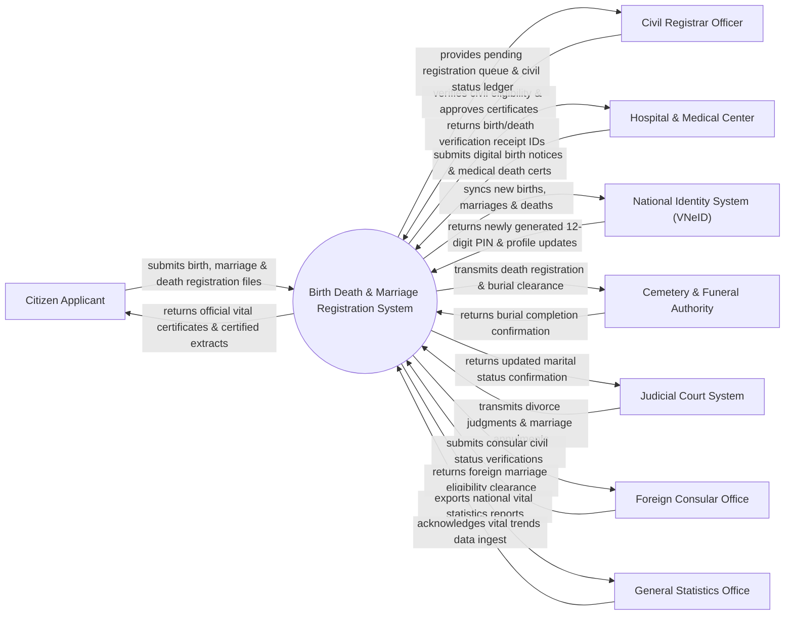

# Context Diagram — Birth Death & Marriage Registration System

## Mermaid Code

## Actor & Interaction Table | Bảng Actor & Tương tác

| # | Actor | Actor Type | Data Sent TO System | Data Received FROM System | Notes |
|---|-------|------------|---------------------|---------------------------|-------|
| 1 | Citizen Applicant | Primary | Birth notice, marriage application, death certificate, ID documents | Birth certificate, Marriage certificate, Death certificate, Extracts | Công dân thực hiện đăng ký hộ tịch cá nhân (khai sinh, kết hôn, khai tử) |
| 2 | Civil Registrar Officer | Primary | Verification approvals, civil ledger entries, certificate signing | Registration task queue, civil status master ledger, background check | Cán bộ tư pháp - hộ tịch tại UBND xã/phường/quận/huyện |
| 3 | Hospital & Medical Center | Supporting | Digital birth notice (Giấy chứng sinh), medical death certificate | Medical notice verification code, hospital sync confirmation | Bệnh viện/Cơ sở y tế cấp giấy chứng sinh và giấy báo tử |
| 4 | National Identity System (VNeID) | Supporting | 12-digit Personal Identification Number (PIN), family linkage | Synchronized vital events (new births, marriages, deaths) | Cơ sở dữ liệu quốc gia về dân cư cấp số định danh cá nhân mới |
| 5 | Cemetery & Funeral Authority | Supporting | Burial/cremation completion confirmation | Death registration confirmation, burial clearance permit | Ban quản lý nghĩa trang / cơ sở hỏa táng cấp phép an táng |
| 6 | Judicial Court System | Supporting | Certified divorce judgments, marriage annulment rulings | Updated marital status records, court decree reference | Tòa án Nhân dân chuyển các bản án ly hôn, hủy kết hôn trái pháp luật |
| 7 | Foreign Consular Office | Supporting | Consular legalizations, foreign marital status clearance | Verified civil status extracts for foreign-element marriages | Cơ quan đại diện ngoại giao nước ngoài xác nhận đăng ký kết hôn |
| 8 | General Statistics Office | Regulatory | Statistical standards, demographic breakdown queries | National vital statistics (Birth rate, Death rate, Marriage rate) | Tổng cục Thống kê tiếp nhận dữ liệu biến động dân số tự nhiên |

## System Boundary Description | Mô tả Phạm vi Hệ thống

Hệ thống Birth Death & Marriage Registration System (Hệ thống Đăng ký và Quản lý Hộ tịch Quốc gia) chịu trách nhiệm quản lý toàn bộ các sự kiện hộ tịch cốt lõi trong đời sống công dân: Đăng ký khai sinh (tự động cấp Số định danh cá nhân 12 số cho trẻ sơ sinh), Đăng ký kết hôn, Đăng ký khai tử, Nhận cha mẹ con, Nuôi con nuôi và Cấp bản sao trích lục hộ tịch. Hệ thống kết nối trực tiếp với Cơ sở dữ liệu quốc gia về dân cư (VNeID) và các bệnh viện toàn quốc. Tuy nhiên, hệ thống KHÔNG trực tiếp cấp thẻ Căn cước công dân vật lý và KHÔNG trực tiếp giải quyết tranh chấp ly hôn (do Tòa án đảm nhận).
