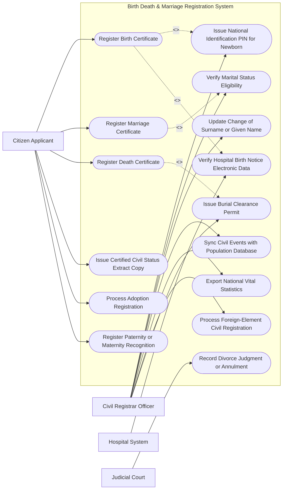

# Use Case Diagram — Birth Death & Marriage Registration System

## Mermaid Code

## Actor Table | Bảng Actor

| # | Actor | Actor Type | Role Description | Related Use Cases |
|---|-------|------------|------------------|-------------------|
| 1 | Citizen Applicant | Primary | Công dân nộp đơn đăng ký khai sinh, kết hôn, khai tử hoặc xin trích lục hộ tịch | UC01, UC03, UC04, UC05, UC07, UC08 |
| 2 | Civil Registrar Officer | Primary | Cán bộ tư pháp hộ tịch thẩm định, phê duyệt và ký số các giấy tờ hộ tịch | UC02, UC06, UC09, UC11, UC12, UC13, UC15 |
| 3 | Hospital System | Secondary | Cơ sở y tế gửi dữ liệu điện tử Giấy chứng sinh và Giấy báo tử | UC14 |
| 4 | Judicial Court | Secondary | Tòa án gửi Quyết định ly hôn hoặc hủy kết hôn trái pháp luật | UC10 |

## Use Case Table | Bảng Use Case

| # | UC ID | Use Case Name | Primary Actor | Secondary Actor | Description | Priority |
|---|-------|---------------|---------------|-----------------|-------------|----------|
| 1 | UC01 | Register Birth Certificate | Applicant | Registrar, Hospital | Đăng ký khai sinh cho trẻ sơ sinh trực tuyến hoặc tại UBND xã | High |
| 2 | UC02 | Issue National Identification PIN for Newborn | Registrar | VNeID | Tự động sinh và cấp Số định danh cá nhân 12 số cho trẻ mới sinh | High |
| 3 | UC03 | Register Marriage Certificate | Applicant | Registrar | Đăng ký kết hôn cho nam nữ đủ điều kiện và phát hành Giấy chứng nhận | High |
| 4 | UC04 | Register Death Certificate | Applicant | Registrar | Đăng ký khai tử cho người qua đời và cấp Trích lục khai tử | High |
| 5 | UC05 | Issue Certified Civil Status Extract Copy | Applicant | Registrar | Cấp bản sao trích lục khai sinh, kết hôn, khai tử từ CSDL Hộ tịch | High |
| 6 | UC06 | Verify Marital Status Eligibility | Registrar | VNeID | Tra cứu xác nhận tình trạng hôn nhân (Độc thân/Đã ly hôn) của đương sự | High |
| 7 | UC07 | Process Adoption Registration | Applicant | Registrar | Đăng ký nhận nuôi con nuôi và cấp Giấy chứng nhận nuôi con nuôi | Medium |
| 8 | UC08 | Register Paternity or Maternity Recognition | Applicant | Registrar | Đăng ký nhận cha, mẹ, con cho trường hợp con ngoài giá thú | Medium |
| 9 | UC09 | Update Change of Surname or Given Name | Registrar | Applicant | Cập nhật thay đổi họ, tên, dân tộc, quốc tịch theo quyết định tư pháp | Medium |
| 10 | UC10 | Record Divorce Judgment or Annulment | Court | Registrar | Ghi chú vào sổ hộ tịch quyết định ly hôn của Tòa án đã có hiệu lực | High |
| 11 | UC11 | Sync Civil Events with Population Database | Registrar | VNeID | Tự động đồng bộ các sự kiện hộ tịch mới vào Cơ sở dữ liệu Quốc gia về Dân cư | High |
| 12 | UC12 | Export National Vital Statistics | Registrar | StatisticsOffice | Trích xuất báo cáo tỷ lệ sinh, tử, kết hôn phục vụ quản lý dân số | Low |
| 13 | UC13 | Process Foreign-Element Civil Registration | Registrar | ConsularOffice | Đăng ký hộ tịch có yếu tố nước ngoài (kết hôn với người nước ngoài) | High |
| 14 | UC14 | Verify Hospital Birth Notice Electronic Data | Hospital | Registrar | Đối soát dữ liệu điện tử Giấy chứng sinh từ bệnh viện với đơn khai sinh | High |
| 15 | UC15 | Issue Burial Clearance Permit | Registrar | Cemetery | Cấp Giấy phép an táng/hỏa táng sau khi hoàn thành đăng ký khai tử | High |

## Use Case Specification | Đặc tả Use Case

---

### UC01 — Register Birth Certificate

| Field | Detail |
|-------|--------|
| **UC ID** | UC01 |
| **Use Case Name** | Register Birth Certificate |
| **Actor(s)** | Primary: Citizen Applicant / Secondary: Civil Registrar Officer, Hospital System |
| **Description** | Cha, mẹ hoặc người thân thực hiện đăng ký khai sinh cho trẻ sơ sinh trực tuyến qua Cổng Dịch vụ công liên thông. |
| **Precondition** | 1. Trẻ sơ sinh đã có Giấy chứng sinh do Bệnh viện/Cơ sở y tế cấp (UC14).   2. Cha, mẹ có đăng ký kết hôn hợp pháp hoặc có giấy xác nhận nhân thân. |
| **Main Flow** | 1. Applicant đăng nhập Cổng Dịch vụ công liên thông (Đăng ký khai sinh - Đăng ký thường trú - Cấp thẻ BHYT).   2. Applicant nhập Mã số Giấy chứng sinh điện tử do bệnh viện cấp.   3. System tự động trích xuất thông tin trẻ (Ngày sinh, giờ sinh, giới tính, cân nặng, tên bệnh viện).   4. Applicant điền tên dự định đặt cho con, dân tộc, quốc tịch và chọn thông tin Cha/Mẹ.   5. System kết nối VNeID cấp Số định danh cá nhân (PIN) 12 số duy nhất cho trẻ (UC02).   6. RegistrarOfficer rà soát thông tin, xác nhận tính hợp lệ và thực hiện ký số Giấy khai sinh điện tử.   7. System sinh Giấy khai sinh bản điện tử (PDF kèm mã QR) và tự động đồng bộ đăng ký BHYT trẻ em dưới 6 tuổi. |
| **Alternative Flow** | **AF1** — Khai sinh cho trẻ bị bỏ rơi: Cán bộ tư pháp lập biên bản trẻ bị bỏ rơi, thông báo niêm yết 7 ngày trước khi thực hiện đăng ký khai sinh theo quy định. |
| **Exception Flow** | **EX1** — Tên trẻ sơ sinh vi phạm quy định pháp luật (chứa chữ số/ký tự đặc biệt): System báo lỗi yêu cầu Applicant đặt lại tên đúng quy định tiếng Việt. |
| **Postcondition** | Giấy khai sinh được lưu trữ trong CSDL Hộ tịch Quốc gia, trẻ có Số định danh cá nhân và thẻ BHYT miễn phí. |
| **Business Rule** | **BR1**: Đăng ký khai sinh cho trẻ sơ sinh phải được thực hiện trong thời hạn 60 ngày kể từ ngày sinh của trẻ. |

---

### UC02 — Issue National Identification PIN for Newborn

| Field | Detail |
|-------|--------|
| **UC ID** | UC02 |
| **Use Case Name** | Issue National Identification PIN for Newborn |
| **Actor(s)** | Primary: Civil Registrar Officer / Secondary: VNeID Core System |
| **Description** | Hệ thống tự động truy vấn CSDL Quốc gia về Dân cư để khởi tạo và cấp Số định danh cá nhân 12 số duy nhất cho trẻ sơ sinh. |
| **Precondition** | 1. Hồ sơ đăng ký khai sinh (UC01) đang được xử lý.   2. Thông tin giới tính, tỉnh/thành phố khai sinh và năm sinh của trẻ đã được xác định. |
| **Main Flow** | 1. System đóng gói thông tin khai sinh của trẻ (Mã tỉnh/thành phố, Giới tính, Thế kỷ sinh, Năm sinh).   2. System gửi yêu cầu API khởi tạo mã định danh tới Cơ sở dữ liệu Quốc gia về Dân cư (VNeID).   3. VNeID Core chạy thuật toán cấu trúc số định danh: `[Mã Tỉnh (3 số)][Mã Giới tính & Thế kỷ (1 số)][Mã Năm sinh (2 số)][Số ngẫu nhiên (6 số)]`.   4. VNeID Core trả về Số định danh cá nhân (PIN) 12 chữ số duy nhất cho System.   5. System tự động điền Số định danh cá nhân vừa cấp vào mục "Số định danh cá nhân" trên Giấy khai sinh.   6. System tự động thiết lập liên kết quan hệ Cha/Mẹ - Con trên CSDL Dân cư. |
| **Alternative Flow** | **AF1** — Khai sinh cho trẻ có yếu tố nước ngoài (Sinh ra ở nước ngoài): VNeID cấp số định danh cá nhân dựa trên mã quốc tịch và đăng ký công dân tự do. |
| **Exception Flow** | **EX1** — Mất kết nối API với CSDL Dân cư: System tạm dừng phê duyệt khai sinh, tự động gửi lại yêu cầu cấp PIN khi kết nối khôi phục trong vòng 15 phút. |
| **Postcondition** | Trẻ sơ sinh sở hữu Số định danh cá nhân 12 số theo suốt cuộc đời. |
| **Business Rule** | **BR1**: Số định danh cá nhân cấp cho trẻ sơ sinh không bao giờ thay đổi (kể cả khi thay đổi tên hay nơi thường trú). |

---

### UC03 — Register Marriage Certificate

| Field | Detail |
|-------|--------|
| **UC ID** | UC03 |
| **Use Case Name** | Register Marriage Certificate |
| **Actor(s)** | Primary: Citizen Applicant (Nam & Nữ) / Secondary: Civil Registrar Officer |
| **Description** | Nam và Nữ đủ điều kiện kết hôn thực hiện đăng ký kết hôn và nhận Giấy chứng nhận kết hôn chính thức. |
| **Precondition** | 1. Nam từ đủ 20 tuổi, Nữ từ đủ 18 tuổi trở lên.   2. Cả hai bên đều đang ở tình trạng độc thân hợp pháp (UC06). |
| **Main Flow** | 1. Nam và Nữ cùng truy cập Cổng Dịch vụ công Đăng ký Kết hôn.   2. Hai bên nhập Mã định danh cá nhân VNeID để tự động điền thông tin nhân thân.   3. System tự động kiểm tra tình trạng hôn nhân của cả hai bên trên CSDL Hộ tịch (Xác nhận chưa có vợ/chồng).   4. Nam và Nữ xác nhận tự nguyện kết hôn và chọn ngày hẹn ký Giấy chứng nhận kết hôn.   5. Đến ngày hẹn, hai bên có mặt tại UBND Xã/Phường xuất trình giấy tờ tùy thân.   6. RegistrarOfficer xác minh trực tiếp sự tự nguyện của hai bên.   7. Nam và Nữ cùng ký tên vào Sổ đăng ký kết hôn và Giấy chứng nhận kết hôn.   8. RegistrarOfficer ký số, đóng dấu và trao 02 bản chính Giấy chứng nhận kết hôn cho hai vợ chồng. |
| **Alternative Flow** | **AF1** — Đăng ký kết hôn có yếu tố nước ngoài: Đương sự nộp thêm Giấy xác nhận tuyên thệ độc thân do Lãnh sự nước ngoài hợp pháp hóa (UC13). |
| **Exception Flow** | **EX1** — Phát hiện một bên đang có vợ/chồng hợp pháp (Vi phạm hôn nhân 1 vợ 1 chồng): System chặn đăng ký, từ chối cấp Giấy chứng nhận và thông báo lý do pháp lý. |
| **Postcondition** | Quan hệ hôn nhân pháp lý được xác lập, trạng thái cá nhân của 2 bên chuyển thành "Đã kết hôn" trên CSDL Dân cư. |
| **Business Rule** | **BR1**: Hai bên nam nữ bắt buộc phải cùng có mặt trực tiếp tại trụ sở UBND khi ký và nhận Giấy chứng nhận kết hôn. |

---

### UC04 — Register Death Certificate

| Field | Detail |
|-------|--------|
| **UC ID** | UC04 |
| **Use Case Name** | Register Death Certificate |
| **Actor(s)** | Primary: Citizen Applicant / Secondary: Civil Registrar Officer, Cemetery Authority |
| **Description** | Thân nhân người quá cố thực hiện đăng ký khai tử và nhận Trích lục khai tử cùng Giấy phép an táng. |
| **Precondition** | 1. Người quá cố có Giấy báo tử do Bệnh viện cấp (từ trần tại bệnh viện) hoặc Biên bản xác nhận của Công an/UBND (từ trần tại nhà). |
| **Main Flow** | 1. Applicant nộp đơn đăng ký khai tử trực tuyến hoặc tại UBND Xã/Phường nơi cư trú cuối cùng của người quá cố.   2. Applicant nộp Giấy báo tử bản chính và Số định danh cá nhân của người quá cố.   3. System kiểm tra và trích xuất thông tin người quá cố từ CSDL Dân cư.   4. RegistrarOfficer thẩm định thông tin nguyên nhân tử vong và ngày giờ từ trần.   5. RegistrarOfficer phê duyệt và ký số Trích lục khai tử điện tử.   6. System tự động cập nhật trạng thái người quá cố thành "Đã mất (Deceased)" trên CSDL Dân cư và hủy hiệu lực tài khoản VNeID.   7. System tự động cấp Giấy phép an táng/hỏa táng (UC15) gửi cho Ban quản lý nghĩa trang. |
| **Alternative Flow** | **AF1** — Khai tử cho người mất tích (Theo quyết định Tòa án): Applicant nộp Quyết định tuyên bố một người đã chết của Tòa án đã có hiệu lực pháp luật. |
| **Exception Flow** | **EX1** — Nghi vấn người quá cố bị chết do tội phạm/bị sát hại: RegistrarOfficer tạm dừng đăng ký khai tử, thông báo ngay cho Cơ quan Công an điều tra làm rõ trước khi khai tử. |
| **Postcondition** | Trích lục khai tử được cấp cho thân nhân, tư cách pháp lý của người quá cố chính thức chấm dứt. |
| **Business Rule** | **BR1**: Thời hạn đăng ký khai tử là 15 ngày kể từ ngày người đó từ trần. |

---

### UC06 — Verify Marital Status Eligibility

| Field | Detail |
|-------|--------|
| **UC ID** | UC06 |
| **Use Case Name** | Verify Marital Status Eligibility |
| **Actor(s)** | Primary: Civil Registrar Officer / Secondary: VNeID System |
| **Description** | Tra cứu và cấp Giấy xác nhận tình trạng hôn nhân (Xác nhận độc thân) cho công dân phục vụ đăng ký kết hôn hoặc giao dịch bất động sản. |
| **Precondition** | 1. Công dân đủ tuổi kết hôn theo quy định pháp luật. |
| **Main Flow** | 1. Applicant nộp yêu cầu cấp Giấy xác nhận tình trạng hôn nhân trên Cổng Dịch vụ công.   2. Applicant chọn mục đích xin xác nhận (Đăng ký kết hôn, Mua bán nhà đất, Vay vốn ngân hàng).   3. System quét toàn bộ lịch sử hộ tịch của Applicant từ năm 18 tuổi đến thời điểm hiện tại trên CSDL Hộ tịch Toàn quốc.   4. System kiểm tra các dữ liệu: Chưa từng đăng ký kết hôn, Đã ly hôn (UC10), Đã vợ/chồng chết (UC04).   5. RegistrarOfficer thẩm định kết quả tra cứu của hệ thống.   6. RegistrarOfficer ký số phát hành Giấy xác nhận tình trạng hôn nhân điện tử.   7. System gửi bản điện tử PDF có mã QR xác thực cho Applicant. |
| **Alternative Flow** | **AF1** — Công dân đã từng cư trú tại nhiều địa phương khác nhau: System tự động gửi truy vấn xác minh liên thông tới các UBND xã/phường nơi công dân từng thường trú. |
| **Exception Flow** | **EX1** — Dữ liệu hộ tịch cũ chưa được số hóa (trước năm 2000): System thông báo yêu cầu cán bộ tư pháp tiến hành xác minh thủ công tại sổ hộ tịch giấy. |
| **Postcondition** | Giấy xác nhận tình trạng hôn nhân được cấp với thời hạn hiệu lực chuẩn 06 tháng kể từ ngày cấp. |
| **Business Rule** | **BR1**: Giấy xác nhận tình trạng hôn nhân xin để kết hôn bắt buộc phải ghi rõ họ tên, năm sinh, giấy tờ tùy thân của người dự định kết hôn. |
