# Conceptual ERD — Birth Death & Marriage Registration System

## Mermaid Code

```mermaid
erDiagram
    CITIZEN_CIVIL_PROFILE {
        int profile_id PK
        string national_pin
        string full_name
        date date_of_birth
        string gender
        string current_marital_status
        string current_status
    }

    BIRTH_REGISTRATION {
        int birth_id PK
        int child_profile_id FK
        int father_profile_id FK
        int mother_profile_id FK
        string birth_certificate_no
        datetime time_of_birth
        string place_of_birth
        date registration_date
    }

    MARRIAGE_REGISTRATION {
        int marriage_id PK
        int husband_profile_id FK
        int wife_profile_id FK
        string marriage_certificate_no
        date registration_date
        string place_of_registration
        string status
    }

    DEATH_REGISTRATION {
        int death_id PK
        int deceased_profile_id FK
        string death_certificate_no
        datetime time_of_death
        string cause_of_death
        string place_of_death
        date registration_date
    }

    HOSPITAL_BIRTH_NOTICE {
        int notice_id PK
        string hospital_code
        string notice_number
        string mother_identity_no
        datetime child_birth_time
        string gender
        string status
    }

    CIVIL_STATUS_EXTRACT {
        int extract_id PK
        int profile_id FK
        string extract_type
        string extract_code
        string purpose
        datetime issued_at
    }

    ADOPTION_RECORD {
        int adoption_id PK
        int child_profile_id FK
        int adoptive_father_id FK
        int adoptive_mother_id FK
        string adoption_certificate_no
        date registration_date
    }

    CIVIL_REGISTRAR {
        int registrar_id PK
        string officer_badge_no
        string full_name
        string ward_office_name
    }

    MARITAL_STATUS_VERIFICATION {
        int verification_id PK
        int profile_id FK
        string purpose
        string confirmed_status
        date valid_until
        datetime issued_at
    }

    CIVIL_AUDIT_LOG {
        int log_id PK
        int profile_id FK
        string action_type
        string performed_by_officer
        datetime timestamp
    }

    CITIZEN_CIVIL_PROFILE ||--o{ BIRTH_REGISTRATION : "child_in"
    CITIZEN_CIVIL_PROFILE ||--o{ MARRIAGE_REGISTRATION : "spouse_in"
    CITIZEN_CIVIL_PROFILE ||--o| DEATH_REGISTRATION : "deceased_in"
    CITIZEN_CIVIL_PROFILE ||--o{ CIVIL_STATUS_EXTRACT : "extracted_for"
    CITIZEN_CIVIL_PROFILE ||--o{ ADOPTION_RECORD : "adopted_in"
    CITIZEN_CIVIL_PROFILE ||--o{ MARITAL_STATUS_VERIFICATION : "verified_in"
    HOSPITAL_BIRTH_NOTICE ||--o| BIRTH_REGISTRATION : "validates"
    CIVIL_REGISTRAR ||--o{ BIRTH_REGISTRATION : "approves"
    CIVIL_REGISTRAR ||--o{ MARRIAGE_REGISTRATION : "approves"
    CIVIL_REGISTRAR ||--o{ DEATH_REGISTRATION : "approves"
    CITIZEN_CIVIL_PROFILE ||--o{ CIVIL_AUDIT_LOG : "tracked_in"
```

## Entity Description Table | Bảng mô tả Entity

| # | Entity Name | Vietnamese Name | Description | Key Attributes | Main Relationships |
|---|-------------|-----------------|-------------|----------------|-------------------|
| 1 | CITIZEN_CIVIL_PROFILE | Hồ sơ Hộ tịch Cá nhân | Thông tin hồ sơ tư pháp hộ tịch cá nhân của công dân | profile_id, national_pin, full_name, current_marital_status | Child in BIRTH_REGISTRATION, spouse in MARRIAGE_REGISTRATION |
| 2 | BIRTH_REGISTRATION | Hồ sơ Đăng ký Khai sinh | Thông tin giấy khai sinh của trẻ sơ sinh và liên kết cha/mẹ | birth_id, birth_certificate_no, time_of_birth, place_of_birth | Belongs to CITIZEN_CIVIL_PROFILE, approved by REGISTRAR |
| 3 | MARRIAGE_REGISTRATION | Hồ sơ Đăng ký Kết hôn | Thông tin giấy chứng nhận kết hôn liên kết 2 cá nhân nam và nữ | marriage_id, marriage_certificate_no, registration_date, status | Belongs to CITIZEN_CIVIL_PROFILE, approved by REGISTRAR |
| 4 | DEATH_REGISTRATION | Hồ sơ Đăng ký Khai tử | Thông tin đăng ký khai tử, nguyên nhân và ngày giờ từ trần | death_id, death_certificate_no, time_of_death, cause_of_death | Belongs to CITIZEN_CIVIL_PROFILE, approved by REGISTRAR |
| 5 | HOSPITAL_BIRTH_NOTICE | Giấy Chứng sinh Điện tử | Dữ liệu chứng sinh điện tử do bệnh viện/cơ sở y tế cấp | notice_id, hospital_code, notice_number, mother_identity_no | Validates BIRTH_REGISTRATION |
| 6 | CIVIL_STATUS_EXTRACT | Bản sao Trích lục Hộ tịch | Bản sao trích lục khai sinh, kết hôn, khai tử cấp theo yêu cầu | extract_id, extract_type, extract_code, purpose | Belongs to CITIZEN_CIVIL_PROFILE |
| 7 | ADOPTION_RECORD | Hồ sơ Nuôi Con nuôi | Thông tin đăng ký nhận con nuôi pháp lý | adoption_id, adoption_certificate_no, registration_date | Belongs to CITIZEN_CIVIL_PROFILE |
| 8 | CIVIL_REGISTRAR | Cán bộ Tư pháp Hộ tịch | Thông tin công chức tư pháp phụ trách ký duyệt giấy tờ hộ tịch | registrar_id, officer_badge_no, full_name, ward_office_name | Approves BIRTH, MARRIAGE, DEATH REGISTRATION |
| 9 | MARITAL_STATUS_VERIFICATION | Giấy Xác nhận Tình trạng Hôn nhân | Giấy xác nhận độc thân cấp cho công dân để kết hôn/giao dịch | verification_id, purpose, confirmed_status, valid_until | Belongs to CITIZEN_CIVIL_PROFILE |
| 10 | CIVIL_AUDIT_LOG | Nhật ký Kiểm toán Hộ tịch | Lưu lại toàn bộ lịch sử chỉnh sửa, đính chính, cấp bản sao hộ tịch | log_id, action_type, performed_by_officer, timestamp | Belongs to CITIZEN_CIVIL_PROFILE |

## Relationship Description | Mô tả Quan hệ

| # | From Entity | Cardinality | To Entity | Relationship Label | Business Explanation |
|---|-------------|-------------|-----------|-------------------|----------------------|
| 1 | CITIZEN_CIVIL_PROFILE | one-to-many | BIRTH_REGISTRATION | child_in | Một cá nhân đóng vai trò là trẻ em trong đăng ký khai sinh |
| 2 | CITIZEN_CIVIL_PROFILE | one-to-many | MARRIAGE_REGISTRATION | spouse_in | Một cá nhân đóng vai trò là vợ hoặc chồng trong đăng ký kết hôn |
| 3 | CITIZEN_CIVIL_PROFILE | one-to-one | DEATH_REGISTRATION | deceased_in | Một cá nhân ghi nhận duy nhất một sự kiện khai tử khi từ trần |
| 4 | CITIZEN_CIVIL_PROFILE | one-to-many | CIVIL_STATUS_EXTRACT | extracted_for | Một cá nhân có thể được cấp nhiều bản sao trích lục hộ tịch |
| 5 | CITIZEN_CIVIL_PROFILE | one-to-many | ADOPTION_RECORD | adopted_in | Một cá nhân đóng vai trò là con nuôi hoặc cha mẹ nuôi |
| 6 | CITIZEN_CIVIL_PROFILE | one-to-many | MARITAL_STATUS_VERIFICATION | verified_in | Một cá nhân được cấp các giấy xác nhận tình trạng hôn nhân |
| 7 | HOSPITAL_BIRTH_NOTICE | one-to-one | BIRTH_REGISTRATION | validates | Một giấy chứng sinh điện tử từ bệnh viện xác thực cho một hồ sơ khai sinh |
| 8 | CIVIL_REGISTRAR | one-to-many | BIRTH_REGISTRATION | approves | Một cán bộ tư pháp duyệt nhiều hồ sơ khai sinh |
| 9 | CIVIL_REGISTRAR | one-to-many | MARRIAGE_REGISTRATION | approves | Một cán bộ tư pháp duyệt nhiều hồ sơ kết hôn |
| 10 | CIVIL_REGISTRAR | one-to-many | DEATH_REGISTRATION | approves | Một cán bộ tư pháp duyệt nhiều hồ sơ khai tử |
