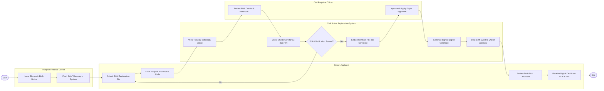

# Swimlane Diagram — Birth Death & Marriage Registration System

## Mermaid Code

## Flow Description | Mô tả luồng

| Lane | Actor | Role in Flow |
|------|-------|-------------|
| 1 | Citizen Applicant | Nộp đơn khai sinh cho con, nhập mã chứng sinh bệnh viện, kiểm tra dự thảo giấy khai sinh và nhận bản điện tử kèm số PIN. |
| 2 | Civil Status Registration System | Đối soát giấy chứng sinh điện tử từ bệnh viện, kết nối CSDL dân cư xin cấp Số định danh cá nhân 12 số, ký số bản án và đồng bộ dữ liệu. |
| 3 | Hospital / Medical Center | Khởi tạo giấy chứng sinh điện tử ngay khi trẻ ra đời và đẩy dữ liệu lên trục liên thông dịch vụ công. |
| 4 | Civil Registrar Officer | Kiểm tra thông tin nhân thân của cha mẹ, thẩm định tính hợp pháp của tên gọi và thực hiện duyệt ký số Giấy khai sinh. |
