# Action Tree — Birth Death & Marriage Registration System

## Mermaid Code

```mermaid
graph TD
    Root["Birth Death & Marriage Registration System"]

    Root --> M1["Birth Registration & Newborn PIN"]
    Root --> M2["Marriage Registration & Status Check"]
    Root --> M3["Death Registration & Burial Clearance"]
    Root --> M4["Civil Extracts & Certificate Copy"]
    Root --> M5["Adoption & Parentage Recognition"]
    Root --> M6["VNeID Sync & Vital Statistics"]

    M1 --> A11["Verify Hospital Birth Notice Data"]
    M1 --> A12["Request 12-Digit Newborn PIN VNeID"]
    M1 --> A13["Register Initial Birth Certificate"]
    M1 --> A14["Link Child to Parent Profiles"]

    M2 --> A21["Verify Marital Status Eligibility"]
    M2 --> A22["Process Marriage Certificate Registration"]
    M2 --> A23["Record Divorce Court Judgments"]
    M2 --> A24["Process Foreign-Element Marriages"]

    M3 --> A31["Verify Hospital Death Certificate"]
    M3 --> A32["Process Death Registration Certificate"]
    M3 --> A33["Issue Cemetery Burial Permits"]
    M3 --> A34["Deactivate Deceased VNeID Account"]

    M4 --> A41["Issue Certified Birth Extract Copy"]
    M4 --> A42["Issue Certified Marriage Extract Copy"]
    M4 --> A43["Issue Certified Death Extract Copy"]
    M4 --> A44["Validate Certificate QR Verification"]

    M5 --> A51["Process Legal Adoption Registration"]
    M5 --> A52["Register Paternity Recognition"]
    M5 --> A53["Register Maternity Recognition"]
    M5 --> A54["Update Surname Name Rectifications"]

    M6 --> A61["Sync Vital Events to Population Base"]
    M6 --> A62["Export Birth Death Marriage Trends"]
    M6 --> A63["Audit Civil Registrar Action Logs"]
    M6 --> A64["Export General Statistics Office Data"]
```

## Module Description | Mô tả Module

| # | Module | Description | Actions |
|---|--------|-------------|---------|
| 1 | Birth Registration & Newborn PIN | Tiếp nhận khai sinh, đối soát giấy chứng sinh bệnh viện, xin cấp Số định danh 12 số cho trẻ và liên kết cha mẹ | Verify Hospital Birth Notice Data, Request 12-Digit Newborn PIN VNeID, Register Initial Birth Certificate, Link Child to Parent Profiles |
| 2 | Marriage Registration & Status Check | Kiểm tra tình trạng độc thân, thực hiện đăng ký kết hôn, ghi chú ly hôn tòa án và đăng ký kết hôn có yếu tố nước ngoài | Verify Marital Status Eligibility, Process Marriage Certificate Registration, Record Divorce Court Judgments, Process Foreign-Element Marriages |
| 3 | Death Registration & Burial Clearance | Tiếp nhận khai tử, xác minh giấy báo tử, cấp giấy phép an táng và hủy hiệu lực tài khoản định danh người quá cố | Verify Hospital Death Certificate, Process Death Registration Certificate, Issue Cemetery Burial Permits, Deactivate Deceased VNeID Account |
| 4 | Civil Extracts & Certificate Copy | Cấp bản sao trích lục khai sinh, kết hôn, khai tử điện tử từ CSDL Hộ tịch và xác thực mã QR pháp lý | Issue Certified Birth Extract Copy, Issue Certified Marriage Extract Copy, Issue Certified Death Extract Copy, Validate Certificate QR Verification |
| 5 | Adoption & Parentage Recognition | Xử lý thủ tục đăng ký nhận con nuôi, nhận cha/mẹ/con ngoài giá thú và đính chính thay đổi họ tên tư pháp | Process Legal Adoption Registration, Register Paternity Recognition, Register Maternity Recognition, Update Surname Name Rectifications |
| 6 | VNeID Sync & Vital Statistics | Tự động đồng bộ các sự kiện hộ tịch vào CSDL Dân cư Quốc gia và trích xuất báo cáo thống kê dân số | Sync Vital Events to Population Base, Export Birth Death Marriage Trends, Audit Civil Registrar Action Logs, Export General Statistics Office Data |
