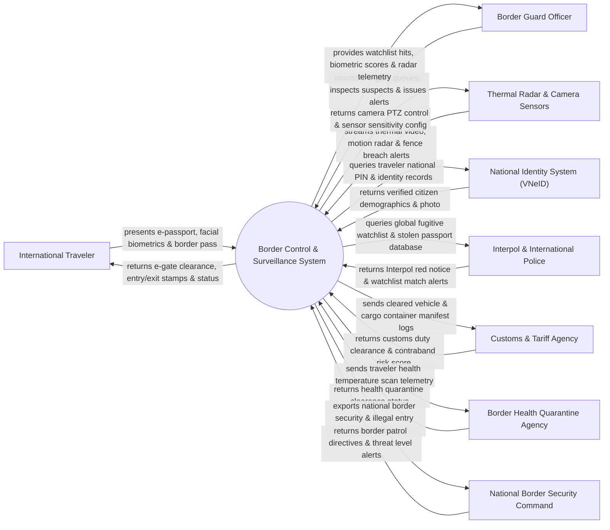

# Context Diagram — Border Control & Surveillance System

## Mermaid Code

## Actor & Interaction Table | Bảng Actor & Tương tác

| # | Actor | Actor Type | Data Sent TO System | Data Received FROM System | Notes |
|---|-------|------------|---------------------|---------------------------|-------|
| 1 | International Traveler | Primary | E-passport chip data, facial/fingerprint biometrics, border pass | E-gate gate opening, entry/exit digital stamp, clearance status | Hành khách xuất nhập cảnh qua các cửa khẩu đường bộ, đường hàng không |
| 2 | Border Guard Officer | Primary | Manual override commands, suspect detention logs, patrol reports | Watchlist match alerts, biometric verification scores, radar feed | Cán bộ Chiến sĩ Bộ đội Biên phòng trực kiểm soát cửa khẩu và tuần tra |
| 3 | Thermal Radar & Camera Sensors | Supporting | Infrared video streams, microwave radar vectors, fence breach alerts | Camera PTZ pan-tilt-zoom control, radar sensitivity config | Cảm biến hồng ngoại, camera AI và trạm radar giám sát đường biên giới |
| 4 | National Identity System (VNeID) | Supporting | Citizen 12-digit PIN, verified address, demographic details | Passport holder identity verification query requests | Cơ sở dữ liệu quốc gia về dân cư đối soát công dân Việt Nam xuất nhập cảnh |
| 5 | Interpol & International Police | Supporting | Global red notices, stolen/lost travel document (SLTD) database | Interpol query parameters, suspect match confirmation | Cơ quan Cảnh sát Hình sự Quốc tế / Interpol đối soát tội phạm truy nã |
| 6 | Customs & Tariff Agency | Supporting | Cargo customs clearance status, contraband risk score | Vehicle license plate OCR, container manifest logs | Cơ quan Hải quan cửa khẩu phối hợp kiểm soát hàng hóa và phương tiện |
| 7 | Border Health Quarantine Agency | Supporting | Body temperature scan rules, health quarantine clearance | Thermal scanner telemetry, quarantine risk alerts | Cơ quan Kiểm dịch Y tế Biên giới kiểm soát dịch bệnh lây truyền |
| 8 | National Border Security Command | Regulatory | National border threat levels, patrol assignment directives | Real-time border security dashboards, illegal entry analytics | Bộ Tư lệnh Bộ đội Biên phòng / Bộ Quốc phòng chỉ đạo vĩ mô |

## System Boundary Description | Mô tả Phạm vi Hệ thống

Hệ thống Border Control & Surveillance System (Hệ thống Cổng Kiểm soát và Giám sát An ninh Biên giới) chịu trách nhiệm tự động hóa quy trình quản lý xuất nhập cảnh và bảo vệ chủ quyền biên giới quốc gia: Kiểm soát xuất nhập cảnh tự động qua luồng e-Gate bằng hộ chiếu gắn chíp và sinh trắc học (Khuôn mặt / Vân tay), kết nối CSDL Interpol chống tội phạm quốc tế, vận hành hệ thống camera nhiệt AI và radar giám sát đường biên giới phát hiện vượt biên trái phép 24/7, kiểm soát phương tiện hàng hóa qua cửa khẩu và phát lệnh báo động khẩn cấp cho lực lượng tuần tra. Tuy nhiên, hệ thống KHÔNG trực tiếp thực hiện việc bắt giữ vật lý tại thực địa và KHÔNG thay thế việc tuần tra chiến đấu của chiến sĩ biên phòng.
