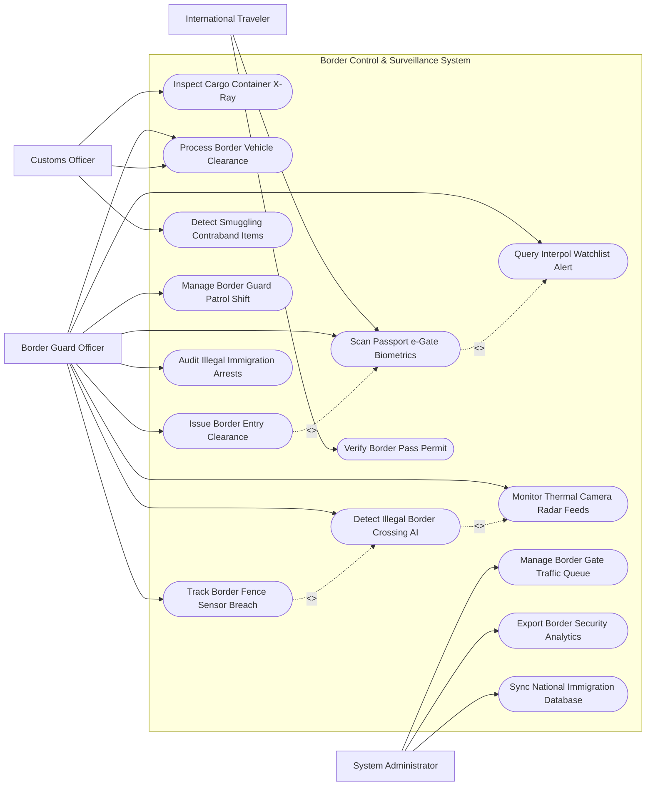

# Use Case Diagram — Border Control & Surveillance System

## Mermaid Code

## Actor Table | Bảng Actor

| # | Actor | Actor Type | Role Description | Related Use Cases |
|---|-------|------------|------------------|-------------------|
| 1 | International Traveler | Primary | Hành khách xuất nhập cảnh qua cửa khẩu bằng hộ chiếu gắn chíp e-Passport | UC01, UC03 |
| 2 | Border Guard Officer | Primary | Cán bộ biên phòng giám sát e-Gate, theo dõi radar camera, bắt giữ vượt biên trái phép | UC01, UC02, UC04, UC05, UC07, UC08, UC10, UC11, UC12 |
| 3 | Customs Officer | Primary | Cán bộ hải quan kiểm tra soi chiếu container, đăng ký phương tiện và chống buôn lậu | UC06, UC07, UC09 |
| 4 | System Administrator | System | Quản trị viên điều phối lưu lượng giao thông cửa khẩu và đồng bộ CSDL Quốc gia | UC13, UC14, UC15 |

## Use Case Table | Bảng Use Case

| # | UC ID | Use Case Name | Primary Actor | Secondary Actor | Description | Priority |
|---|-------|---------------|---------------|-----------------|-------------|----------|
| 1 | UC01 | Scan Passport e-Gate Biometrics | Traveler, Guard | VNeID | Tự động đọc chíp hộ chiếu điện tử, quét khuôn mặt/vân tay mở cửa e-Gate | High |
| 2 | UC02 | Detect Illegal Border Crossing AI | Guard | Radar Sensor | Thuật toán AI phân tích camera nhiệt và radar phát hiện đối tượng vượt biên trái phép | High |
| 3 | UC03 | Verify Border Pass Permit | Traveler | Guard | Kiểm tra Giấy thông hành biên giới dành cho cư dân vùng biên giới hai nước | High |
| 4 | UC04 | Query Interpol Watchlist Alert | Guard | Interpol | Tự động truy vấn CSDL Interpol đối soát đối tượng bị nợ truy nã/cấm xuất cảnh | High |
| 5 | UC05 | Monitor Thermal Camera Radar Feeds | Guard | Camera PTZ | Giám sát hình ảnh camera hồng ngoại đêm và đường quét radar biên giới 24/7 | High |
| 6 | UC06 | Inspect Cargo Container X-Ray | Customs | - | Phân tích hình ảnh soi chiếu X-quang container hàng hóa phát hiện hàng cấm | High |
| 7 | UC07 | Process Border Vehicle Clearance | Guard, Customs | OCR Camera | Đọc biển số xe, quét mã định danh phương tiện và làm thủ tục xuất nhập cảnh xe | High |
| 8 | UC08 | Issue Border Entry Clearance | Guard | Traveler | Ban hành Quyết định cho phép nhập cảnh và đóng dấu chứng nhận số lên CSDL | High |
| 9 | UC09 | Detect Smuggling Contraband Items | Customs | - | Phát hiện hành vi buôn lậu chất ma túy, vũ khí, ngoại tệ trái phép qua cửa khẩu | High |
| 10 | UC10 | Manage Border Guard Patrol Shift | Guard | - | Phân công ca trực tuần tra cột mốc biên giới và ghi nhận nhật ký tuần tra | Medium |
| 11 | UC11 | Track Border Fence Sensor Breach | Guard | Sensor Hardware | Bật báo động khẩn cấp khi cảm biến rung/hồng ngoại hàng rào biên giới bị tác động | High |
| 12 | UC12 | Audit Illegal Immigration Arrests | Guard | Police | Lập hồ sơ xử lý hành chính/khởi tố hình sự các đối tượng tổ chức vượt biên chui | High |
| 13 | UC13 | Manage Border Gate Traffic Queue | Admin | - | Phân luồng giao thông làn xe và làn người tại cửa khẩu tránh nghẽn | Medium |
| 14 | UC14 | Export Border Security Analytics | Admin | BorderCommand | Trích xuất báo cáo lưu lượng xuất nhập cảnh và nguy cơ an ninh nộp Bộ Tư lệnh | Low |
| 15 | UC15 | Sync National Immigration Database | System | ImmigrationDB | Đồng bộ dữ liệu xuất nhập cảnh thời gian thực về CSDL Quản lý Xuất nhập cảnh QG | High |

## Use Case Specification | Đặc tả Use Case

---

### UC01 — Scan Passport e-Gate Biometrics

| Field | Detail |
|-------|--------|
| **UC ID** | UC01 |
| **Use Case Name** | Scan Passport e-Gate Biometrics |
| **Actor(s)** | Primary: International Traveler, Border Guard Officer / Secondary: VNeID |
| **Description** | Hành khách thực hiện xuất nhập cảnh tự động tại luồng e-Gate bằng cách quét hộ chiếu chíp và xác thực sinh trắc học. |
| **Precondition** | 1. Hành khách có Hộ chiếu điện tử (e-Passport) còn hiệu lực và đã đăng ký sinh trắc học. |
| **Main Flow** | 1. Traveler đến trước Cổng e-Gate cửa số 1.   2. Traveler đặt trang Hộ chiếu chíp lên Máy đọc OCR/RFID Reader.   3. System đọc dữ liệu chíp ICAO: Họ tên, Số hộ chiếu, Quốc tịch, Ảnh khuôn mặt chuẩn ICAO.   4. Cửa e-Gate 1 mở, Traveler bước vào buồng xác thực sinh trắc học e-Gate 2.   5. Camera AI quét sinh trắc học khuôn mặt (Live Facial Scan) và máy quét vân tay.   6. System đối soát dữ liệu sinh trắc học thực tế vs Dữ liệu trong chíp hộ chiếu (Khuôn mặt khớp $> 98\%$).   7. System tự động kiểm tra CSDL Cấm xuất nhập cảnh và Interpol (UC04).   8. If Hợp lệ: System ghi nhận lịch sử xuất/nhập cảnh, Cửa e-Gate 2 mở cho Traveler đi qua. |
| **Alternative Flow** | **AF1** — Xác thực cư dân vùng biên giới: Traveler quét Giấy thông hành biên giới (UC03) tại luồng e-Gate dành riêng cho cư dân biên giới. |
| **Exception Flow** | **EX1** — Sinh trắc học không khớp hoặc Phát hiện bị cấm xuất cảnh (UC04): Cửa e-Gate 2 đóng chặt, đèn Đỏ nhấp nháy báo động, System tự động gửi tín hiệu thông báo cho Cán bộ biên phòng trực quầy đến áp giải đối tượng. |
| **Postcondition** | Hành khách hoàn thành xuất nhập cảnh tự động trong 15 giây, thông tin được đồng bộ CSDL Quản lý Xuất nhập cảnh. |
| **Business Rule** | **BR1**: Thời gian xử lý kiểm soát e-Gate cho 01 hành khách hợp lệ không vượt quá 15 giây. |

---

### UC02 — Detect Illegal Border Crossing AI

| Field | Detail |
|-------|--------|
| **UC ID** | UC02 |
| **Use Case Name** | Detect Illegal Border Crossing AI |
| **Actor(s)** | Primary: Border Guard Officer / Secondary: Thermal Radar Sensors |
| **Description** | Thuật toán AI phân tích luồng video camera nhiệt hồng ngoại và trạm radar biên giới để tự động phát hiện người/phương tiện vượt biên trái phép ban đêm. |
| **Precondition** | 1. Hệ thống camera nhiệt PTZ và trạm radar vi sóng biên giới hoạt động 24/7. |
| **Main Flow** | 1. SurveillanceSensors truyền luồng video hồng ngoại đêm và tín hiệu radar quét vùng biên giới về trung tâm.   2. Thuật toán AI Computer Vision phân tích các mục tiêu di chuyển trong vùng cấm biên giới.   3. AI tự động phân loại mục tiêu: Phân biệt giữa Con người / Phương tiện vs Động vật hoang dã.   4. If Phát hiện nhóm người di chuyển cắt rừng vượt biên: System lập tức khoanh vùng khung Đỏ mục tiêu trên bản đồ GIS.   5. System tính toán vị trí tọa độ GPS chính xác và dự báo hướng di chuyển của nhóm vượt biên.   6. System phát âm thanh cảnh báo Đỏ tại Trung tâm Chỉ huy Biên phòng.   7. BorderGuard điều khiển camera PTZ zoom cận cảnh khuôn mặt và điều động Đội tuần tra cơ động đến vây bắt (UC10). |
| **Alternative Flow** | **AF1** — Phát hiện phương tiện di chuyển trái phép đường sông/biển: AI bóc tách mục tiêu tàu xuồng không bật định vị AIS trên vùng biển biên giới. |
| **Exception Flow** | **EX1** — Thời tiết sương mù quá dày làm giảm tầm nhìn camera: System tự động tăng công suất trạm radar vi sóng để duy trì khả năng bám bắt mục tiêu. |
| **Postcondition** | Phát hiện kịp thời các vụ vượt biên trái phép từ xa, bảo vệ vững chắc an ninh chủ quyền biên giới. |
| **Business Rule** | **BR1**: Thuật toán AI phải phát hiện được mục tiêu con người di chuyển ban đêm trong khoảng cách đến 3km. |

---

### UC04 — Query Interpol Watchlist Alert

| Field | Detail |
|-------|--------|
| **UC ID** | UC04 |
| **Use Case Name** | Query Interpol Watchlist Alert |
| **Actor(s)** | Primary: Border Guard Officer / Secondary: Interpol |
| **Description** | Tự động truy vấn CSDL Tội phạm Truy nã Quốc tế (Interpol Red Notice) và Danh sách Cấm xuất nhập cảnh Quốc gia ngay khi quét hộ chiếu. |
| **Precondition** | 1. Hành khách quét hộ chiếu tại e-Gate (UC01) hoặc quầy thủ tục biên phòng. |
| **Main Flow** | 1. System trích xuất các thuộc tính: Số hộ chiếu, Họ tên, Ngày sinh, Quốc tịch, Mã hash sinh trắc học khuôn mặt.   2. System gửi truy vấn API song song tới CSDL Cấm xuất nhập cảnh Bộ Công an và CSDL Interpol SLTD/Red Notice.   3. Interpol Engine chạy thuật toán khớp tên fuzzy matching và khớp ảnh hình sự.   4. If Không có trong danh sách: Interpol trả về "Clean - No Match".   5. If Trùng khớp với Lệnh Truy nã Đỏ (Interpol Red Notice): System báo động Đỏ "Tội phạm truy nã quốc tế nguy hiểm".   6. System hiển thị thông tin vụ án, ảnh hình sự và mức độ nguy hiểm của đối tượng lên màn hình Cán bộ biên phòng.   7. BorderGuard lập tức kích hoạt quy trình bắt giữ khẩn cấp và cách ly đối tượng vào phòng an ninh cửa khẩu. |
| **Alternative Flow** | **AF1** — Đối tượng thuộc danh sách hoãn xuất cảnh do nợ thuế/thi hành án: System phát cảnh báo Vàng "Tạm hoãn xuất cảnh", hướng dẫn đối tượng làm việc với cơ quan chức năng. |
| **Exception Flow** | **EX1** — Trùng họ tên/ngày sinh với tội phạm nhưng khác sinh trắc học (Trùng tên ngẫu nhiên): BorderGuard kiểm tra vân tay thực tế, xác nhận không phải đối tượng bị truy nã và giải tỏa cho đi. |
| **Postcondition** | Ngăn chặn tuyệt đối các đối tượng tội phạm quốc tế và đối tượng cấm xuất cảnh tẩu thoát qua đường biên giới. |
| **Business Rule** | **BR1**: Việc đối soát CSDL Interpol và Danh sách cấm xuất nhập cảnh phải hoàn thành trong vòng $< 1$ giây. |

---

### UC07 — Process Border Vehicle Clearance

| Field | Detail |
|-------|--------|
| **UC ID** | UC07 |
| **Use Case Name** | Process Border Vehicle Clearance |
| **Actor(s)** | Primary: Border Guard Officer, Customs Officer / Secondary: OCR Camera |
| **Description** | Thực hiện thủ tục kiểm soát xuất nhập cảnh và thông quan cho các phương tiện ô tô, xe tải, container qua cửa khẩu đường bộ. |
| **Precondition** | 1. Phương tiện di chuyển vào làn kiểm soát phương tiện tại cửa khẩu. |
| **Main Flow** | 1. Camera OCR tự động đọc biển số xe (Việt Nam và Quốc tế) và quét mã số thùng container.   2. Driver xuất trình Giấy phép vận tải đường bộ quốc tế (TIR / Cửa khẩu liên vận) và Giấy đăng ký xe.   3. BorderGuard quét mã định danh phương tiện và xác thực thông tin tài xế qua VNeID.   4. CustomsOfficer thực hiện soi chiếu X-quang container (UC06) để kiểm tra hàng cấm (UC09).   5. System tự động kiểm tra lịch sử chấp hành pháp luật của phương tiện (Có từng chở hàng lậu/vượt biên trái phép không).   6. If Hợp lệ: BorderGuard và CustomsOfficer cùng ký số phê duyệt Thông quan phương tiện.   7. System tự động điều khiển nâng Barrier làn xe, cho phép phương tiện qua biên giới. |
| **Alternative Flow** | **AF1** — Xe rỗng không chở hàng: System cho phép di chuyển qua Luồng Xanh (Green Lane) để thông quan nhanh trong 1 phút. |
| **Exception Flow** | **EX1** — Camera X-quang phát hiện hình ảnh nghi vấn giấu người hoặc ma túy trong vách thùng xe: CustomsOfficer phát lệnh đưa xe vào khu vực khám xét thủ công chi tiết. |
| **Postcondition** | Phương tiện được phép xuất/nhập cảnh hợp pháp, lịch sử di chuyển phương tiện được ghi nhận vào CSDL. |
| **Business Rule** | **BR1**: 100% các xe container xuất nhập cảnh qua cửa khẩu phải được quét đọc biển số OCR tự động và kiểm tra luồng thông quan. |
