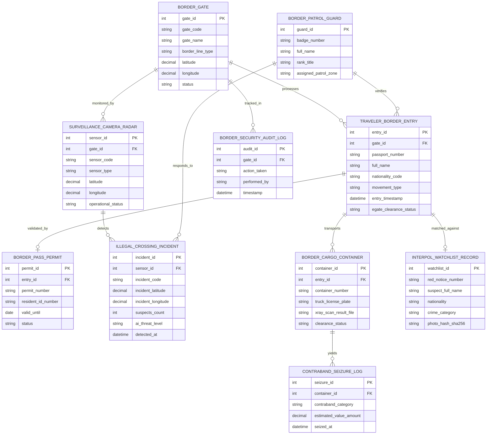

# Conceptual ERD — Border Control & Surveillance System

## Mermaid Code

## Entity Description Table | Bảng mô tả Entity

| # | Entity Name | Vietnamese Name | Description | Key Attributes | Main Relationships |
|---|-------------|-----------------|-------------|----------------|-------------------|
| 1 | BORDER_GATE | Cửa khẩu Biên giới | Thông tin trạm/cổng kiểm soát cửa khẩu đường bộ, đường biển, hàng không | gate_id, gate_code, gate_name, border_line_type, status | Processes TRAVELER_BORDER_ENTRY, monitored by SENSORS |
| 2 | TRAVELER_BORDER_ENTRY | Lượt Xuất Nhập cảnh | Nhật ký xuất nhập cảnh của hành khách (hộ chiếu, loại di chuyển, thời gian) | entry_id, passport_number, full_name, movement_type, egate_clearance_status | Belongs to BORDER_GATE, matched against INTERPOL |
| 3 | BORDER_PASS_PERMIT | Giấy Thông hành Biên giới | Giấy thông hành cấp cho cư dân biên giới hai nước xuất nhập cảnh qua lại | permit_id, permit_number, resident_id_number, valid_until | Validates TRAVELER_BORDER_ENTRY |
| 4 | SURVEILLANCE_CAMERA_RADAR | Cảm biến Radar & Camera Nhiệt | Cảm biến hồng ngoại nhiệt, radar vi sóng và camera AI giám sát đường biên | sensor_id, sensor_code, sensor_type, latitude, longitude | Belongs to BORDER_GATE, detects ILLEGAL_CROSSING |
| 5 | ILLEGAL_CROSSING_INCIDENT | Vụ việc Vượt biên Trái phép | Hồ sơ vụ việc phát hiện đối tượng xâm nhập/vượt biên chui qua đường rừng | incident_id, incident_code, incident_latitude, ai_threat_level, detected_at | Detected by SENSOR, responded by GUARD |
| 6 | BORDER_CARGO_CONTAINER | Container Hàng hóa Cửa khẩu | Thông tin container, biển số xe tải và kết quả soi chiếu X-quang thông quan | container_id, container_number, truck_license_plate, xray_scan_result_file | Belongs to TRAVELER_BORDER_ENTRY, yields CONTRABAND |
| 7 | INTERPOL_WATCHLIST_RECORD | Danh sách Truy nã Interpol | Bản ghi Lệnh truy nã Đỏ Interpol và danh sách cấm xuất nhập cảnh quốc gia | watchlist_id, red_notice_number, suspect_full_name, crime_category | Matched against TRAVELER_BORDER_ENTRY |
| 8 | BORDER_PATROL_GUARD | Chiến sĩ Bộ đội Biên phòng | Thông tin cán bộ chiến sĩ biên phòng trực cửa khẩu và đội tuần tra cơ động | guard_id, badge_number, full_name, rank_title, assigned_patrol_zone | Responds to INCIDENT, verifies TRAVELER_ENTRY |
| 9 | CONTRABAND_SEIZURE_LOG | Nhật ký Bắt giữ Hàng cấm | Biên bản thu giữ ma túy, vũ khí, ngoại tệ buôn lậu qua cửa khẩu | seizure_id, contraband_category, estimated_value_amount, seized_at | Belongs to BORDER_CARGO_CONTAINER |
| 10 | BORDER_SECURITY_AUDIT_LOG | Nhật ký Kiểm toán An ninh Biên giới | Lưu vết toàn bộ lịch sử qua luồng e-Gate, cảnh báo camera, đối soát Interpol | audit_id, action_taken, performed_by, timestamp | Belongs to BORDER_GATE |

## Relationship Description | Mô tả Quan hệ

| # | From Entity | Cardinality | To Entity | Relationship Label | Business Explanation |
|---|-------------|-------------|-----------|-------------------|----------------------|
| 1 | BORDER_GATE | one-to-many | TRAVELER_BORDER_ENTRY | processes | Một cửa khẩu xử lý hàng triệu lượt hành khách xuất nhập cảnh hàng năm |
| 2 | TRAVELER_BORDER_ENTRY | one-to-one | BORDER_PASS_PERMIT | validated_by | Lượt xuất nhập cảnh cư dân biên giới được xác thực bằng Giấy thông hành |
| 3 | BORDER_GATE | one-to-many | SURVIVOR_CAMERA_RADAR | monitored_by | Một cửa khẩu/tuyến biên giới được giám sát bởi nhiều camera nhiệt và radar |
| 4 | SURVEILLANCE_CAMERA_RADAR | one-to-many | ILLEGAL_CROSSING_INCIDENT | detects | Một cảm biến radar/camera nhiệt phát hiện nhiều sự cố vượt biên trái phép |
| 5 | TRAVELER_BORDER_ENTRY | one-to-many | BORDER_CARGO_CONTAINER | transports | Một lượt phương tiện nhập cảnh mang theo các container hàng hóa |
| 6 | TRAVELER_BORDER_ENTRY | one-to-one | INTERPOL_WATCHLIST_RECORD | matched_against | Mỗi lượt xuất nhập cảnh được đối soát thời gian thực với CSDL Interpol |
| 7 | BORDER_PATROL_GUARD | one-to-many | ILLEGAL_CROSSING_INCIDENT | responds_to | Đội tuần tra biên phòng phản ứng vây bắt nhiều vụ việc vượt biên trái phép |
| 8 | BORDER_CARGO_CONTAINER | one-to-many | CONTRABAND_SEIZURE_LOG | yields | Một container vi phạm phát sinh các biên bản tịch thu hàng cấm buôn lậu |
| 9 | BORDER_GATE | one-to-many | BORDER_SECURITY_AUDIT_LOG | tracked_in | Mọi hoạt động an ninh tại cửa khẩu được ghi lại nhật ký kiểm toán bất biến |
| 10 | BORDER_PATROL_GUARD | one-to-many | TRAVELER_BORDER_ENTRY | verifies | Một cán bộ biên phòng thực hiện kiểm tra đối soát cho nhiều lượt hành khách |
