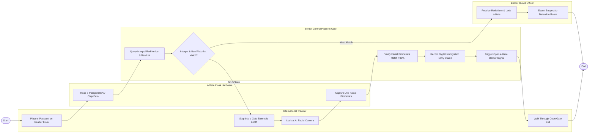

# Swimlane Diagram — Border Control & Surveillance System

## Mermaid Code

## Flow Description | Mô tả luồng

| Lane | Actor | Role in Flow |
|------|-------|-------------|
| 1 | International Traveler | Đặt hộ chiếu chíp lên máy đọc, bước vào buồng sinh trắc học e-Gate, nhìn vào camera quét mặt và đi qua cổng. |
| 2 | e-Gate Kiosk Hardware | Đọc dữ liệu chíp ICAO trên hộ chiếu điện tử, tự động chụp ảnh sinh trắc học khuôn mặt thực tế của hành khách. |
| 3 | Border Control Platform Core | Truy vấn CSDL Interpol & Danh sách cấm xuất nhập cảnh, đối soát sinh trắc học khuôn mặt, ghi nhận tem số và mở cổng. |
| 4 | Border Guard Officer | Nhận báo động Đỏ khi phát hiện đối tượng truy nã/cấm xuất cảnh, tự động khóa e-Gate và áp giải đối tượng vào phòng an ninh. |
