# Action Tree — Border Control & Surveillance System

## Mermaid Code

```mermaid
graph TD
    Root["Border Control & Surveillance System"]

    Root --> M1["e-Gate & Biometric Clearance"]
    Root --> M2["Thermal Radar & Fence Surveillance"]
    Root --> M3["Illegal Crossing & AI Detection"]
    Root --> M4["Cargo & Vehicle Customs Inspection"]
    Root --> M5["Watchlist & Interpol Integration"]
    Root --> M6["Command BI & Border Security Audit"]

    M1 --> A11["Scan e-Passport ICAO Chip Data"]
    M1 --> A12["Verify Live Facial Biometrics Match"]
    M1 --> A13["Verify Border Pass Resident Permits"]
    M1 --> A14["Issue Digital Entry Exit Stamps"]

    M2 --> A21["Monitor Thermal Camera Infrared Feeds"]
    M2 --> A22["Scan Microwave Radar Border Vectors"]
    M2 --> A23["Track Border Fence Vibration Sensors"]
    M2 --> A24["Control PTZ Camera Pan Tilt Zoom"]

    M3 --> A31["Detect Illegal Border Crossing AI"]
    M3 --> A32["Classify Human vs Animal Targets"]
    M3 --> A33["Calculate Target GPS Coordinates"]
    M3 --> A34["Dispatch Mobile Border Patrol Shift"]

    M4 --> A41["Inspect Cargo Container X-Ray Scans"]
    M4 --> A42["Scan Vehicle License Plates OCR"]
    M4 --> A43["Detect Smuggling Contraband Items"]
    M4 --> A44["Manage Border Gate Traffic Queues"]

    M5 --> A51["Query Interpol Red Notices SLTD"]
    M5 --> A52["Check National Exit Ban List"]
    M5 --> A53["Trigger e-Gate Red Alarm Lock"]
    M5 --> A54["Audit Illegal Immigration Arrests"]

    M6 --> A61["Sync National Immigration Database"]
    M6 --> A62["Export Border Command BI Dashboards"]
    M6 --> A63["Log System Immutable Security Audits"]
    M6 --> A64["Export Health Quarantine Statistics"]
```

## Module Description | Mô tả Module

| # | Module | Description | Actions |
|---|--------|-------------|---------|
| 1 | e-Gate & Biometric Clearance | Đọc chíp hộ chiếu điện tử e-Passport, xác thực sinh trắc học khuôn mặt/vân tay, kiểm tra giấy thông hành và đóng tem số | Scan e-Passport ICAO Chip Data, Verify Live Facial Biometrics Match, Verify Border Pass Resident Permits, Issue Digital Entry Exit Stamps |
| 2 | Thermal Radar & Fence Surveillance | Giám sát hình ảnh camera nhiệt hồng ngoại đêm, trạm radar vi sóng, cảm biến rung hàng rào và điều khiển camera PTZ | Monitor Thermal Camera Infrared Feeds, Scan Microwave Radar Border Vectors, Track Border Fence Vibration Sensors, Control PTZ Camera Pan Tilt Zoom |
| 3 | Illegal Crossing & AI Detection | Thuật toán AI phát hiện đối tượng xâm nhập/vượt biên chui, tính toán tọa độ GPS mục tiêu và điều động đội tuần tra | Detect Illegal Border Crossing AI, Classify Human vs Animal Targets, Calculate Target GPS Coordinates, Dispatch Mobile Border Patrol Shift |
| 4 | Cargo & Vehicle Customs Inspection | Phân tích hình ảnh soi chiếu X-quang container, đọc biển số xe OCR tự động, phát hiện buôn lậu và điều tiết luồng giao thông | Inspect Cargo Container X-Ray Scans, Scan Vehicle License Plates OCR, Detect Smuggling Contraband Items, Manage Border Gate Traffic Queues |
| 5 | Watchlist & Interpol Integration | Liên thông CSDL Interpol Lệnh truy nã Đỏ, kiểm tra danh sách cấm xuất nhập cảnh, khóa e-Gate và lập biên bản bắt giữ | Query Interpol Red Notices SLTD, Check National Exit Ban List, Trigger e-Gate Red Alarm Lock, Audit Illegal Immigration Arrests |
| 6 | Command BI & Border Security Audit | Đồng bộ CSDL Quản lý Xuất nhập cảnh Quốc gia, trích xuất báo cáo BI trình Bộ Tư lệnh Biên phòng và kiểm toán an ninh | Sync National Immigration Database, Export Border Command BI Dashboards, Log System Immutable Security Audits, Export Health Quarantine Statistics |
