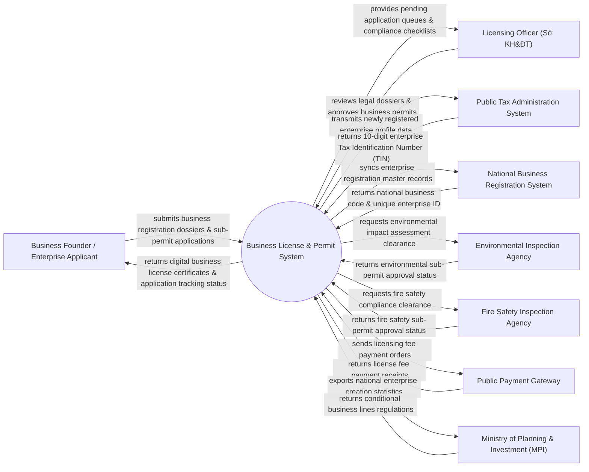

# Context Diagram — Business License & Permit System

## Mermaid Code

## Actor & Interaction Table | Bảng Actor & Tương tác

| # | Actor | Actor Type | Data Sent TO System | Data Received FROM System | Notes |
|---|-------|------------|---------------------|---------------------------|-------|
| 1 | Business Founder / Enterprise Applicant | Primary | Business registration form, charter, ID documents, sub-permit files | Digital Business Certificate, application tracking status, fee notices | Doanh nghiệp/Chủ hộ kinh doanh đăng ký thành lập hoặc xin giấy phép |
| 2 | Licensing Officer (Sở KH&ĐT) | Primary | File review notes, license approval decisions, revocation orders | Application queue, legal verification checklist, SLA timer | Cán bộ Sở Kế hoạch & Đầu tư / Phòng Đăng ký kinh doanh |
| 3 | Public Tax Administration System | Supporting | 10-digit Enterprise Tax Identification Number (TIN), tax status | Registered enterprise master record, legal representative data | Cơ quan Thuế tự động cấp Mã số thuế doanh nghiệp liên thông |
| 4 | National Business Registration System | Supporting | National unique business code, enterprise identity verification | Synchronized enterprise profile updates, active status logs | Cơ sở dữ liệu Quốc gia về Đăng ký Doanh nghiệp toàn quốc |
| 5 | Environmental Inspection Agency | Supporting | Environmental impact assessment (ĐTM) clearance certificate | Sub-permit review requests, factory location coordinates | Cơ quan Môi trường cấp giấy phép môi trường cho ngành có điều kiện |
| 6 | Fire Safety Inspection Agency | Supporting | Fire safety clearance certificate, facility compliance rating | Sub-permit review requests, building fire safety files | Cơ quan Cảnh sát PCCC cấp Giấy phép an toàn PCCC |
| 7 | Public Payment Gateway | Supporting | License fee payment transaction receipts, invoice IDs | License fee payment orders, enterprise fee breakdown | Cổng thanh toán Dịch vụ công thu lệ phí đăng ký doanh nghiệp |
| 8 | Ministry of Planning & Investment (MPI) | Regulatory | Conditional business sector codes (227 ngành nghề kinh doanh có điều kiện) | National business creation analytics, capital investment stats | Bộ Kế hoạch & Đầu tư ban hành chính sách và mã ngành nghề |

## System Boundary Description | Mô tả Phạm vi Hệ thống

Hệ thống Business License & Permit System (Hệ thống Cấp Giấy phép Kinh doanh và Giấy phép Con) chịu trách nhiệm quản lý quy trình cấp phép đăng ký doanh nghiệp liên thông toàn quốc: Đăng ký thành lập doanh nghiệp mới, tự động lấy Mã số thuế 10 số, cấp Giấy phép kinh doanh điện tử (Đăng ký doanh nghiệp / Hộ kinh doanh), quản lý 227 ngành nghề kinh doanh có điều kiện (Giấy phép con về PCCC, Môi trường, An toàn thực phẩm), thay đổi nội dung đăng ký kinh doanh, tạm ngừng / giải thể và thu hồi Giấy phép. Tuy nhiên, hệ thống KHÔNG trực tiếp thu thuế thu nhập doanh nghiệp và KHÔNG thay thế việc kiểm tra thực địa của các đoàn thanh tra chuyên ngành.
