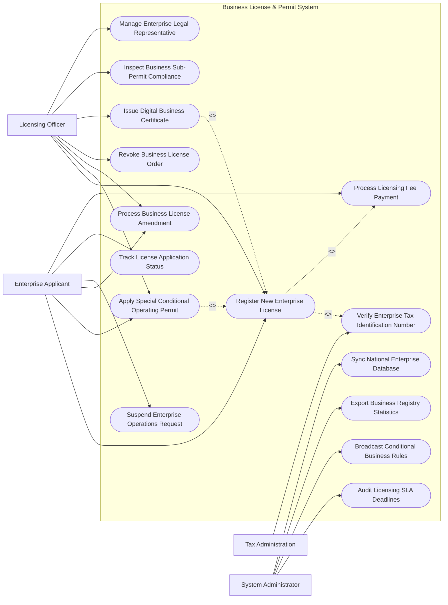

# Use Case Diagram — Business License & Permit System

## Mermaid Code

## Actor Table | Bảng Actor

| # | Actor | Actor Type | Role Description | Related Use Cases |
|---|-------|------------|------------------|-------------------|
| 1 | Enterprise Applicant | Primary | Chủ doanh nghiệp/Người đại diện nộp hồ sơ thành lập, xin giấy phép con và thay đổi ĐKKD | UC01, UC02, UC04, UC05, UC07, UC08 |
| 2 | Licensing Officer | Primary | Cán bộ Phòng Đăng ký kinh doanh thẩm định hồ sơ, ký duyệt và phát hành Giấy phép | UC01, UC02, UC04, UC06, UC09, UC10, UC11 |
| 3 | Tax Administration | Secondary | Cơ quan Thuế cấp Mã số thuế 10 số liên thông tự động cho doanh nghiệp mới | UC03 |
| 4 | System Administrator | System | Quản trị hệ thống giám sát SLA, đồng bộ CSDL Quốc gia và trích xuất báo cáo | UC12, UC13, UC14, UC15 |

## Use Case Table | Bảng Use Case

| # | UC ID | Use Case Name | Primary Actor | Secondary Actor | Description | Priority |
|---|-------|---------------|---------------|-----------------|-------------|----------|
| 1 | UC01 | Register New Enterprise License | Applicant | Officer, TaxOffice | Đăng ký thành lập doanh nghiệp mới (Cty TNHH, Cty Cổ phần, DNTN) trực tuyến | High |
| 2 | UC02 | Apply Special Conditional Operating Permit | Applicant | Officer | Xin cấp Giấy phép con đối với các ngành nghề kinh doanh có điều kiện | High |
| 3 | UC03 | Verify Enterprise Tax Identification Number | TaxOffice | System | Tự động sinh và cấp Mã số thuế doanh nghiệp 10 số đồng thời là Mã số doanh nghiệp | High |
| 4 | UC04 | Process Business License Amendment | Applicant | Officer | Thay đổi nội dung đăng ký doanh nghiệp (Tăng vốn, thay tên, chuyển địa chỉ) | High |
| 5 | UC05 | Suspend Enterprise Operations Request | Applicant | Officer | Đăng ký tạm ngừng kinh doanh hoặc tiếp tục kinh doanh trước thời hạn | Medium |
| 6 | UC06 | Revoke Business License Order | Officer | Police, TaxOffice | Thẩm định và ban hành Quyết định thu hồi Giấy chứng nhận đăng ký doanh nghiệp | High |
| 7 | UC07 | Track License Application Status | Applicant | - | Tra cứu tiến độ xử lý hồ sơ đăng ký kinh doanh theo mã số hồ sơ | High |
| 8 | UC08 | Process Licensing Fee Payment | Applicant | PayGW | Thanh toán lệ phí đăng ký doanh nghiệp và phí công bố thông tin | High |
| 9 | UC09 | Issue Digital Business Certificate | Officer | Applicant | Ký số và cấp Giấy chứng nhận đăng ký doanh nghiệp bản điện tử kèm mã QR | High |
| 10 | UC10 | Inspect Business Sub-Permit Compliance | Officer | Inspector | Hậu kiểm điều kiện kinh doanh đối với các ngành nghề kinh doanh có điều kiện | Medium |
| 11 | UC11 | Manage Enterprise Legal Representative | Officer | VNeID | Cập nhật thông tin Người đại diện theo pháp luật gắn với định danh VNeID | Medium |
| 12 | UC12 | Audit Licensing SLA Deadlines | Admin | - | Kiểm toán thời gian giải quyết hồ sơ tuân thủ quy định tối đa 03 ngày làm việc | High |
| 13 | UC13 | Broadcast Conditional Business Rules | Admin | MPI | Cập nhật và phát hành danh mục các ngành nghề kinh doanh có điều kiện | Medium |
| 14 | UC14 | Export Business Registry Statistics | Admin | MPI | Trích xuất báo cáo tình hình phát triển doanh nghiệp nộp Bộ KH&ĐT | Low |
| 15 | UC15 | Sync National Enterprise Database | System | NationalBusinessDB | Đồng bộ dữ liệu doanh nghiệp thời gian thực về CSDL Đăng ký Doanh nghiệp QG | High |

## Use Case Specification | Đặc tả Use Case

---

### UC01 — Register New Enterprise License

| Field | Detail |
|-------|--------|
| **UC ID** | UC01 |
| **Use Case Name** | Register New Enterprise License |
| **Actor(s)** | Primary: Enterprise Applicant / Secondary: Licensing Officer, Tax Administration |
| **Description** | Chủ doanh nghiệp nộp hồ sơ đăng ký thành lập doanh nghiệp mới trực tuyến qua Cổng Thông tin Quốc gia về Đăng ký Doanh nghiệp. |
| **Precondition** | 1. Người thành lập có tài khoản VNeID mức 2 hoặc Chữ ký số công cộng. |
| **Main Flow** | 1. Applicant đăng nhập hệ thống và chọn loại hình doanh nghiệp (Công ty TNHH 1 thành viên, TNHH 2 thành viên trở lên, Công ty Cổ phần, DNTN).   2. Applicant nhập Tên doanh nghiệp (Tiếng Việt, Tiếng Anh, Tên viết tắt). System tự động tra cứu chống trùng tên.   3. Applicant nhập Địa chỉ trụ sở chính, Vốn điều lệ, Danh sách thành viên/cổ đông sáng lập và chọn Mã ngành nghề kinh doanh (VSIC).   4. Applicant nộp tệp đính kèm: Điều lệ công ty, Bản sao CCCD thành viên.   5. System kết nối Thuế sinh Mã số thuế 10 số tự động (UC03).   6. Applicant nộp lệ phí đăng ký kinh doanh và phí công bố nội dung đăng ký (UC08).   7. Officer thụ lý hồ sơ, kiểm tra tính hợp lệ trong vòng 03 ngày làm việc và bấm "Ký duyệt cấp Giấy phép".   8. System phát hành Giấy chứng nhận đăng ký doanh nghiệp điện tử kèm Mã QR chính thức (UC09). |
| **Alternative Flow** | **AF1** — Hồ sơ chưa hợp lệ: Officer phát hành Thông báo sửa đổi bổ sung hồ sơ ghi rõ lý do, System chuyển hồ sơ về trạng thái "Chờ sửa đổi" cho Applicant. |
| **Exception Flow** | **EX1** — Tên doanh nghiệp bị trùng hoặc gây nhầm lẫn: System báo lỗi trùng tên, yêu cầu Applicant đổi tên khác trước khi nộp. |
| **Postcondition** | Doanh nghiệp được thành lập chính thức, mã số doanh nghiệp đồng thời là mã số thuế có hiệu lực trên toàn quốc. |
| **Business Rule** | **BR1**: Thời hạn xử lý đăng ký thành lập doanh nghiệp mới không quá 03 ngày làm việc kể từ ngày nhận đủ hồ sơ hợp lệ. |

---

### UC02 — Apply Special Conditional Operating Permit

| Field | Detail |
|-------|--------|
| **UC ID** | UC02 |
| **Use Case Name** | Apply Special Conditional Operating Permit |
| **Actor(s)** | Primary: Enterprise Applicant / Secondary: Licensing Officer, Specialized Agencies |
| **Description** | Nộp hồ sơ xin cấp Giấy phép kinh doanh có điều kiện (Giấy phép con: PCCC, Môi trường, Vệ sinh an toàn thực phẩm, An ninh trật tự). |
| **Precondition** | 1. Doanh nghiệp đã được cấp Giấy chứng nhận đăng ký doanh nghiệp (UC01).   2. Ngành nghề đăng ký thuộc Danh mục 227 ngành nghề kinh doanh có điều kiện. |
| **Main Flow** | 1. Applicant chọn ngành nghề cần xin Giấy phép con (Ví dụ: Kinh doanh Karaoke, Nhà hàng ăn uống, Sản xuất rượu, Vận tải).   2. System hiển thị Danh mục điều kiện pháp lý và hồ sơ cần nộp theo quy định chuyên ngành.   3. Applicant tải lên các tài liệu chứng minh đủ điều kiện: Giấy chứng nhận PCCC, Bản cam kết bảo vệ môi trường, Giấy tập huấn an toàn thực phẩm.   4. System tự động phân chuyển hồ sơ tới Cơ quan chuyên ngành tương ứng (Công an PCCC, Sở Y tế, Sở TN&MT).   5. Cán bộ chuyên ngành thẩm định hồ sơ và tổ chức kiểm tra thực địa (nếu có).   6. Cán bộ chuyên ngành cập nhật Kết quả thẩm định: "Đủ điều kiện cấp phép".   7. LicensingOfficer ký duyệt và phát hành Giấy phép kinh doanh có điều kiện điện tử. |
| **Alternative Flow** | **AF1** — Tự động từ chối cấp phép do không đủ khoảng cách địa lý (Ví dụ: Vũ trường cách trường học < 200m): System đối soát bản đồ GIS và từ chối hồ sơ tự động. |
| **Exception Flow** | **EX1** — Kiểm tra thực địa không đạt yêu cầu: Cơ quan thẩm định lập biên bản không đạt, gia hạn 30 ngày cho doanh nghiệp khắc phục trước khi kiểm tra lại. |
| **Postcondition** | Doanh nghiệp đủ điều kiện pháp lý chính thức đi vào hoạt động ngành nghề kinh doanh có điều kiện. |
| **Business Rule** | **BR1**: Doanh nghiệp chỉ được phép hoạt động ngành nghề có điều kiện sau khi đã được cấp Giấy phép con hợp lệ. |

---

### UC04 — Process Business License Amendment

| Field | Detail |
|-------|--------|
| **UC ID** | UC04 |
| **Use Case Name** | Process Business License Amendment |
| **Actor(s)** | Primary: Enterprise Applicant / Secondary: Licensing Officer |
| **Description** | Thực hiện thủ tục thay đổi nội dung đăng ký doanh nghiệp (Thay đổi địa chỉ, thay đổi đại diện pháp luật, tăng/giảm vốn điều lệ). |
| **Precondition** | 1. Doanh nghiệp đang ở trạng thái hoạt động bình thường (Active). |
| **Main Flow** | 1. Applicant chọn mục "Thay đổi nội dung Đăng ký Doanh nghiệp".   2. Applicant chọn các mục cần thay đổi: Tên doanh nghiệp, Địa chỉ trụ sở, Vốn điều lệ, Ngành nghề kinh doanh, Người đại diện theo pháp luật.   3. Applicant nhập thông tin mới và tải lên Biên bản họp HĐTV/HĐQT và Quyết định thay đổi.   4. System tự động kiểm tra đối soát thông tin cũ và thông tin mới đề xuất.   5. Applicant ký số và nộp lệ phí thay đổi.   6. Officer kiểm tra tính hợp lệ của văn bản họp và ký duyệt quyết định thay đổi.   7. System tự động cập nhật CSDL Đăng ký Doanh nghiệp Quốc gia và cấp Giấy chứng nhận đăng ký doanh nghiệp mới (UC09). |
| **Alternative Flow** | **AF1** — Thay đổi địa chỉ khác Tỉnh/Thành phố: System tự động kích hoạt quy trình chốt nghĩa vụ thuế tại Cơ quan thuế cũ trước khi chuyển vùng. |
| **Exception Flow** | **EX1** — Doanh nghiệp đang bị cưỡng chế thuế: System tự động chặn thủ tục thay đổi người đại diện pháp luật cho đến khi nộp đủ tiền thuế nợ. |
| **Postcondition** | Thông tin đăng ký doanh nghiệp mới được ghi nhận chính thức, mã số doanh nghiệp giữ nguyên. |
| **Business Rule** | **BR1**: Doanh nghiệp phải đăng ký thay đổi nội dung Giấy chứng nhận đăng ký doanh nghiệp trong thời hạn 10 ngày kể từ ngày có thay đổi. |

---

### UC06 — Revoke Business License Order

| Field | Detail |
|-------|--------|
| **UC ID** | UC06 |
| **Use Case Name** | Revoke Business License Order |
| **Actor(s)** | Primary: Licensing Officer / Secondary: Police, Tax Office |
| **Description** | Thẩm định và ban hành Quyết định thu hồi Giấy chứng nhận đăng ký doanh nghiệp đối với các vi phạm pháp luật nghiêm trọng. |
| **Precondition** | 1. Doanh nghiệp vi phạm thuộc các trường hợp bị thu hồi theo Luật Doanh nghiệp (Nội dung kê khai giả mạo, ngừng hoạt động 01 năm không báo cáo, vi phạm tố tụng). |
| **Main Flow** | 1. System tiếp nhận Văn bản đề nghị thu hồi từ Cơ quan Thuế (Nợ thuế quá hạn) hoặc Cơ quan Công an (Kê khai giả mạo).   2. Officer mở hồ sơ vi phạm của doanh nghiệp.   3. Officer phát hành Thông báo vi phạm yêu cầu người đại diện doanh nghiệp đến giải trình trong thời hạn 10 ngày.   4. Hết thời hạn giải trình nhưng doanh nghiệp không đến hoặc giải trình không thỏa đáng: Officer lập Quyết định thu hồi Giấy chứng nhận đăng ký doanh nghiệp.   5. Trưởng phòng Đăng ký kinh doanh ký số Quyết định thu hồi.   6. System tự động chuyển trạng thái doanh nghiệp thành "Bị thu hồi - Đang làm thủ tục giải thể".   7. System đồng bộ trạng thái bị thu hồi sang Cơ quan Thuế, Công an, Ngân hàng và Cổng thông tin Quốc gia. |
| **Alternative Flow** | **AF1** — Doanh nghiệp khắc phục vi phạm thành công trong thời hạn giải trình: Officer lập Biên bản hủy văn bản đề nghị thu hồi, giữ nguyên trạng thái hoạt động. |
| **Exception Flow** | **EX1** — Doanh nghiệp khiếu nại quyết định thu hồi lên Tòa án: System ghi nhận trạng thái "Đang tranh chấp khiếu nại tố tụng" cho đến khi có bản án. |
| **Postcondition** | Giấy chứng nhận đăng ký doanh nghiệp hết hiệu lực pháp lý, doanh nghiệp bắt buộc phải tiến hành thủ tục giải thể. |
| **Business Rule** | **BR1**: Quyết định thu hồi Giấy chứng nhận đăng ký doanh nghiệp phải được đăng tải công khai trên Cổng thông tin Quốc gia trong vòng 24 giờ. |

---

### UC09 — Issue Digital Business Certificate

| Field | Detail |
|-------|--------|
| **UC ID** | UC09 |
| **Use Case Name** | Issue Digital Business Certificate |
| **Actor(s)** | Primary: Licensing Officer / Secondary: Enterprise Applicant |
| **Description** | Ký số pháp lý và phát hành Giấy chứng nhận đăng ký doanh nghiệp bản điện tử PDF kèm Mã QR xác thực có giá trị pháp lý toàn quốc. |
| **Precondition** | 1. Hồ sơ đăng ký mới (UC01) hoặc thay đổi (UC04) đã được phê duyệt thành công. |
| **Main Flow** | 1. System tổng hợp thông tin pháp lý của doanh nghiệp: Mã số doanh nghiệp/Mã số thuế, Tên doanh nghiệp, Trụ sở chính, Vốn điều lệ, Người đại diện.   2. System tự động sinh file Giấy chứng nhận đăng ký doanh nghiệp theo biểu mẫu chuẩn của Bộ KH&ĐT.   3. System sinh Mã QR xác thực chứa đường liên kết kiểm tra dữ liệu gốc trên CSDL Quốc gia.   4. Lãnh đạo Phòng Đăng ký kinh doanh sử dụng Chữ ký số cơ quan nhà nước ký duyệt lên file PDF.   5. System lưu bản chính điện tử vào Kho dữ liệu đăng ký doanh nghiệp.   6. System tự động đồng bộ bản điện tử vào Tài khoản doanh nghiệp trên Cổng dịch vụ công và ứng dụng VNeID.   7. System gửi email thông báo kèm tệp Giấy chứng nhận điện tử cho Applicant. |
| **Alternative Flow** | **AF1** — Đăng ký cấp bản in giấy: Applicant chọn dịch vụ chuyển phát nhanh bưu điện, System in bản giấy đóng dấu đỏ gửi về địa chỉ trụ sở doanh nghiệp. |
| **Exception Flow** | **EX1** — Lỗi chứng thư số của lãnh đạo ký duyệt: System báo lỗi xác thực PKI, yêu cầu đổi chữ ký số dự phòng để phát hành lại. |
| **Postcondition** | Giấy chứng nhận đăng ký doanh nghiệp điện tử có giá trị pháp lý tương đương bản in giấy, dùng cho mọi giao dịch ngân hàng/hợp đồng. |
| **Business Rule** | **BR1**: Giấy chứng nhận đăng ký doanh nghiệp điện tử phải đáp ứng đầy đủ tiêu chuẩn Luật Giao dịch Điện tử và Luật Doanh nghiệp. |
