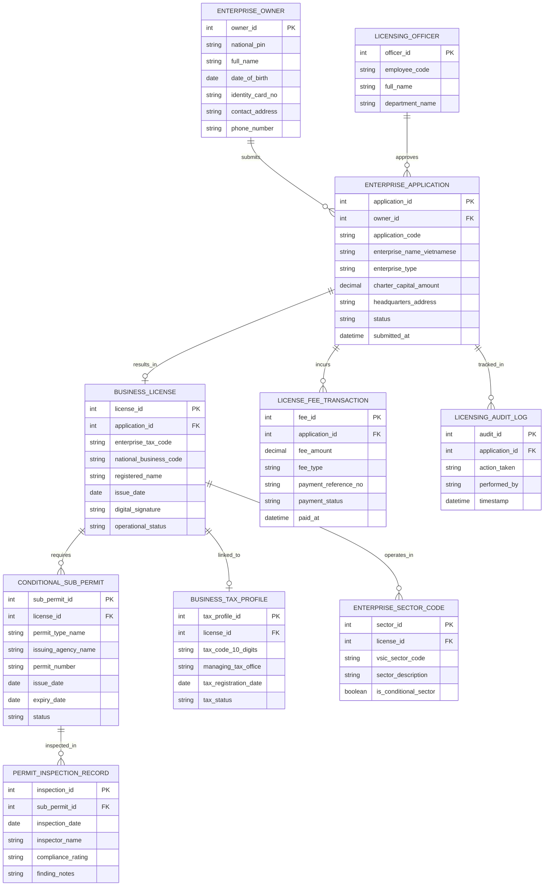

# Conceptual ERD — Business License & Permit System

## Mermaid Code

## Entity Description Table | Bảng mô tả Entity

| # | Entity Name | Vietnamese Name | Description | Key Attributes | Main Relationships |
|---|-------------|-----------------|-------------|----------------|-------------------|
| 1 | ENTERPRISE_OWNER | Chủ Doanh nghiệp / Người ĐDPL | Thông tin cá nhân người sáng lập hoặc người đại diện theo pháp luật | owner_id, national_pin, full_name, identity_card_no, contact_address | Submits ENTERPRISE_APPLICATION |
| 2 | ENTERPRISE_APPLICATION | Hồ sơ Đăng ký Doanh nghiệp | Thông tin hồ sơ đăng ký thành lập mới, thay đổi ĐKKD hoặc giải thể | application_id, application_code, enterprise_name_vietnamese, status | Belongs to ENTERPRISE_OWNER, results in BUSINESS_LICENSE |
| 3 | BUSINESS_LICENSE | Giấy chứng nhận Đăng ký Doanh nghiệp | Giấy chứng nhận đăng ký kinh doanh chính thức kèm mã số thuế 10 số | license_id, enterprise_tax_code, national_business_code, operational_status | Results from APPLICATION, requires SUB_PERMIT |
| 4 | CONDITIONAL_SUB_PERMIT | Giấy phép Kinh doanh Có điều kiện | Danh mục các giấy phép con (PCCC, Môi trường, An toàn thực phẩm) | sub_permit_id, permit_type_name, issuing_agency_name, status | Belongs to BUSINESS_LICENSE, inspected in INSPECTION_RECORD |
| 5 | BUSINESS_TAX_PROFILE | Hồ sơ Thuế Doanh nghiệp | Thông tin quản lý thuế liên thông của doanh nghiệp tại cơ quan thuế | tax_profile_id, tax_code_10_digits, managing_tax_office, tax_status | Linked to BUSINESS_LICENSE |
| 6 | ENTERPRISE_SECTOR_CODE | Mã Ngành nghề Kinh doanh (VSIC) | Danh mục mã ngành nghề kinh doanh cấp 4 theo Phân ngành kinh tế Việt Nam | sector_id, vsic_sector_code, sector_description, is_conditional_sector | Belongs to BUSINESS_LICENSE |
| 7 | LICENSING_OFFICER | Cán bộ Đăng ký Kinh doanh | Thông tin chuyên viên Sở Kế hoạch & Đầu tư thẩm định hồ sơ | officer_id, employee_code, full_name, department_name | Approves ENTERPRISE_APPLICATION |
| 8 | PERMIT_INSPECTION_RECORD | Biên bản Hậu kiểm Giấy phép Con | Kết quả kiểm tra điều kiện thực địa của các cơ quan chuyên ngành | inspection_id, inspection_date, inspector_name, compliance_rating | Belongs to CONDITIONAL_SUB_PERMIT |
| 9 | LICENSE_FEE_TRANSACTION | Giao dịch Lệ phí Đăng ký | Chứng từ nộp lệ phí đăng ký kinh doanh và phí công bố thông tin | fee_id, fee_amount, fee_type, payment_status, paid_at | Belongs to ENTERPRISE_APPLICATION |
| 10 | LICENSING_AUDIT_LOG | Nhật ký Kiểm toán Cấp phép | Lưu toàn bộ lịch sử luân chuyển, phê duyệt hồ sơ và thời gian SLA | audit_id, action_taken, performed_by, timestamp | Belongs to ENTERPRISE_APPLICATION |

## Relationship Description | Mô tả Quan hệ

| # | From Entity | Cardinality | To Entity | Relationship Label | Business Explanation |
|---|-------------|-------------|-----------|-------------------|----------------------|
| 1 | ENTERPRISE_OWNER | one-to-many | ENTERPRISE_APPLICATION | submits | Một cá nhân chủ doanh nghiệp có thể nộp nhiều hồ sơ đăng ký kinh doanh |
| 2 | ENTERPRISE_APPLICATION | one-to-one | BUSINESS_LICENSE | results_in | Một hồ sơ thành lập hợp lệ cấp ra duy nhất một Giấy chứng nhận ĐKKD |
| 3 | BUSINESS_LICENSE | one-to-many | CONDITIONAL_SUB_PERMIT | requires | Một doanh nghiệp có thể phải xin nhiều Giấy phép con đối với ngành có điều kiện |
| 4 | BUSINESS_LICENSE | one-to-one | BUSINESS_TAX_PROFILE | linked_to | Mỗi doanh nghiệp liên thông duy nhất với một hồ sơ quản lý thuế 10 số |
| 5 | BUSINESS_LICENSE | one-to-many | ENTERPRISE_SECTOR_CODE | operates_in | Một doanh nghiệp đăng ký hoạt động trong nhiều mã ngành nghề kinh doanh |
| 6 | CONDITIONAL_SUB_PERMIT | one-to-many | PERMIT_INSPECTION_RECORD | inspected_in | Một giấy phép con trải qua nhiều đợt kiểm tra hậu kiểm của cơ quan chức năng |
| 7 | ENTERPRISE_APPLICATION | one-to-many | LICENSE_FEE_TRANSACTION | incurs | Một hồ sơ đăng ký doanh nghiệp phát sinh các khoản nộp lệ phí đăng ký |
| 8 | LICENSING_OFFICER | one-to-many | ENTERPRISE_APPLICATION | approves | Một cán bộ đăng ký kinh doanh thẩm định và duyệt nhiều hồ sơ thành lập |
| 9 | ENTERPRISE_APPLICATION | one-to-many | LICENSING_AUDIT_LOG | tracked_in | Mọi thao tác xử lý hồ sơ đều được ghi lại nhật ký kiểm toán bất biến |
