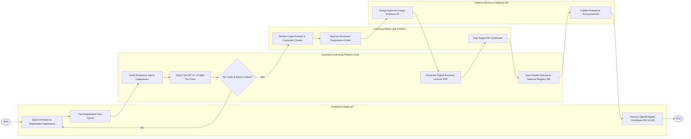

# Swimlane Diagram — Business License & Permit System

## Mermaid Code

## Flow Description | Mô tả luồng

| Lane | Actor | Role in Flow |
|------|-------|-------------|
| 1 | Enterprise Applicant | Nộp hồ sơ đăng ký thành lập doanh nghiệp trực tuyến, nộp lệ phí công bố và nhận Giấy phép kinh doanh điện tử. |
| 2 | Business Licensing Platform Core | Kiểm tra trùng tên doanh nghiệp, liên thông API Thuế sinh Mã số thuế 10 số, tạo Giấy phép điện tử và đồng bộ CSDL Quốc gia. |
| 3 | Licensing Officer (Sở KH&ĐT) | Thẩm định tính hợp lệ của Điều lệ và hồ sơ nhân thân, duyệt quyết định cấp phép và ký số pháp lý PKI. |
| 4 | National Business Registry DB | Cấp mã số doanh nghiệp quốc gia duy nhất và tự động công bố thông tin đăng ký doanh nghiệp trên Cổng thông tin. |
