# Action Tree — Business License & Permit System

## Mermaid Code

```mermaid
graph TD
    Root["Business License & Permit System"]

    Root --> M1["Initial Enterprise Registration"]
    Root --> M2["Conditional Sub-Permit Management"]
    Root --> M3["License Amendments & Status Changes"]
    Root --> M4["Tax Integration & Digital Certificate"]
    Root --> M5["Fee Processing & SLA Audit"]
    Root --> M6["National Analytics & Business Sync"]

    M1 --> A11["Register New Enterprise Application"]
    M1 --> A12["Check Enterprise Name Uniqueness"]
    M1 --> A13["Verify Founder Identity VNeID"]
    M1 --> A14["Classify VSIC Sector Business Codes"]

    M2 --> A21["Apply Conditional Sub-Permit Licenses"]
    M2 --> A22["Route Files Fire Safety Agencies"]
    M2 --> A23["Route Files Environmental Agencies"]
    M2 --> A24["Conduct Field Inspection Verification"]

    M3 --> A31["Process Corporate Charter Amendments"]
    M3 --> A32["Process Capital Increase Reductions"]
    M3 --> A33["Process Operation Suspension Notices"]
    M3 --> A34["Issue License Revocation Orders"]

    M4 --> A41["Request 10-Digit Tax Code Tax System"]
    M4 --> A42["Issue Signed Digital Certificate PDF"]
    M4 --> A43["Embed QR Code Verification Token"]
    M4 --> A44["Update Legal Representative Profile"]

    M5 --> A51["Process Licensing Fee E-Payments"]
    M5 --> A52["Publish National Business Notices"]
    M5 --> A53["Audit Officer 3-Day SLA Compliance"]
    M5 --> A54["Issue Refusal Amendment Notices"]

    M6 --> A61["Sync Master Database National Registry"]
    M6 --> A62["Export MPI Enterprise Growth Stats"]
    M6 --> A63["Log System Immutable Audit Ledgers"]
    M6 --> A64["Export Foreign Direct Investment FDI"]
```

## Module Description | Mô tả Module

| # | Module | Description | Actions |
|---|--------|-------------|---------|
| 1 | Initial Enterprise Registration | Tiếp nhận hồ sơ đăng ký thành lập doanh nghiệp mới, kiểm tra trùng tên, xác thực định danh sáng lập và chọn mã ngành VSIC | Register New Enterprise Application, Check Enterprise Name Uniqueness, Verify Founder Identity VNeID, Classify VSIC Sector Business Codes |
| 2 | Conditional Sub-Permit Management | Quản lý thủ tục xin cấp Giấy phép con đối với 227 ngành nghề có điều kiện, liên thông PCCC, Môi trường và kiểm tra thực địa | Apply Conditional Sub-Permit Licenses, Route Files Fire Safety Agencies, Route Files Environmental Agencies, Conduct Field Inspection Verification |
| 3 | License Amendments & Status Changes | Xử lý các thủ tục thay đổi đăng ký kinh doanh, tăng giảm vốn, tạm ngừng hoạt động, giải thể và thu hồi Giấy phép | Process Corporate Charter Amendments, Process Capital Increase Reductions, Process Operation Suspension Notices, Issue License Revocation Orders |
| 4 | Tax Integration & Digital Certificate | Liên thông cấp Mã số thuế 10 số, phát hành Giấy chứng nhận đăng ký doanh nghiệp điện tử kèm QR và quản lý người đại diện | Request 10-Digit Tax Code Tax System, Issue Signed Digital Certificate PDF, Embed QR Code Verification Token, Update Legal Representative Profile |
| 5 | Fee Processing & SLA Audit | Thu lệ phí đăng ký và công bố thông tin doanh nghiệp, kiểm toán thời gian xử lý hồ sơ SLA 03 ngày làm việc | Process Licensing Fee E-Payments, Publish National Business Notices, Audit Officer 3-Day SLA Compliance, Issue Refusal Amendment Notices |
| 6 | National Analytics & Business Sync | Đồng bộ CSDL Đăng ký Doanh nghiệp Quốc gia, phân tích tốc độ phát triển doanh nghiệp nộp Bộ KH&ĐT | Sync Master Database National Registry, Export MPI Enterprise Growth Stats, Log System Immutable Audit Ledgers, Export Foreign Direct Investment FDI |
