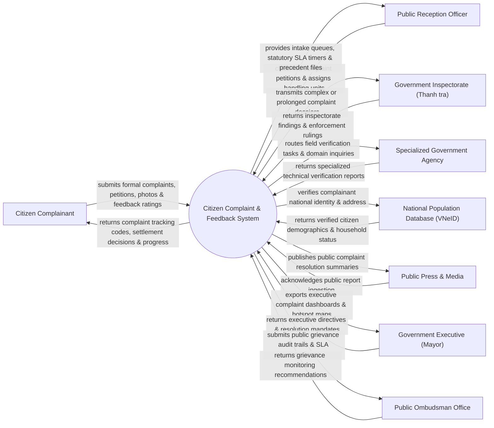

# Context Diagram — Citizen Complaint & Feedback System

## Mermaid Code

## Actor & Interaction Table | Bảng Actor & Tương tác

| # | Actor | Actor Type | Data Sent TO System | Data Received FROM System | Notes |
|---|-------|------------|---------------------|---------------------------|-------|
| 1 | Citizen Complainant | Primary | Formal complaint petition, land/administrative evidence, feedback rating | Complaint tracking code, verification schedule, settlement decision | Công dân gửi đơn khiếu nại, tố cáo, kiến nghị phản ánh chính quyền |
| 2 | Public Reception Officer | Primary | Petition classification codes, assigned department, handling deadline | Intake queues, precedent case files, statutory SLA countdown | Cán bộ Trực tiếp dân / Phòng Tiếp công dân thuộc UBND các cấp |
| 3 | Government Inspectorate (Thanh tra) | Primary | Inspection team decisions, formal audit rulings, disciplinary orders | Prolonged complaint dossiers, field verification evidence logs | Cơ quan Thanh tra Nhà nước giải quyết khiếu nại lần 2/phức tạp |
| 4 | Specialized Government Agency | Supporting | Technical land measurement logs, environmental test results | Field verification task orders, domain inquiry requests | Các Sở/Phòng chuyên môn (Sở TN&MT, Sở Xây dựng) xác minh thực địa |
| 5 | National Population Database (VNeID) | Supporting | Citizen 12-digit PIN, verified address, demographic details | Identity verification query requests | Cơ sở dữ liệu quốc gia về dân cư xác thực nhân thân người nộp đơn |
| 6 | Public Press & Media | Supporting | Media inquiry parameters | Published complaint settlement summaries, public notices | Báo chí truyền thông theo dõi công khai kết quả giải quyết khiếu nại |
| 7 | Government Executive (Mayor) | Primary | Special resolution mandates, priority investigation directives | Executive BI complaint dashboards, regional hotspot maps | Chủ tịch UBND Tỉnh/Thành phố/Quận/Huyện chỉ đạo giải quyết |
| 8 | Public Ombudsman Office | Regulatory | Ombudsman oversight guidelines, compliance inquiry queries | Grievance audit ledgers, statutory SLA compliance reports | Ban Dân nguyện / Cơ quan giám sát của HĐND và Quốc hội |

## System Boundary Description | Mô tả Phạm vi Hệ thống

Hệ thống Citizen Complaint & Feedback System (Hệ thống Tiếp nhận và Giải quyết Khiếu nại, Tố cáo, Kiến nghị Phản ánh của Công dân / 1022) chịu trách nhiệm tự động hóa quy trình tiếp dân và xử lý đơn thư chính quyền: Tiếp nhận đơn khiếu nại/tố cáo (trực tiếp hoặc qua Cổng Dịch vụ công), xác thực nhân thân qua VNeID, phân loại xử lý đơn thư (Đơn đủ điều kiện / Không đủ điều kiện), phân công cán bộ thụ lý, giám sát thời hạn giải quyết theo Luật Khiếu nại tố cáo, công khai Quyết định giải quyết và đánh giá mức độ hài lòng của công dân. Tuy nhiên, hệ thống KHÔNG trực tiếp thụ lý các đơn khiếu nại thuộc thẩm quyền của Tòa án Nhân dân và KHÔNG thay thế việc cưỡng chế thi hành quyết định ngoài thực địa.
