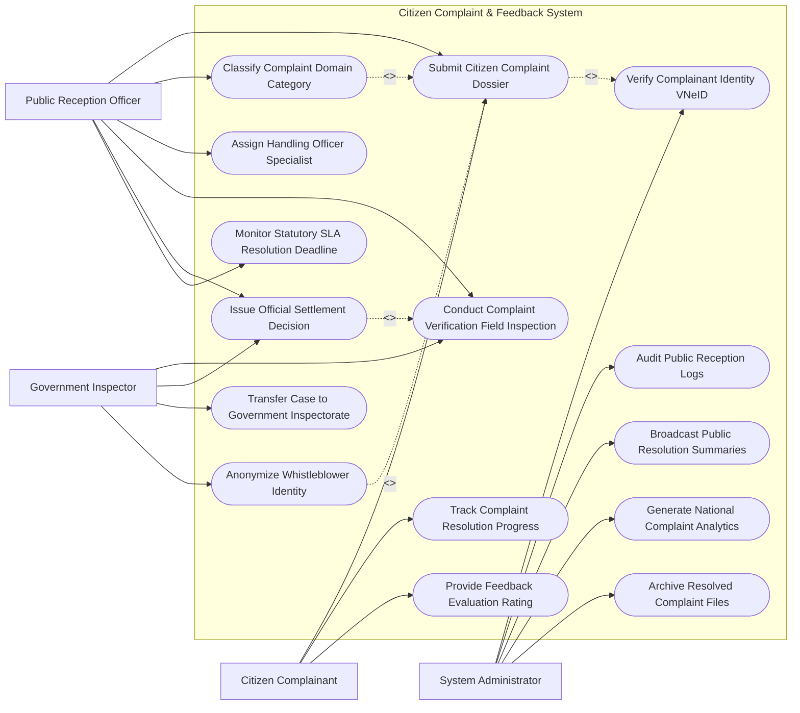

# Use Case Diagram — Citizen Complaint & Feedback System

## Mermaid Code

## Actor Table | Bảng Actor

| # | Actor | Actor Type | Role Description | Related Use Cases |
|---|-------|------------|------------------|-------------------|
| 1 | Citizen Complainant | Primary | Công dân gửi đơn khiếu nại, tố giác, theo dõi tiến độ và đánh giá độ hài lòng | UC01, UC07, UC08 |
| 2 | Public Reception Officer | Primary | Cán bộ tiếp dân tiếp nhận, phân loại đơn thư, thụ lý và ra quyết định giải quyết | UC01, UC03, UC04, UC05, UC06, UC09 |
| 3 | Government Inspector | Primary | Thanh tra viên xác minh thực địa, thẩm định đơn khiếu nại lần 2 và bảo vệ tố giác | UC05, UC06, UC10, UC12 |
| 4 | System Administrator | System | Quản trị viên đối soát VNeID, giám sát SLA, công khai kết quả và xuất báo cáo | UC02, UC11, UC13, UC14, UC15 |

## Use Case Table | Bảng Use Case

| # | UC ID | Use Case Name | Primary Actor | Secondary Actor | Description | Priority |
|---|-------|---------------|---------------|-----------------|-------------|----------|
| 1 | UC01 | Submit Citizen Complaint Dossier | Citizen | Officer, VNeID | Gửi đơn khiếu nại, tố cáo, kiến nghị phản ánh kèm ảnh chứng cứ trực tuyến | High |
| 2 | UC02 | Verify Complainant Identity VNeID | System | VNeID | Tự động đối soát nhân thân người nộp đơn qua CSDL Quốc gia về Dân cư | High |
| 3 | UC03 | Classify Complaint Domain Category | Officer | - | Phân loại đơn thư (Khiếu nại Đất đai, Tố cáo Tham nhũng, Phản ánh Hạ tầng) | High |
| 4 | UC04 | Assign Handling Officer Specialist | Officer | - | Phân công cán bộ thụ lý chuyên trách và thành lập Đoàn xác minh | High |
| 5 | UC05 | Conduct Complaint Verification Field Inspection | Officer, Inspector | SpecializedAgency | Khảo sát thực địa, đối thoại trực tiếp và lập Biên bản xác minh khiếu nại | High |
| 6 | UC06 | Issue Official Settlement Decision | Officer, Inspector | Citizen | Ban hành Quyết định giải quyết khiếu nại (hoặc Kết luận tố cáo) có chữ ký số | High |
| 7 | UC07 | Track Complaint Resolution Progress | Citizen | - | Tra cứu tiến độ giải quyết đơn thư theo thời gian thực bằng Mã hồ sơ | High |
| 8 | UC08 | Provide Feedback Evaluation Rating | Citizen | - | Công dân đánh giá mức độ hài lòng (1-5 sao) đối với kết quả giải quyết | Medium |
| 9 | UC09 | Monitor Statutory SLA Resolution Deadline | Officer | Executive | Đồng hồ tự động đếm ngược thời hạn giải quyết theo Luật (30-45 ngày) | High |
| 10 | UC10 | Transfer Case to Government Inspectorate | Inspector | - | Chuyển đơn khiếu nại phức tạp hoặc khiếu nại lần 2 lên Thanh tra Tỉnh/Bộ | High |
| 11 | UC11 | Audit Public Reception Logs | Admin | Ombudsman | Kiểm toán nhật ký các buổi tiếp công dân định kỳ của Lãnh đạo | Medium |
| 12 | UC12 | Anonymize Whistleblower Identity | Inspector | System | Mã hóa tuyệt đối thông tin cá nhân của người tố cáo để bảo vệ an toàn | High |
| 13 | UC13 | Broadcast Public Resolution Summaries | Admin | PublicPress | Công khai tóm tắt kết quả giải quyết khiếu nại tố cáo trên Cổng thông tin | Medium |
| 14 | UC14 | Generate National Complaint Analytics | Admin | Executive | Phân tích bản đồ nhiệt các điểm nóng khiếu nại nộp Chủ tịch UBND | Low |
| 15 | UC15 | Archive Resolved Complaint Files | System | NationalArchives | Đóng gói và lưu trữ vĩnh viễn hồ sơ giải quyết khiếu nại đã hoàn thành | Low |

## Use Case Specification | Đặc tả Use Case

---

### UC01 — Submit Citizen Complaint Dossier

| Field | Detail |
|-------|--------|
| **UC ID** | UC01 |
| **Use Case Name** | Submit Citizen Complaint Dossier |
| **Actor(s)** | Primary: Citizen Complainant / Secondary: Public Reception Officer, VNeID |
| **Description** | Công dân gửi Đơn khiếu nại, Đơn tố cáo hoặc Đơn kiến nghị phản ánh trực tuyến kèm hình ảnh, video chứng cứ. |
| **Precondition** | 1. Công dân đăng nhập tài khoản VNeID mức 2 hoặc Chữ ký số cá nhân. |
| **Main Flow** | 1. Complainant truy cập Cổng Tiếp nhận Đơn thư Khiếu nại Phản ánh (1022).   2. Complainant chọn loại đơn: Đơn khiếu nại (về quyết định hành chính/hành vi hành chính), Đơn tố cáo, Đơn kiến nghị phản ánh.   3. System kết nối VNeID tự động điền thông tin người nộp đơn (Họ tên, Số CCCD, Địa chỉ cư trú).   4. Complainant chọn Cơ quan có thẩm quyền giải quyết (UBND Tỉnh/Thành phố/Quận/Huyện/Sở).   5. Complainant nhập Tóm tắt nội dung khiếu nại, thời gian diễn ra vụ việc và yêu cầu giải quyết.   6. Complainant tải lên tệp đính kèm: Đơn khiếu nại có chữ ký, tệp ảnh chụp hiện trường, giấy tờ nhà đất, văn bản liên quan.   7. System tự động kiểm tra loại đơn (Nếu là đơn tố cáo: Cho phép chọn chế độ Bảo vệ người tố cáo - UC12).   8. System cấp Mã hồ sơ khiếu nại (Complaint Ticket ID) và phát hành Giấy biên nhận hồ sơ điện tử gửi cho Complainant. |
| **Alternative Flow** | **AF1** — Nộp đơn trực tiếp tại Trụ sở Tiếp công dân: Officer tiếp nhận đơn giấy, quét scan tệp và nhập dữ liệu vào hệ thống thay cho công dân. |
| **Exception Flow** | **EX1** — Đơn trùng lặp hoặc đơn đã có bản án Tòa án đã có hiệu lực: System tự động phát hiện trùng lặp, ra thông báo từ chối thụ lý và hướng dẫn công dân. |
| **Postcondition** | Đơn thư được ghi nhận vào Sổ tiếp nhận đơn thư, sẵn sàng cho khâu phân loại và phân công thụ lý (UC03, UC04). |
| **Business Rule** | **BR1**: Thời hạn phân loại và xử lý đơn thư ban đầu không quá 07 ngày làm việc kể từ ngày nhận đơn. |

---

### UC02 — Verify Complainant Identity VNeID

| Field | Detail |
|-------|--------|
| **UC ID** | UC02 |
| **Use Case Name** | Verify Complainant Identity VNeID |
| **Actor(s)** | Primary: System Administrator / Secondary: VNeID Core System |
| **Description** | Hệ thống tự động truy vấn CSDL Quốc gia về Dân cư để xác thực chính xác thông tin nhân thân của người đứng đơn khiếu nại. |
| **Precondition** | 1. Đơn khiếu nại (UC01) được gửi lên hệ thống. |
| **Main Flow** | 1. System trích xuất Số định danh cá nhân (CCCD 12 số) của Complainant từ đơn nộp.   2. System gửi yêu cầu API xác thực nhân thân tới CSDL Quốc gia về Dân cư (VNeID).   3. VNeID Core xác thực thông tin: Họ và tên, Ngày sinh, Giới tính, Địa chỉ thường trú, Trạng thái tài khoản (Đang hoạt động/Đã mất).   4. VNeID Core trả về kết quả: "Xác thực nhân thân hợp lệ (Identity Verified)".   5. System ghi nhận thông tin xác thực vào Hồ sơ khiếu nại và chuyển trạng thái "Đủ điều kiện thụ lý về mặt nhân thân".   6. System thông báo cho cán bộ tiếp dân về kết quả xác thực nhân thân thành công. |
| **Alternative Flow** | **AF1** — Người nộp đơn là Ủy quyền pháp lý (Luật sư/Đại diện): System yêu cầu nộp thêm Văn bản ủy quyền hợp pháp có công chứng. |
| **Exception Flow** | **EX1** — Đơn mạo danh (Số CCCD không tồn tại hoặc không khớp họ tên): System đánh dấu "Đơn không đủ điều kiện xử lý do giả mạo nhân thân" và lưu sổ đơn nặc danh. |
| **Postcondition** | Đơn khiếu nại đảm bảo tính chính chủ pháp lý, loại bỏ hoàn toàn tình trạng đơn mạo danh ảo. |
| **Business Rule** | **BR1**: Đơn khiếu nại bắt buộc phải xác định được rõ họ tên, địa chỉ của người khiếu nại theo quy định Luật Khiếu nại. |

---

### UC05 — Conduct Complaint Verification Field Inspection

| Field | Detail |
|-------|--------|
| **UC ID** | UC05 |
| **Use Case Name** | Conduct Complaint Verification Field Inspection |
| **Actor(s)** | Primary: Public Reception Officer, Government Inspector / Secondary: Specialized Agency |
| **Description** | Đoàn xác minh tiến hành đo đạc thực địa, thu thập chứng cứ, làm việc với các bên liên quan và tổ chức đối thoại trực tiếp. |
| **Precondition** | 1. Đơn khiếu nại đã có Quyết định thụ lý và Quyết định thành lập Đoàn xác minh (UC04). |
| **Main Flow** | 1. Inspector mở ứng dụng Nhật ký Xác minh Khiếu nại trên máy tính bảng.   2. Inspector lập Kế hoạch xác minh: Xác định nội dung cần xác minh, danh sách mốc thời gian làm việc.   3. Inspector đến khảo sát hiện trường thực địa (Đo đạc ranh giới đất tranh chấp, kiểm tra công trình vi phạm, đo kiểm ô nhiễm).   4. Inspector chụp ảnh hiện trường có gắn định vị GPS và tải trực tiếp lên hồ sơ vụ việc.   5. Inspector tổ chức Buổi làm việc đối thoại trực tiếp giữa Người khiếu nại và Cơ quan bị khiếu nại.   6. Inspector lập Biên bản đối thoại giải quyết khiếu nại và Biên bản xác minh thực địa.   7. Các bên tham gia ký số/ký tên vào biên bản.   8. Inspector biên soạn Báo cáo kết quả xác minh nội dung khiếu nại gửi Lãnh đạo ra Quyết định (UC06). |
| **Alternative Flow** | **AF1** — Đối thoại không thành (Hai bên không thống nhất): Inspector ghi nhận ý kiến bảo lưu của các bên vào Biên bản đối thoại không thành để làm căn cứ ban hành quyết định. |
| **Exception Flow** | **EX1** — Người khiếu nại cố tình vắng mặt quá 2 lần không có lý do: Đoàn xác minh lập biên bản vắng mặt và tiến hành ra quyết định dựa trên hồ sơ hiện có. |
| **Postcondition** | Báo cáo xác minh thực địa hoàn thành, làm căn cứ pháp lý cốt lõi để ban hành Quyết định giải quyết (UC06). |
| **Business Rule** | **BR1**: Việc đối thoại trực tiếp với người khiếu nại là bắt buộc trong quá trình giải quyết khiếu nại lần đầu. |

---

### UC06 — Issue Official Settlement Decision

| Field | Detail |
|-------|--------|
| **UC ID** | UC06 |
| **Use Case Name** | Issue Official Settlement Decision |
| **Actor(s)** | Primary: Public Reception Officer, Government Inspector / Secondary: Citizen |
| **Description** | Ban hành Quyết định giải quyết khiếu nại (hoặc Kết luận nội dung tố cáo) có chữ ký số pháp lý gửi cho công dân và đăng công khai. |
| **Precondition** | 1. Đã có Báo cáo kết quả xác minh khiếu nại và Biên bản đối thoại (UC05). |
| **Main Flow** | 1. Inspector dự thảo Quyết định giải quyết khiếu nại theo mẫu quy định (Mẫu số 22-KN).   2. Quyết định ghi rõ: Kết quả xác minh, Căn cứ pháp lý, Kết luận (Khiếu nại Đúng, Đúng một phần hoặc Sai toàn bộ), Nội dung bồi thường/khôi phục quyền lợi (nếu có).   3. Chủ tịch UBND / Thủ trưởng cơ quan xem xét và ký số Quyết định bằng Chữ ký số chuyên dùng PKI.   4. System tự động cấp Số Quyết định và đăng ký vào Sổ quyết định giải quyết khiếu nại.   5. System phát hành Quyết định bản điện tử PDF kèm mã QR gửi tới Tài khoản VNeID/Email của Complainant.   6. System tự động đăng tải Tóm tắt Quyết định giải quyết lên Cổng thông tin công khai (UC13).   7. System chuyển trạng thái hồ sơ thành "Đã giải quyết - Đang theo dõi thi hành". |
| **Alternative Flow** | **AF1** — Kết luận nội dung tố cáo: System phát hành Kết luận nội dung tố cáo và Quyết định xử lý hành vi vi phạm đối với người bị tố cáo. |
| **Exception Flow** | **EX1** — Công dân không đồng ý với Quyết định giải quyết lần đầu: System hướng dẫn công dân nộp Đơn khiếu nại lần hai lên Thanh tra Tỉnh (UC10) hoặc khởi kiện ra Tòa án Hành chính. |
| **Postcondition** | Quyết định giải quyết có hiệu lực thi hành, quyền lợi hợp pháp của công dân được khôi phục. |
| **Business Rule** | **BR1**: Quyết định giải quyết khiếu nại phải được gửi cho người khiếu nại trong thời hạn 07 ngày kể từ ngày ban hành. |

---

### UC10 — Transfer Case to Government Inspectorate

| Field | Detail |
|-------|--------|
| **UC ID** | UC10 |
| **Use Case Name** | Transfer Case to Government Inspectorate |
| **Actor(s)** | Primary: Government Inspector / Secondary: None |
| **Description** | Chuyển giao toàn bộ hồ sơ vụ việc khiếu nại lần hai hoặc vụ việc có tính chất đặc biệt phức tạp lên Thanh tra Tỉnh / Thanh tra Bộ. |
| **Precondition** | 1. Công dân nộp đơn khiếu nại lần hai do không đồng ý với quyết định giải quyết lần đầu.   2. Hoặc vụ việc vượt quá thẩm quyền giải quyết của cấp Huyện/Sở. |
| **Main Flow** | 1. Inspector mở hồ sơ vụ việc khiếu nại lần hai.   2. System tự động kiểm tra thời hạn khiếu nại lần hai (Trong vòng 30 ngày kể từ ngày nhận quyết định lần đầu).   3. Inspector tập hợp toàn bộ tệp tài liệu: Đơn ban đầu, Biên bản xác minh lần 1, Quyết định giải quyết lần 1, Đơn khiếu nại lần 2 và chứng cứ mới.   4. Inspector lập Văn bản chuyển giao hồ sơ vụ việc sang Cơ quan Thanh tra cấp trên (Government Inspectorate).   5. Lãnh đạo duyệt và ký số Văn bản chuyển giao.   6. System đóng gói Gói hồ sơ điện tử e-Case PDF/A và truyền sang Hệ thống Quản lý Án Thanh tra.   7. Cơ quan Thanh tra cấp trên tiếp nhận hồ sơ, ký xác nhận Biên nhận liên thông và thụ lý giải quyết theo thẩm quyền lần hai.   8. System cập nhật trạng thái hồ sơ "Đã chuyển Thanh tra cấp trên thụ lý lần 2". |
| **Alternative Flow** | **AF1** — Phát hiện dấu hiệu tội phạm hình sự trong quá trình xác minh: Inspector lập hồ sơ chuyển giao ngay cho Cơ quan Cảnh sát Điều tra (Công an) xử lý theo Luật Tố tụng Hình sự. |
| **Exception Flow** | **EX1** — Quá thời hạn khiếu nại lần hai (> 30 ngày): System phát thông báo từ chối thụ lý lần hai, hướng dẫn công dân quyền khởi kiện ra Tòa án Hành chính. |
| **Postcondition** | Thẩm quyền giải quyết được chuyển giao cho Cơ quan Thanh tra cấp trên, đảm bảo tính khách quan tối đa. |
| **Business Rule** | **BR1**: Hồ sơ khiếu nại lần hai phải được Thanh tra cấp trên thụ lý giải quyết trong thời hạn không quá 45 ngày. |
