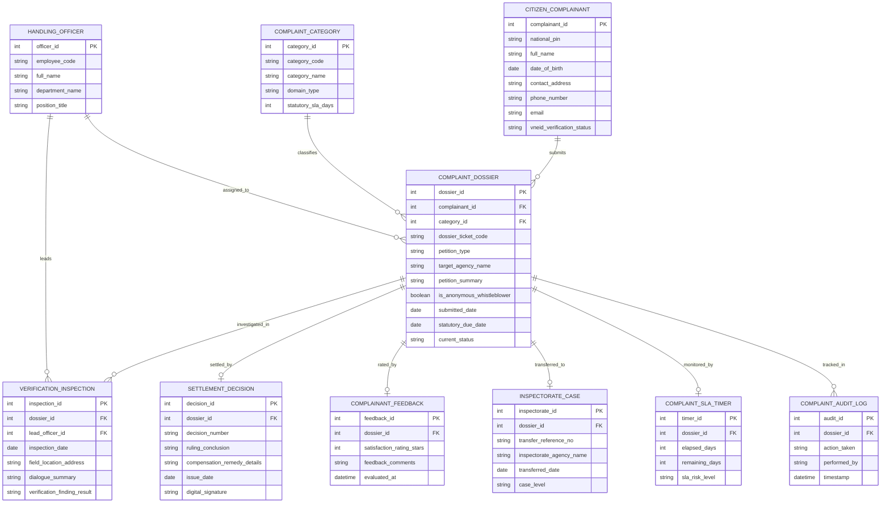

# Conceptual ERD — Citizen Complaint & Feedback System

## Mermaid Code

## Entity Description Table | Bảng mô tả Entity

| # | Entity Name | Vietnamese Name | Description | Key Attributes | Main Relationships |
|---|-------------|-----------------|-------------|----------------|-------------------|
| 1 | CITIZEN_COMPLAINANT | Người Nộp Đơn Khiếu nại | Thông tin công dân gửi đơn khiếu nại, tố cáo hoặc kiến nghị phản ánh | complainant_id, national_pin, full_name, vneid_verification_status | Submits COMPLAINT_DOSSIER |
| 2 | COMPLAINT_CATEGORY | Danh mục Phân loại Đơn thư | Danh mục lĩnh vực khiếu nại (Đất đai, Môi trường, Xây dựng, Hành chính) và SLA | category_id, category_code, category_name, statutory_sla_days | Classifies COMPLAINT_DOSSIER |
| 3 | COMPLAINT_DOSSIER | Hồ sơ Đơn thư Khiếu nại | Thông tin chi tiết đơn thư, loại đơn, tóm tắt nội dung và thời hạn xử lý | dossier_id, dossier_ticket_code, petition_type, current_status | Belongs to CITIZEN, CATEGORY, settled by SETTLEMENT_DECISION |
| 4 | HANDLING_OFFICER | Cán bộ Thụ lý Giải quyết | Thông tin cán bộ tiếp dân, chuyên viên thụ lý hoặc Trưởng đoàn xác minh | officer_id, employee_code, full_name, department_name | Assigned to COMPLAINT_DOSSIER, leads VERIFICATION_INSPECTION |
| 5 | VERIFICATION_INSPECTION | Biên bản Xác minh Thực địa | Chi tiết khảo sát hiện trường, thu thập chứng cứ và biên bản đối thoại | inspection_id, inspection_date, dialogue_summary, verification_finding_result | Belongs to COMPLAINT_DOSSIER, led by OFFICER |
| 6 | SETTLEMENT_DECISION | Quyết định Giải quyết | Quyết định giải quyết khiếu nại chính thức có chữ ký số của lãnh đạo | decision_id, decision_number, ruling_conclusion, digital_signature | Belongs to COMPLAINT_DOSSIER |
| 7 | COMPLAINANT_FEEDBACK | Đánh giá Độ Hài lòng | Điểm đánh giá (1-5 sao) và nhận xét của công dân sau khi nhận kết quả | feedback_id, satisfaction_rating_stars, feedback_comments | Belongs to COMPLAINT_DOSSIER |
| 8 | INSPECTORATE_CASE | Hồ sơ Chuyển Thanh tra | Thông tin chuyển đơn khiếu nại lần 2 hoặc đơn phức tạp lên Thanh tra | inspectorate_id, transfer_reference_no, inspectorate_agency_name | Belongs to COMPLAINT_DOSSIER |
| 9 | COMPLAINT_SLA_TIMER | Đồng hồ Giám sát SLA | Đếm ngược số ngày còn lại để giải quyết đơn thư theo Luật Khiếu nại | timer_id, elapsed_days, remaining_days, sla_risk_level | Belongs to COMPLAINT_DOSSIER |
| 10 | COMPLAINT_AUDIT_LOG | Nhật ký Kiểm toán Đơn thư | Lưu vết toàn bộ lịch sử luân chuyển, sửa đổi, gia hạn và ban hành quyết định | audit_id, action_taken, performed_by, timestamp | Belongs to COMPLAINT_DOSSIER |

## Relationship Description | Mô tả Quan hệ

| # | From Entity | Cardinality | To Entity | Relationship Label | Business Explanation |
|---|-------------|-------------|-----------|-------------------|----------------------|
| 1 | CITIZEN_COMPLAINANT | one-to-many | COMPLAINT_DOSSIER | submits | Một công dân có thể nộp nhiều đơn khiếu nại, phản ánh khác nhau |
| 2 | COMPLAINT_CATEGORY | one-to-many | COMPLAINT_DOSSIER | classifies | Một loại danh mục lĩnh vực phân loại cho nhiều hồ sơ đơn thư |
| 3 | COMPLAINT_DOSSIER | one-to-many | VERIFICATION_INSPECTION | investigated_in | Một đơn khiếu nại có thể trải qua nhiều đợt khảo sát xác minh thực địa |
| 4 | COMPLAINT_DOSSIER | one-to-one | SETTLEMENT_DECISION | settled_by | Mỗi hồ sơ khiếu nại kết thúc bằng duy nhất một Quyết định giải quyết |
| 5 | COMPLAINT_DOSSIER | one-to-one | COMPLAINANT_FEEDBACK | rated_by | Mỗi hồ sơ giải quyết xong được công dân đánh giá duy nhất một lượt feedback |
| 6 | COMPLAINT_DOSSIER | one-to-one | INSPECTORATE_CASE | transferred_to | Một hồ sơ phức tạp có thể được chuyển sang một vụ án Thanh tra cấp trên |
| 7 | COMPLAINT_DOSSIER | one-to-one | COMPLAINT_SLA_TIMER | monitored_by | Mỗi hồ sơ đơn thư được gắn duy nhất một đồng hồ đếm ngược SLA |
| 8 | HANDLING_OFFICER | one-to-many | VERIFICATION_INSPECTION | leads | Một cán bộ thụ lý có thể làm trưởng đoàn nhiều cuộc xác minh thực địa |
| 9 | HANDLING_OFFICER | one-to-many | COMPLAINT_DOSSIER | assigned_to | Một cán bộ được phân công phụ trách thụ lý giải quyết nhiều đơn thư |
| 10 | COMPLAINT_DOSSIER | one-to-many | COMPLAINT_AUDIT_LOG | tracked_in | Mọi thao tác trên hồ sơ đơn thư được ghi lại nhật ký kiểm toán bất biến |
