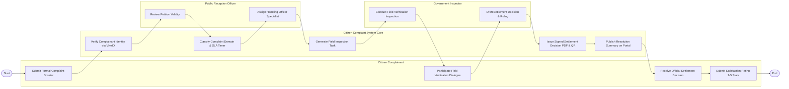

# Swimlane Diagram — Citizen Complaint & Feedback System

## Mermaid Code

## Flow Description | Mô tả luồng

| Lane | Actor | Role in Flow |
|------|-------|-------------|
| 1 | Citizen Complainant | Nộp đơn khiếu nại/phản ánh trực tuyến, tham gia đối thoại thực địa, nhận quyết định giải quyết và đánh giá mức độ hài lòng. |
| 2 | Citizen Complaint System Core | Tự động xác thực VNeID, phân loại danh mục và đếm ngược SLA, tạo gói nhiệm vụ xác minh, phát hành quyết định điện tử và công khai. |
| 3 | Public Reception Officer | Rà soát tính hợp lệ của đơn thư ban đầu và phân công cán bộ thụ lý chuyên trách. |
| 4 | Government Inspector | Khảo sát thực địa, tổ chức đối thoại trực tiếp với công dân, biên soạn Báo cáo xác minh và dự thảo Quyết định giải quyết. |
