# Action Tree — Citizen Complaint & Feedback System

## Mermaid Code

```mermaid
graph TD
    Root["Citizen Complaint & Feedback System"]

    Root --> M1["Complaint Intake & Identity Verification"]
    Root --> M2["Classification & Officer Assignment"]
    Root --> M3["Verification & Field Inspection"]
    Root --> M4["Settlement Decision & Enforcement"]
    Root --> M5["Citizen Feedback & SLA Tracking"]
    Root --> M6["Analytics & Inspectorate Reporting"]

    M1 --> A11["Submit Online Complaint Petition"]
    M1 --> A12["Verify Identity Complainant VNeID"]
    M1 --> A13["Anonymize Whistleblower Profiles"]
    M1 --> A14["Issue Electronic Intake Receipts"]

    M2 --> A21["Classify Complaint Categories Land Admin"]
    M2 --> A22["Assign Lead Handling Officers"]
    M2 --> A23["Establish Joint Inspection Teams"]
    M2 --> A24["Filter Duplicate Invalid Petitions"]

    M3 --> A31["Conduct On-Site Field Measurements"]
    M3 --> A32["Organize Direct Citizen Dialogue"]
    M3 --> A33["Record Field Inspection Summary"]
    M3 --> A34["Request Technical Agency Opinions"]

    M4 --> A41["Draft Official Settlement Decision"]
    M4 --> A42["Apply PKI Executive Digital Signature"]
    M4 --> A43["Broadcast Public Resolution Summaries"]
    M4 --> A44["Transfer Cases Government Inspectorate"]

    M5 --> A51["Track Statutory 30-Day SLA Countdown"]
    M5 --> A52["Collect Citizen Rating 1-5 Stars"]
    M5 --> A53["Notify Real-time Petition Progress"]
    M5 --> A54["Issue Overdue Escalation Alerts"]

    M6 --> A61["Render Regional Hotspot GIS Maps"]
    M6 --> A62["Export Ombudsman Oversight Reports"]
    M6 --> A63["Log System Immutable Audit Ledgers"]
    M6 --> A64["Archive Resolved Cases National Record"]
```

## Module Description | Mô tả Module

| # | Module | Description | Actions |
|---|--------|-------------|---------|
| 1 | Complaint Intake & Identity Verification | Tiếp nhận đơn khiếu nại/tố cáo/phản ánh trực tuyến, xác thực VNeID, bảo mật thông tin người tố cáo và phát hành biên nhận | Submit Online Complaint Petition, Verify Identity Complainant VNeID, Anonymize Whistleblower Profiles, Issue Electronic Intake Receipts |
| 2 | Classification & Officer Assignment | Phân loại đơn thư theo lĩnh vực (Đất đai, Môi trường, Hành chính), phân công cán bộ thụ lý và lọc đơn trùng lặp | Classify Complaint Categories Land Admin, Assign Lead Handling Officers, Establish Joint Inspection Teams, Filter Duplicate Invalid Petitions |
| 3 | Verification & Field Inspection | Khảo sát đo đạc thực địa, tổ chức đối thoại trực tiếp với công dân, lấy ý kiến chuyên môn và lập biên bản xác minh | Conduct On-Site Field Measurements, Organize Direct Citizen Dialogue, Record Field Inspection Summary, Request Technical Agency Opinions |
| 4 | Settlement Decision & Enforcement | Dự thảo Quyết định giải quyết khiếu nại, ký số PKI lãnh đạo, công khai kết quả và chuyển đơn phức tạp lên Thanh tra | Draft Official Settlement Decision, Apply PKI Executive Digital Signature, Broadcast Public Resolution Summaries, Transfer Cases Government Inspectorate |
| 5 | Citizen Feedback & SLA Tracking | Theo dõi thời hạn đếm ngược SLA 30-45 ngày, thu thập đánh giá hài lòng (1-5 sao) của công dân và cảnh báo trễ hạn | Track Statutory 30-Day SLA Countdown, Collect Citizen Rating 1-5 Stars, Notify Real-time Petition Progress, Issue Overdue Escalation Alerts |
| 6 | Analytics & Inspectorate Reporting | Phân tích bản đồ nhiệt các điểm nóng khiếu nại GIS, trích xuất báo cáo Ban Dân nguyện và lưu trữ hồ sơ lịch sử | Render Regional Hotspot GIS Maps, Export Ombudsman Oversight Reports, Log System Immutable Audit Ledgers, Archive Resolved Cases National Record |
