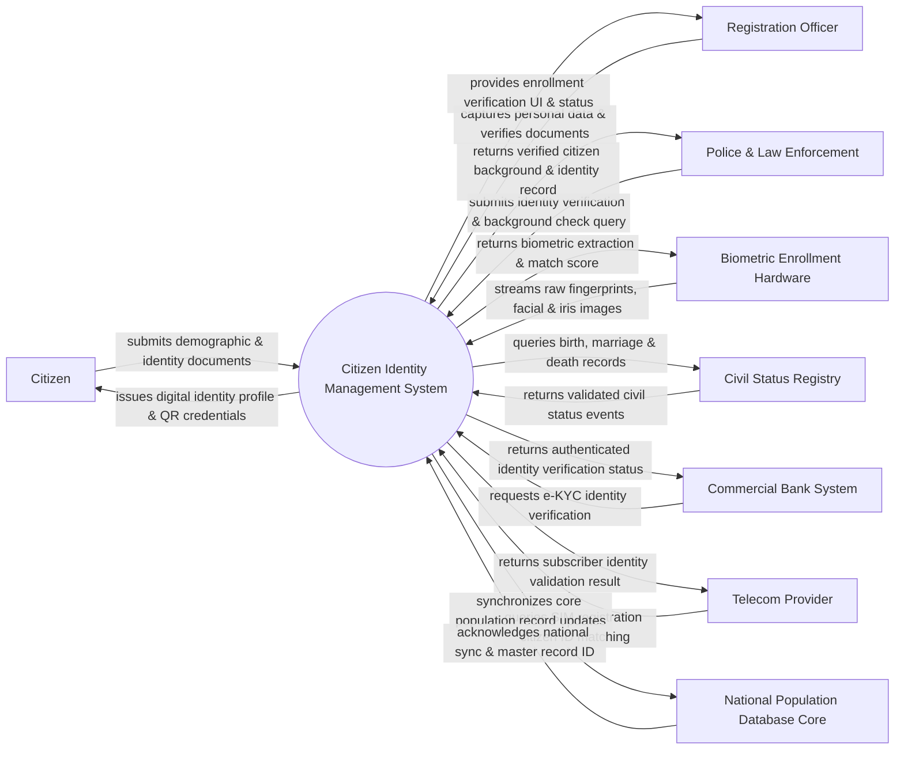

# Context Diagram — Citizen Identity Management System

## Mermaid Code

## Actor & Interaction Table | Bảng Actor & Tương tác

| # | Actor | Actor Type | Data Sent TO System | Data Received FROM System | Notes |
|---|-------|------------|---------------------|---------------------------|-------|
| 1 | Citizen | Primary | Demographic information, physical ID documents, biometric samples | Digital identity certificate, personal identity QR code | Công dân thực hiện đăng ký và sử dụng định danh cá nhân |
| 2 | Registration Officer | Primary | Document verification status, enrollment validation approval | Enrollment task queue, document scanning feedback | Cán bộ công an/hành chính tại trạm đăng ký định danh |
| 3 | Police & Law Enforcement | Primary | Identity check queries, criminal background verification requests | Verified identity dossier, biometric matching report | Cơ quan công an thực hiện xác minh nhân thân và truy vết |
| 4 | Biometric Enrollment Hardware | Supporting | Raw fingerprint images, high-res facial photos, iris scans | Capture quality score, feature extraction confirmation | Thiết bị phần cứng quét vân tay, chụp ảnh chân dung và mống mắt |
| 5 | Civil Status Registry | Supporting | Certified birth certificates, marriage statuses, death notices | Citizen ID reference, civil status change confirmation | Hệ thống cơ sở dữ liệu hộ tịch (khai sinh, kết hôn, khai tử) |
| 6 | Commercial Bank System | Supporting | e-KYC validation requests, citizen ID query parameters | Verified demographic token, e-KYC approval status | Hệ thống ngân hàng thương mại xác thực định danh khách hàng |
| 7 | Telecom Provider | Supporting | Phone subscriber identity matching request | Subscriber identity validation status | Nhà mạng viễn thông xác thực chủ sở hữu thuê bao di động |
| 8 | National Population Database Core | Regulatory | Master population policy rules, national ID number block | Synchronized population updates, new enrollment data | Cơ sở dữ liệu quốc gia về dân cư lưu trữ gốc dữ liệu định danh |

## System Boundary Description | Mô tả Phạm vi Hệ thống

Hệ thống Citizen Identity Management System (Hệ thống Quản lý Định danh Công dân) chịu trách nhiệm thu thập, lưu trữ, quản lý và xác thực thông tin định danh cá nhân của toàn bộ công dân trong quốc gia. Hệ thống bao gồm phân hệ thu thập dữ liệu nhân khẩu học, thu thập và đối soát sinh trắc học (vân tay, khuôn mặt, mống mắt), quản lý mã số định danh cá nhân duy nhất và cung cấp dịch vụ xác thực e-KYC cho các bên thứ ba. Tuy nhiên, hệ thống KHÔNG trực tiếp sản xuất vật lý thẻ Căn cước nhựa (do Hệ thống Cấp phát Căn cước đảm nhận riêng), KHÔNG thay thế cơ sở dữ liệu hộ tịch tư pháp và KHÔNG lưu trữ dữ liệu giao dịch tài chính của công dân tại các ngân hàng.
