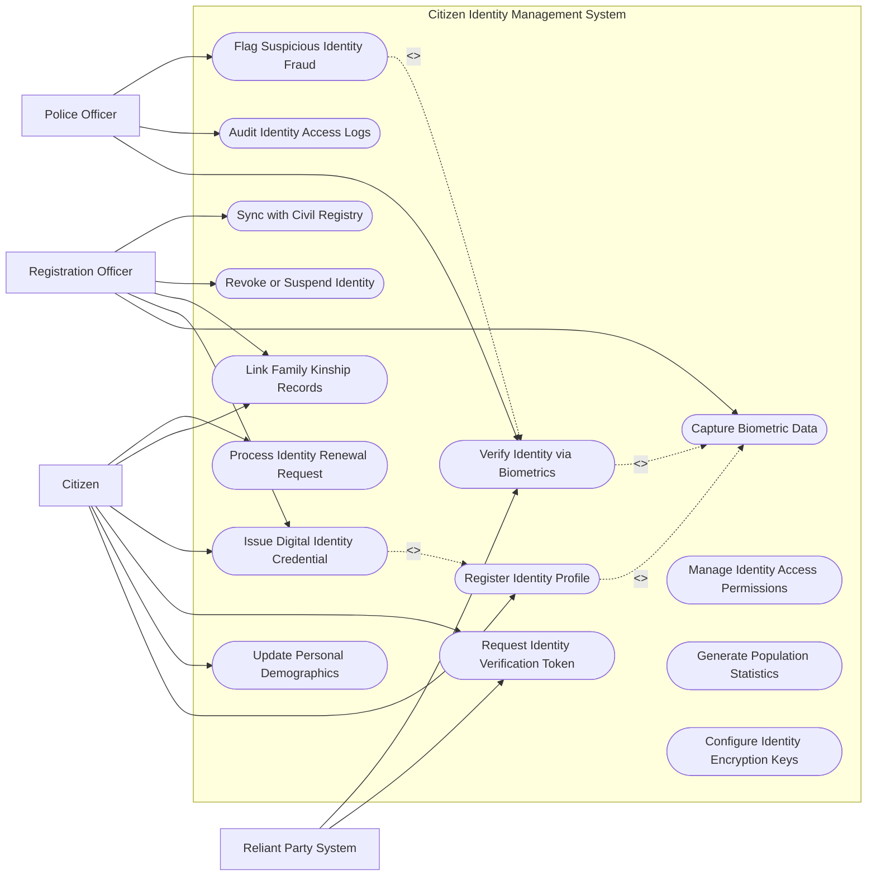

# Use Case Diagram — Citizen Identity Management System

## Mermaid Code

## Actor Table | Bảng Actor

| # | Actor | Actor Type | Role Description | Related Use Cases |
|---|-------|------------|------------------|-------------------|
| 1 | Citizen | Primary | Công dân thực hiện đăng ký, cập nhật và yêu cầu xác thực định danh | UC01, UC03, UC04, UC05, UC07, UC13 |
| 2 | Registration Officer | Primary | Cán bộ thu thập sinh trắc học và thẩm định hồ sơ định danh | UC02, UC05, UC07, UC08, UC11 |
| 3 | Police Officer | Primary | Cán bộ điều tra xác minh sinh trắc học và xử lý gian lận định danh | UC06, UC09, UC14 |
| 4 | Reliant Party System | Supporting | Hệ thống bên thứ ba (Ngân hàng, Viễn thông) gửi yêu cầu xác thực e-KYC | UC04, UC06 |

## Use Case Table | Bảng Use Case

| # | UC ID | Use Case Name | Primary Actor | Secondary Actor | Description | Priority |
|---|-------|---------------|---------------|-----------------|-------------|----------|
| 1 | UC01 | Register Identity Profile | Citizen | Registration Officer | Khởi tạo thông tin hồ sơ định danh cá nhân mới | High |
| 2 | UC02 | Capture Biometric Data | Registration Officer | Biometric Scanner | Thu thập dữ liệu vân tay, khuôn mặt và mống mắt | High |
| 3 | UC03 | Update Personal Demographics | Citizen | Registration Officer | Cập nhật thay đổi thông tin cư trú, trình độ, nghề nghiệp | Medium |
| 4 | UC04 | Request Identity Verification Token | ReliantParty | Citizen | Phát hành mã token xác thực định danh cho ứng dụng ngân hàng | High |
| 5 | UC05 | Issue Digital Identity Credential | Registration Officer | Citizen | Cấp chứng thư định danh số VNeID và mã QR pháp lý | High |
| 6 | UC06 | Verify Identity via Biometrics | ReliantParty, Police | Biometric Scanner | Đối soát mẫu sinh trắc học trực tiếp với CSDL quốc gia | High |
| 7 | UC07 | Link Family Kinship Records | Citizen | Civil Registry | Phân loại và tạo liên kết quan hệ hộ gia đình, nhân thân | Medium |
| 8 | UC08 | Revoke or Suspend Identity | Registration Officer | - | Tạm khóa hoặc hủy định danh khi công dân mất tích/tước quốc tịch | High |
| 9 | UC09 | Audit Identity Access Logs | Police | - | Truy vết lịch sử các bên thứ ba tra cứu thông tin công dân | Medium |
| 10 | UC10 | Manage Identity Access Permissions | SysAdmin | - | Phân quyền truy cập các trường dữ liệu định danh theo quy định | High |
| 11 | UC11 | Sync with Civil Registry | Registration Officer | Civil Registry | Đồng bộ dữ liệu biến động khai sinh, khai tử từ tư pháp | High |
| 12 | UC12 | Generate Population Statistics | SysAdmin | - | Trích xuất báo cáo thống kê dân số theo độ tuổi, giới tính, vùng | Low |
| 13 | UC13 | Process Identity Renewal Request | Citizen | Registration Officer | Đổi hoặc cấp lại định danh số khi hết hạn hoặc mất thiết bị | Medium |
| 14 | UC14 | Flag Suspicious Identity Fraud | Police | - | Đánh dấu cảnh báo giả mạo định danh hoặc dùng hồ sơ giả | High |
| 15 | UC15 | Configure Identity Encryption Keys | SysAdmin | Security System | Quản lý khóa mã hóa dữ liệu sinh trắc học và chứng thư số | High |

## Use Case Specification | Đặc tả Use Case

---

### UC01 — Register Identity Profile

| Field | Detail |
|-------|--------|
| **UC ID** | UC01 |
| **Use Case Name** | Register Identity Profile |
| **Actor(s)** | Primary: Citizen / Secondary: Registration Officer |
| **Description** | Tạo mới hồ sơ định danh cá nhân cho công dân bao gồm thông tin nhân khẩu học và số định danh cá nhân duy nhất. |
| **Precondition** | 1. Công dân đã có giấy khai sinh hợp pháp.   2. Trạm thu thập định danh hoạt động bình thường. |
| **Main Flow** | 1. Citizen xuất trình giấy khai sinh và giấy tờ tùy thân hợp lệ cho cán bộ.   2. Registration Officer nhập thông tin nhân khẩu (Họ tên, ngày sinh, quê quán, nơi thường trú).   3. System tự động kiểm tra xem thông tin đã tồn tại trong CSDL Dân cư hay chưa.   4. System khởi tạo Số định danh cá nhân (Personal Identification Number - PIN) 12 chữ số duy nhất.   5. System chuyển hồ sơ sang bước thu thập sinh trắc học (UC02).   6. System lưu trữ hồ sơ đăng ký ở trạng thái "Chờ xác minh sinh trắc". |
| **Alternative Flow** | **AF1** — Đăng ký trước qua ứng dụng trực tuyến: Citizen khai báo thông tin trước tại nhà, nhận mã hồ sơ. Khi tới trạm, cán bộ chỉ cần quét mã hồ sơ để lấy lại dữ liệu. |
| **Exception Flow** | **EX1** — Thông tin trùng lặp với công dân đã có: System đưa ra cảnh báo trùng lặp nhân khẩu, chặn khởi tạo mã mới và gửi hồ sơ sang bộ phận đối soát chuyên sâu. |
| **Postcondition** | Hồ sơ nhân khẩu học được khởi tạo thành công với mã định danh quốc gia duy nhất. |
| **Business Rule** | **BR1**: Số định danh cá nhân (12 số) phải bao gồm mã thế kỷ sinh, mã giới tính, mã tỉnh/thành phố và số ngẫu nhiên theo quy định Bộ Công an. |

---

### UC02 — Capture Biometric Data

| Field | Detail |
|-------|--------|
| **UC ID** | UC02 |
| **Use Case Name** | Capture Biometric Data |
| **Actor(s)** | Primary: Registration Officer / Secondary: Biometric Enrollment Hardware |
| **Description** | Thu thập các đặc trưng sinh trắc học (10 dấu vân tay, ảnh chân dung chuẩn ICAO và quét mống mắt) của công dân. |
| **Precondition** | 1. Hồ sơ định danh nhân khẩu (UC01) đã được tạo thành công trên hệ thống.   2. Thiết bị lấy mẫu sinh trắc được kết nối và hiệu chỉnh chuẩn. |
| **Main Flow** | 1. Officer lấy mẫu 10 dấu vân tay của Citizen qua máy quét quang học.   2. System kiểm tra chất lượng ảnh vân tay (NFIQ score >= 3/5).   3. Officer chụp ảnh khuôn mặt Citizen theo chuẩn khuôn mặt ICAO.   4. System tự động căn chỉnh và phân tích đặc điểm khuôn mặt.   5. Officer thực hiện quét mống mắt 2 bên mắt bằng thiết bị camera chuyên dụng.   6. System mã hóa tập hợp dữ liệu sinh trắc thành các file mẫu vector và đính kèm vào hồ sơ định danh. |
| **Alternative Flow** | **AF1** — Công dân bị khuyết tật ngón tay: Officer đánh dấu ngón tay bị khuyết tật trên sơ đồ bàn tay, System bỏ qua yêu cầu lấy mẫu ngón đó và ghi chú lý do pháp lý. |
| **Exception Flow** | **EX1** — Dữ liệu vân tay mờ không đủ chất lượng: System từ chối nhận mẫu, Officer làm sạch ngón tay và thực hiện lấy mẫu lại tối đa 3 lần. |
| **Postcondition** | Dữ liệu sinh trắc học được mã hóa an toàn và gắn chặt với mã định danh cá nhân của công dân. |
| **Business Rule** | **BR1**: Mẫu sinh trắc học gốc phải được chuyển đổi thành chuỗi đặc trưng vector mã hóa không thể đảo ngược trước khi lưu database. |

---

### UC06 — Verify Identity via Biometrics

| Field | Detail |
|-------|--------|
| **UC ID** | UC06 |
| **Use Case Name** | Verify Identity via Biometrics |
| **Actor(s)** | Primary: Reliant Party System, Police Officer / Secondary: Biometric Scanner |
| **Description** | Thực hiện đối soát dữ liệu sinh trắc học trực tiếp (1:1 hoặc 1:N) để xác minh danh tính thực sự của công dân. |
| **Precondition** | 1. Dữ liệu sinh trắc học của công dân đã tồn tại trong kho CSDL định danh quốc gia.   2. Bên yêu cầu xác thực có quyền truy cập API hợp lệ. |
| **Main Flow** | 1. ReliantParty gửi yêu cầu xác thực chứa ảnh khuôn mặt/vân tay vừa thu thập từ khách hàng.   2. System tiến hành kiểm tra chống giả mạo khuôn mặt (Liveness Detection).   3. System trích xuất mẫu đặc trưng sinh trắc học từ dữ liệu gửi lên.   4. System thực hiện thuật toán đối soát AFIS/ABIS với kho dữ liệu quốc gia.   5. System tính toán điểm tương đồng (Match Score).   6. System trả về kết quả "Xác thực thành công - Đúng danh tính" (nếu Match Score >= 98%) kèm thông tin định danh tương ứng. |
| **Alternative Flow** | **AF1** — Đối soát 1:1 theo Mã định danh: Bên yêu cầu gửi kèm Số định danh cá nhân. System thực hiện đối soát trực tiếp 1:1 thay vì tìm kiếm 1:N toàn bộ database để tăng tốc độ. |
| **Exception Flow** | **EX1** — Phát hiện giả mạo khuôn mặt (Liveness failed): System từ chối xác thực, ghi log sự cố an ninh và gửi thông báo giả mạo (UC14).   **EX2** — Điểm tương đồng dưới ngưỡng: System trả về kết quả "Xác thực thất bại - Không khớp sinh trắc". |
| **Postcondition** | Kết quả đối soát sinh trắc học được ghi lại vào nhật ký truy vết với mốc thời gian rõ ràng. |
| **Business Rule** | **BR1**: Thời gian phản hồi giao dịch đối soát sinh trắc học 1:1 qua API không được vượt quá 1.5 giây. |

---

### UC05 — Issue Digital Identity Credential

| Field | Detail |
|-------|--------|
| **UC ID** | UC05 |
| **Use Case Name** | Issue Digital Identity Credential |
| **Actor(s)** | Primary: Registration Officer / Secondary: Citizen |
| **Description** | Cấp phát tài khoản định danh điện tử mức độ 2 trên ứng dụng di động cho công dân sau khi hồ sơ được duyệt. |
| **Precondition** | 1. Hồ sơ nhân khẩu và sinh trắc học đã hoàn thành và phê duyệt pháp lý.   2. Công dân cung cấp số điện thoại chính chủ. |
| **Main Flow** | 1. Registration Officer phê duyệt lệnh cấp tài khoản định danh điện tử trên hệ thống quản trị.   2. System khởi tạo cặp khóa mã hóa công khai/bảo mật (PKI Keypair) cho công dân.   3. System sinh mã kích hoạt (Activation Code) và gửi qua tin nhắn SMS tới số điện thoại công dân.   4. Citizen tải ứng dụng VNeID, nhập Số định danh và Mã kích hoạt.   5. Citizen thiết lập mật khẩu và mã PIN bảo mật cá nhân.   6. System xác nhận kích hoạt thành công và tải chứng thư định danh số về thiết bị công dân. |
| **Alternative Flow** | **AF1** — Kích hoạt qua NFC Căn cước công dân: Citizen tự quét chip NFC trên thẻ CCCD nhựa bằng điện thoại di động để tự kích hoạt tài khoản mức 1 mà không cần cán bộ duyệt. |
| **Exception Flow** | **EX1** — Mã kích hoạt SMS hết hạn (quá 3 ngày): System vô hiệu mã cũ, Citizen chọn "Gửi lại mã kích hoạt" để nhận mã mới. |
| **Postcondition** | Tài khoản định danh điện tử mức 2 được kích hoạt thành công trên thiết bị di động cá nhân của công dân. |
| **Business Rule** | **BR1**: Mỗi tài khoản định danh điện tử chỉ được kích hoạt hoạt động trên duy nhất 1 thiết bị di động tại một thời điểm. |

---

### UC07 — Link Family Kinship Records

| Field | Detail |
|-------|--------|
| **UC ID** | UC07 |
| **Use Case Name** | Link Family Kinship Records |
| **Actor(s)** | Primary: Citizen / Secondary: Civil Registry |
| **Description** | Quản lý và liên kết cây quan hệ gia đình (bố, mẹ, vợ/chồng, con cái) dựa trên dữ liệu hộ tịch và định danh cá nhân. |
| **Precondition** | 1. Các thành viên trong gia đình đều đã có số định danh cá nhân trên hệ thống. |
| **Main Flow** | 1. Citizen hoặc Officer chọn tính năng "Quản lý quan hệ nhân thân".   2. System hiển thị thông tin các thành viên hiện tại có liên kết quan hệ.   3. Citizen nhập Số định danh cá nhân của người thân cần liên kết (ví dụ: Con mới sinh hoặc Vợ/Chồng mới kết hôn).   4. System truy vấn Cơ sở dữ liệu Hộ tịch để kiểm tra Giấy chứng nhận kết hôn hoặc Giấy khai sinh tương ứng.   5. System xác nhận quan hệ pháp lý hợp lệ.   6. System tự động tạo đường liên kết quan hệ nhân thân hai chiều trong cơ sở dữ liệu. |
| **Alternative Flow** | **AF1** — Hủy liên kết quan hệ (Khi ly hôn): Khi có Quyết định ly hôn từ Tòa án, Officer cập nhật trạng thái, System cắt liên kết Vợ/Chồng và lưu lịch sử quan hệ cũ. |
| **Exception Flow** | **EX1** — Dữ liệu hộ tịch không khớp quan hệ khai báo: System từ chối tạo liên kết và yêu cầu công dân xuất trình bản gốc giấy tờ hộ tịch tại cơ quan Công an để xác minh thủ công. |
| **Postcondition** | Cây quan hệ nhân thân gia đình được cập nhật chuẩn xác trong Cơ sở dữ liệu dân cư quốc gia. |
| **Business Rule** | **BR1**: Quan hệ Vợ/Chồng tại một thời điểm chỉ được phép tồn tại duy nhất 1 liên kết hoạt động (tuân thủ Luật Hôn nhân & Gia đình). |
