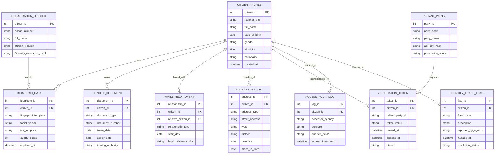

# Conceptual ERD — Citizen Identity Management System

## Mermaid Code

## Entity Description Table | Bảng mô tả Entity

| # | Entity Name | Vietnamese Name | Description | Key Attributes | Main Relationships |
|---|-------------|-----------------|-------------|----------------|-------------------|
| 1 | CITIZEN_PROFILE | Hồ sơ Định danh Công dân | Lưu trữ thông tin nhân khẩu học cốt lõi của công dân | citizen_id, national_pin, full_name, date_of_birth | Has BIOMETRIC_DATA, owns IDENTITY_DOCUMENT |
| 2 | BIOMETRIC_DATA | Dữ liệu Sinh trắc học | Lưu trữ mã mẫu vector vân tay, khuôn mặt và mống mắt mã hóa | biometric_id, fingerprint_template, facial_vector | Belongs to CITIZEN_PROFILE, enrolled by OFFICER |
| 3 | IDENTITY_DOCUMENT | Giấy tờ Định danh | Thông tin các giấy tờ tùy thân (Giấy khai sinh, CCCD, Hộ chiếu) | document_id, document_type, document_number | Belongs to CITIZEN_PROFILE |
| 4 | FAMILY_RELATIONSHIP | Quan hệ Nhân thân | Mối quan hệ gia đình giữa các định danh công dân | relationship_id, relationship_type, legal_reference_doc | Links two CITIZEN_PROFILE entities |
| 5 | ADDRESS_HISTORY | Lịch sử Cư trú | Quản lý thông tin thường trú, tạm trú và nơi ở hiện tại | address_id, address_type, street_address, province | Belongs to CITIZEN_PROFILE |
| 6 | VERIFICATION_TOKEN | Mã Xác thực Định danh | Mã token phục vụ xác thực e-KYC cho bên thứ ba | token_id, token_value, status, expires_at | Belongs to CITIZEN_PROFILE, requested by RELIANT_PARTY |
| 7 | ACCESS_AUDIT_LOG | Nhật ký Truy vết Truy cập | Ghi lại thông tin các cơ quan/bên thứ ba truy vấn định danh công dân | log_id, accessor_agency, queried_fields | Belongs to CITIZEN_PROFILE |
| 8 | REGISTRATION_OFFICER | Cán bộ Đăng ký Định danh | Công chức/công an thu thập và phê duyệt định danh | officer_id, badge_number, station_location | Enrolls BIOMETRIC_DATA |
| 9 | RELIANT_PARTY | Bên Thu nhập / Sử dụng Định danh | Tổ chức bên thứ ba (Ngân hàng, Ví điện tử) tích hợp API e-KYC | party_id, party_code, permission_scope | Requests VERIFICATION_TOKEN |
| 10 | IDENTITY_FRAUD_FLAG | Cảnh báo Gian lận Định danh | Hồ sơ ghi nhận các dấu hiệu giả mạo, nghi vấn gian lận nhân thân | flag_id, fraud_type, resolution_status | Belongs to CITIZEN_PROFILE |

## Relationship Description | Mô tả Quan hệ

| # | From Entity | Cardinality | To Entity | Relationship Label | Business Explanation |
|---|-------------|-------------|-----------|-------------------|----------------------|
| 1 | CITIZEN_PROFILE | one-to-many | BIOMETRIC_DATA | has | Một công dân có thể có nhiều phiên bản cập nhật sinh trắc học |
| 2 | CITIZEN_PROFILE | one-to-many | IDENTITY_DOCUMENT | owns | Một công dân sở hữu nhiều loại giấy tờ pháp lý khác nhau |
| 3 | CITIZEN_PROFILE | one-to-many | FAMILY_RELATIONSHIP | linked_with | Một công dân liên kết quan hệ gia đình với nhiều công dân khác |
| 4 | CITIZEN_PROFILE | one-to-many | ADDRESS_HISTORY | resides_at | Một công dân lưu vết lịch sử di chuyển và các địa chỉ cư trú |
| 5 | CITIZEN_PROFILE | one-to-many | VERIFICATION_TOKEN | authenticated_by | Một công dân sinh ra nhiều mã xác thực e-KYC trong các giao dịch |
| 6 | CITIZEN_PROFILE | one-to-many | ACCESS_AUDIT_LOG | audited_in | Mọi lượt tra cứu định danh công dân đều ghi vào nhật ký kiểm toán |
| 7 | CITIZEN_PROFILE | one-to-many | IDENTITY_FRAUD_FLAG | flagged_by | Hồ sơ công dân có thể ghi nhận cảnh báo nghi vấn gian lận |
| 8 | RELIANT_PARTY | one-to-many | VERIFICATION_TOKEN | requests | Một bên thứ ba gửi nhiều yêu cầu tạo token xác thực e-KYC |
| 9 | REGISTRATION_OFFICER | one-to-many | BIOMETRIC_DATA | enrolls | Một cán bộ thực hiện lấy mẫu sinh trắc cho nhiều công dân |
