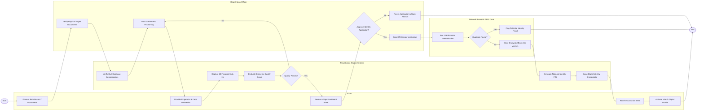

# Swimlane Diagram — Citizen Identity Management System

## Mermaid Code

## Flow Description | Mô tả luồng

| Lane | Actor | Role in Flow |
|------|-------|-------------|
| 1 | Citizen | Xuất trình giấy tờ gốc, hợp tác lấy mẫu sinh trắc học, ký xác nhận phiếu thu nhận và kích hoạt tài khoản định danh số. |
| 2 | Registration Station System | Kiểm tra dữ liệu nhân khẩu trên máy trạm, lấy mẫu sinh trắc, đánh giá chất lượng hình ảnh, khởi tạo số định danh 12 số và cấp chứng thư số. |
| 3 | Registration Officer | Kiểm tra đối soát giấy tờ gốc, hướng dẫn công dân lấy sinh trắc học và thực hiện thẩm định phê duyệt hồ sơ. |
| 4 | National Biometric ABIS Core | Hệ thống nhận dạng sinh trắc học tự động quốc gia thực hiện đối soát trùng lặp 1:N toàn bộ database để phát hiện gian lận và mã hóa lưu trữ vector sinh trắc. |
