# Action Tree — Citizen Identity Management System

## Mermaid Code

```mermaid
graph TD
    Root["Citizen Identity Management System"]

    Root --> M1["Demographic Data Management"]
    Root --> M2["Biometric Enrollment & ABIS"]
    Root --> M3["Digital Identity Credentials"]
    Root --> M4["Kinship & Address Registry"]
    Root --> M5["Fraud Detection & Audit"]
    Root --> M6["Third-Party e-KYC Integration"]

    M1 --> A11["Register Demographic Record"]
    M1 --> A12["Generate National Identification PIN"]
    M1 --> A13["Update Residency & Demographics"]
    M1 --> A14["Sync Civil Status Birth and Death"]

    M2 --> A21["Capture 10-Fingerprint Scans"]
    M2 --> A22["Capture ICAO Facial Photograph"]
    M2 --> A23["Capture Dual-Iris Scans"]
    M2 --> A24["Execute 1:N Biometric ABIS Match"]

    M3 --> A31["Issue VNeID Digital Profile"]
    M3 --> A32["Generate Legal Digital Identity QR"]
    M3 --> A33["Renew Expired Identity Credentials"]
    M3 --> A34["Revoke/Suspend Identity Profile"]

    M4 --> A41["Link Family Kinship Relationships"]
    M4 --> A42["Track Residence Address History"]
    M4 --> A43["Export Household Record Extract"]
    M4 --> A44["Manage Guardianship Links"]

    M5 --> A51["Flag Suspicious Duplicate Identity"]
    M5 --> A52["Detect Liveness Spoofing Attacks"]
    M5 --> A53["Log Third-Party Access Audits"]
    M5 --> A54["Configure Security Encryption Keys"]

    M6 --> A61["Process Commercial Bank e-KYC"]
    M6 --> A62["Verify Telecom Subscriber ID"]
    M6 --> A63["Provide OAuth2 SSO Gateway"]
    M6 --> A64["Manage Reliant Party API Tokens"]
```

## Module Description | Mô tả Module

| # | Module | Description | Actions |
|---|--------|-------------|---------|
| 1 | Demographic Data Management | Quản lý thông tin nhân khẩu học cốt lõi, cấp số định danh cá nhân duy nhất và đồng bộ dữ liệu | Register Demographic Record, Generate National Identification PIN, Update Residency & Demographics, Sync Civil Status Birth and Death |
| 2 | Biometric Enrollment & ABIS | Thu thập và xử lý các đặc trưng sinh trắc học, thực hiện đối soát 1:N bằng hệ thống ABIS quốc gia | Capture 10-Fingerprint Scans, Capture ICAO Facial Photograph, Capture Dual-Iris Scans, Execute 1:N Biometric ABIS Match |
| 3 | Digital Identity Credentials | Cấp phát, gia hạn, thu hồi chứng thư định danh số và mã QR pháp lý trên thiết bị di động | Issue VNeID Digital Profile, Generate Legal Digital Identity QR, Renew Expired Identity Credentials, Revoke/Suspend Identity Profile |
| 4 | Kinship & Address Registry | Quản lý cây quan hệ nhân thân gia đình, lịch sử thường trú/tạm trú và trích xuất thông tin hộ gia đình | Link Family Kinship Relationships, Track Residence Address History, Export Household Record Extract, Manage Guardianship Links |
| 5 | Fraud Detection & Audit | Cảnh báo giả mạo định danh, phát hiện tấn công sinh trắc học và kiểm toán nhật ký truy cập | Flag Suspicious Duplicate Identity, Detect Liveness Spoofing Attacks, Log Third-Party Access Audits, Configure Security Encryption Keys |
| 6 | Third-Party e-KYC Integration | Cung cấp giao diện API xác thực danh tính điện tử e-KYC cho ngân hàng, viễn thông và bên thứ ba | Process Commercial Bank e-KYC, Verify Telecom Subscriber ID, Provide OAuth2 SSO Gateway, Manage Reliant Party API Tokens |
