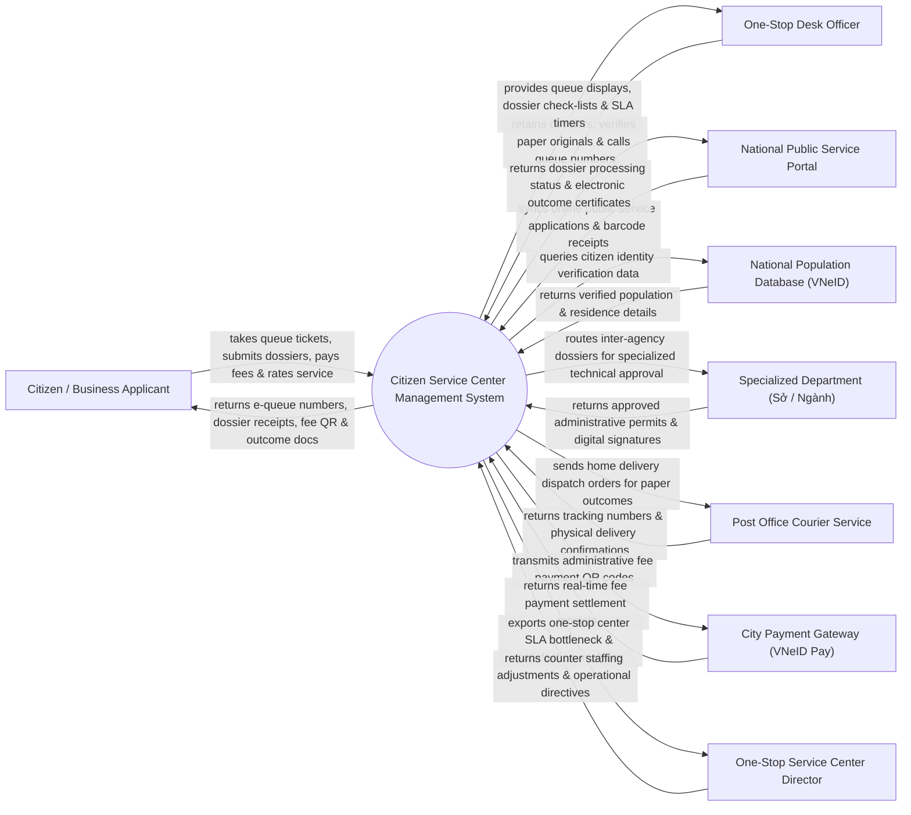

# Context Diagram — Citizen Service Center Management System

## Mermaid Code

## Actor & Interaction Table | Bảng Actor & Tương tác

| # | Actor | Actor Type | Data Sent TO System | Data Received FROM System | Notes |
|---|-------|------------|---------------------|---------------------------|-------|
| 1 | Citizen / Business Applicant | Primary | Queue ticket requests, administrative dossier files, fee payments | E-queue numbers, dossier receipts, fee QR, electronic outcome certificates | Công dân và Doanh nghiệp thực hiện thủ tục hành chính tại Trung tâm Hành chính công |
| 2 | One-Stop Desk Officer | Primary | Dossier reception confirmations, paper original verification notes | Queue displays, dossier checklists, SLA countdown timers | Cán bộ tiếp nhận và trả kết quả tại Quầy Một cửa |
| 3 | One-Stop Service Center Director | Primary | Counter staffing adjustments, SLA extension approvals, directives | One-stop center SLA bottleneck reports, citizen satisfaction BI | Giám đốc Trung tâm Phục vụ Hành chính công Tỉnh/Huyện |
| 4 | National Public Service Portal | Supporting | Online public service applications, barcode receipts, sync logs | Dossier processing status, electronic outcome certificates | Cổng Dịch vụ công Quốc gia (dichvucong.gov.vn) |
| 5 | National Population Database (VNeID) | Supporting | Verified population details, residence data, identity confirmations | Citizen identity verification queries | CSDL Quốc gia về Dân cư xác thực thông tin công dân |
| 6 | Specialized Department (Sở / Ngành) | Supporting | Approved administrative permits, digital signatures, rejection notes | Inter-agency dossiers routed for technical approval | Các Sở/Ngành chuyên môn (Sở KH&ĐT, Sở Xây dựng, Sở TN&MT) thẩm định |
| 7 | Post Office Courier Service | Supporting | Tracking numbers, physical delivery confirmations | Home delivery dispatch orders for paper outcomes | Bưu điện VNPost giao kết quả thủ tục hành chính tại nhà |
| 8 | City Payment Gateway (VNeID Pay) | Supporting | Real-time fee payment settlement receipts, transaction IDs | Administrative fee payment QR codes, amount instructions | Cổng thanh toán trực tuyến phí/lệ phí hành chính |

## System Boundary Description | Mô tả Phạm vi Hệ thống

Hệ thống Citizen Service Center Management System (Hệ thống Quản lý và Điều hành Trung tâm Phục vụ Hành chính công Đô thị / One-Stop Center System) chịu trách nhiệm tự động hóa toàn bộ quy trình tiếp nhận và trả kết quả thủ tục hành chính theo cơ chế Một cửa / Một cửa liên thông: Lấy số thứ tự thông minh tại Kiosk kiosk/VNeID, tiếp nhận hồ sơ hành chính, xác thực thông tin công dân qua VNeID, tự động luân chuyển hồ sơ sang các Sở/Ngành chuyên môn thẩm định, theo dõi hạn xử lý SLA (Đúng hạn/Trễ hạn), thanh toán phí/lệ phí trực tuyến, trả kết quả bản điện tử (văn bản ký số PKI) hoặc chuyển phát kết quả tại nhà qua Bưu điện và đánh giá mức độ hài lòng của công dân. Tuy nhiên, hệ thống KHÔNG trực tiếp thẩm định chuyên môn xây dựng/đất đai và KHÔNG thay thế việc ký phê duyệt của Giám đốc Sở chuyên ngành.
