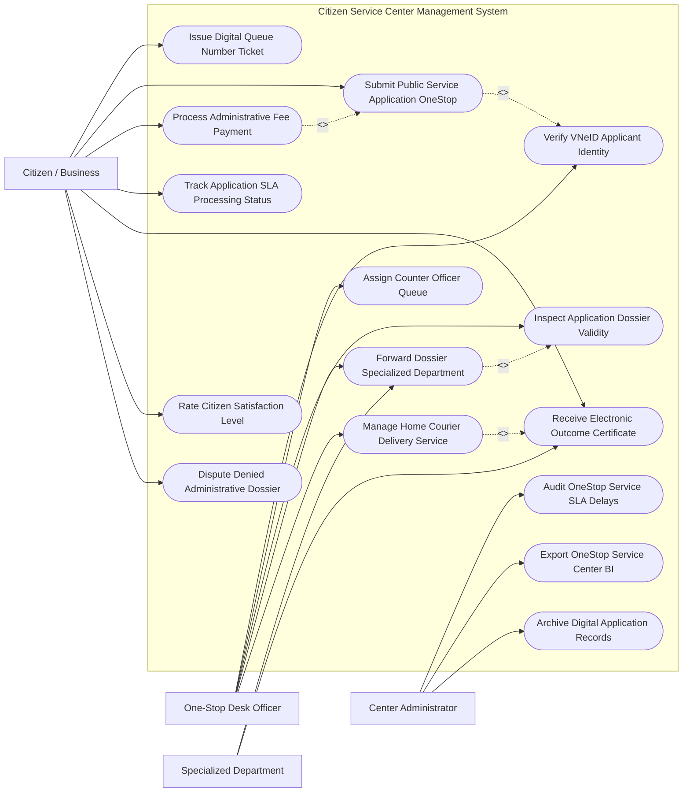

# Use Case Diagram — Citizen Service Center Management System

## Mermaid Code

## Actor Table | Bảng Actor

| # | Actor | Actor Type | Role Description | Related Use Cases |
|---|-------|------------|------------------|-------------------|
| 1 | Citizen / Business | Primary | Công dân/Doanh nghiệp lấy số thứ tự, nộp hồ sơ, nộp phí, tra cứu tiến độ, nhận kết quả và đánh giá | UC01, UC02, UC04, UC05, UC09, UC12, UC13 |
| 2 | One-Stop Desk Officer | Primary | Cán bộ Quầy Một cửa xác thực VNeID, kiểm tra tính hợp lệ của hồ sơ, gọi số và chuyển hồ sơ liên thông | UC03, UC06, UC07, UC08, UC10 |
| 3 | Specialized Department | Secondary | Các Sở/Ngành chuyên môn tiếp nhận hồ sơ liên thông, thẩm định chuyên môn và ký số kết quả điện tử | UC08, UC09 |
| 4 | Center Administrator | System | Quản trị viên Trung tâm theo dõi đôn đốc hạn xử lý SLA, xuất báo cáo chỉ số cải cách hành chính | UC11, UC14, UC15 |

## Use Case Table | Bảng Use Case

| # | UC ID | Use Case Name | Primary Actor | Secondary Actor | Description | Priority |
|---|-------|---------------|---------------|-----------------|-------------|----------|
| 1 | UC01 | Issue Digital Queue Number Ticket | Citizen | Kiosk | Lấy số thứ tự thông minh tại Kiosk hoặc hẹn giờ giao dịch trước qua ứng dụng di động VNeID | High |
| 2 | UC02 | Submit Public Service Application OneStop | Citizen, Officer | NationalPortal | Tiếp nhận và khởi tạo Hồ sơ thủ tục hành chính tại Quầy Một cửa hoặc Cổng dịch vụ công | High |
| 3 | UC03 | Verify VNeID Applicant Identity | Officer | VNeID | Quét mã QR CCCD/VNeID để tự động điền thông tin nhân thân và xác thực danh tính công dân | High |
| 4 | UC04 | Process Administrative Fee Payment | Citizen | PaymentGateway | Thanh toán phí, lệ phí giải quyết thủ tục hành chính trực tuyến qua mã QR VietQR / VNeID Pay | High |
| 5 | UC05 | Track Application SLA Processing Status | Citizen | SMS | Tra cứu tiến độ giải quyết hồ sơ thời gian thực qua mã QR Giấy tiếp nhận hoặc SMS | High |
| 6 | UC06 | Assign Counter Officer Queue | Officer | System | Hệ thống tự động phân bổ số thứ tự công dân vào Quầy tiếp nhận phù hợp đang rảnh | High |
| 7 | UC07 | Inspect Application Dossier Validity | Officer | - | Kiểm tra thành phần hồ sơ theo Danh mục quy định, cấp Giấy tiếp nhận và hẹn trả kết quả | High |
| 8 | UC08 | Forward Dossier Specialized Department | Officer | Department | Luân chuyển hồ sơ điện tử liên thông từ Trung tâm Một cửa sang các Sở/Ngành chuyên môn | High |
| 9 | UC09 | Receive Electronic Outcome Certificate | Citizen, Dept | NationalPortal | Trả Kết quả thủ tục hành chính bản điện tử (văn bản ký số PKI) vào Kho dữ liệu công dân | High |
| 10 | UC10 | Manage Home Courier Delivery Service | Officer | Courier | Đăng ký và chuyển phát Kết quả thủ tục hành chính bản giấy tận nhà qua Bưu điện VNPost | Medium |
| 11 | UC11 | Audit OneStop Service SLA Delays | Admin | Executive | Tự động phát cảnh báo hồ sơ trễ hạn SLA và đôn đốc các Sở/Ngành gửi Thư xin lỗi công dân | High |
| 12 | UC12 | Rate Citizen Satisfaction Level | Citizen | Kiosk | Công dân đánh giá mức độ hài lòng đối với thái độ phục vụ của Cán bộ quầy qua máy Kiosk đánh giá | High |
| 13 | UC13 | Dispute Denied Administrative Dossier | Citizen | Admin | Tiếp nhận và giải quyết khiếu nại của công dân đối với các hồ sơ bị từ chối không rõ lý do | Medium |
| 14 | UC14 | Export OneStop Service Center BI | Admin | Director | Trích xuất báo cáo Chỉ số Cải cách Hành chính (PAR INDEX) nộp Chủ tịch UBND Tỉnh | Low |
| 15 | UC15 | Archive Digital Application Records | System | Archives | Lưu trữ vĩnh viễn hồ sơ và kết quả giải quyết thủ tục hành chính điện tử theo quy định | Low |

## Use Case Specification | Đặc tả Use Case

---

### UC01 — Issue Digital Queue Number Ticket

| Field | Detail |
|-------|--------|
| **UC ID** | UC01 |
| **Use Case Name** | Issue Digital Queue Number Ticket |
| **Actor(s)** | Primary: Citizen / Business Applicant / Secondary: Kiosk Unit |
| **Description** | Công dân lấy số thứ tự thông minh tại máy Kiosk hoặc đặt lịch hẹn giờ giao dịch trước qua ứng dụng di động VNeID. |
| **Precondition** | 1. Công dân có mặt tại Trung tâm Phục vụ Hành chính công hoặc đặt lịch trực tuyến trước. |
| **Main Flow** | 1. Citizen đến Máy Kiosk lấy số thứ tự tại sảnh Trung tâm.   2. Citizen chọn lĩnh vực thủ tục cần giải quyết (Đất đai, Tư pháp, Đăng ký kinh doanh, Xây dựng, Lao động).   3. Citizen quét mã QR CCCD trên VNeID tại Kiosk.   4. Kiosk trích xuất thông tin: Họ tên, Mã định danh VNeID, Thủ tục đăng ký.   5. System tự động cấp Số thứ tự giao dịch (Ví dụ: Số A-102 dành cho Lĩnh vực Đất đai).   6. Kiosk in Phiếu lấy số thứ tự (hoặc gửi Số thứ tự điện tử vào ứng dụng VNeID).   7. System hiển thị Số thứ tự A-102 lên Màn hình điện tử tổng và thông báo thời gian chờ dự kiến (10 phút). |
| **Alternative Flow** | **AF1** — Đặt lịch hẹn giờ trực tuyến trên VNeID (Online Appointment): Công dân chọn Khung giờ $9h00-9h30$, khi đến Trung tâm chỉ cần quét mã QR đặt lịch để được ưu tiên gọi số. |
| **Exception Flow** | **EX1** — Máy Kiosk hết giấy in: Kiosk phát cảnh báo cho Nhân viên lễ tân, tự động chuyển sang chế độ gửi Phiếu số thứ tự qua tin nhắn Zalo/SMS. |
| **Postcondition** | Công dân nhận được số thứ tự thông minh, giảm thời gian xếp hàng chờ đợi thụ động. |
| **Business Rule** | **BR1**: Ưu tiên gọi số ngay lập tức đối với người cao tuổi, phụ nữ mang thai, người khuyết tật và các giao dịch đã đặt lịch hẹn trực tuyến. |

---

### UC02 — Submit Public Service Application OneStop

| Field | Detail |
|-------|--------|
| **UC ID** | UC02 |
| **Use Case Name** | Submit Public Service Application OneStop |
| **Actor(s)** | Primary: Citizen / Business Applicant, One-Stop Desk Officer / Secondary: National Public Service Portal |
| **Description** | Tiếp nhận, số hóa giấy tờ và nộp Hồ sơ thủ tục hành chính tại Quầy Một cửa hoặc nộp trực tuyến qua Cổng Dịch vụ công. |
| **Precondition** | 1. Công dân được gọi số thứ tự vào Quầy Một cửa (UC06) và mang theo đầy đủ thành phần hồ sơ. |
| **Main Flow** | 1. Officer chọn số thứ tự công dân vừa vào quầy.   2. Officer quét mã QR trên VNeID của công dân để xác thực nhân thân (UC03).   3. Officer kiểm tra danh mục thành phần hồ sơ nộp vs Quy trình chuẩn của thủ tục.   4. Officer quét (Scan) toàn bộ các giấy tờ bản giấy do công dân nộp để tạo Tệp hồ sơ điện tử (E-Dossier).   5. System kết nối Kho Dữ liệu Công dân (Citizen Data Vault): Tự động tái sử dụng các giấy tờ điện tử đã có sẵn (Bằng lái xe, Khai sinh) mà không bắt nộp lại bản sao.   6. If Hồ sơ đầy đủ hợp lệ: Officer phát hành Giấy tiếp nhận hồ sơ và Hẹn trả kết quả (Mẫu 01/NĐ-CP) có mã QR tra cứu.   7. System tự động khởi tạo Mã hồ sơ duy nhất (Ví dụ: `000.00.01.H29-260728-0001`) và kích hoạt Đồng hồ đếm ngược thời hạn giải quyết SLA (UC05). |
| **Alternative Flow** | **AF1** — Nộp hồ sơ trực tuyến từ nhà (Full-process Online Service): Công dân tự nộp tệp tệp đính kèm trên Cổng Dịch vụ công, Officer chỉ thẩm định dữ liệu số. |
| **Exception Flow** | **EX1** — Hồ sơ thiếu thành phần: Officer lập Phiếu yêu cầu bổ sung, hoàn thiện hồ sơ (Mẫu 02/NĐ-CP) ghi rõ lý do và tài liệu cần bổ sung. |
| **Postcondition** | Hồ sơ được khởi tạo chính thức trên hệ thống, bắt đầu quy trình luân chuyển xử lý liên thông (UC08). |
| **Business Rule** | **BR1**: Cán bộ Một cửa tuyệt đối không được yêu cầu công dân nộp thêm giấy tờ ngoài danh mục thủ tục hành chính đã được công khai. |

---

### UC04 — Process Administrative Fee Payment

| Field | Detail |
|-------|--------|
| **UC ID** | UC04 |
| **Use Case Name** | Process Administrative Fee Payment |
| **Actor(s)** | Primary: Citizen / Business Applicant / Secondary: City Payment Gateway |
| **Description** | Thanh toán phí, lệ phí giải quyết thủ tục hành chính không dùng tiền mặt qua mã QR VietQR, VNeID Pay hoặc ví điện tử. |
| **Precondition** | 1. Hồ sơ thủ tục hành chính thuộc đối tượng có thu phí/lệ phí theo quy định HĐND Tỉnh. |
| **Main Flow** | 1. System tự động tính toán số tiền Phí/Lệ phí cần nộp dựa trên Danh mục phí quy định (Ví dụ: Lệ phí cấp phép xây dựng 150,000 VND).   2. System phát hành Mã QR thanh toán động (Dynamic VietQR / VNeID Pay QR) hiển thị trên màn hình Quầy hoặc gửi qua tin nhắn SMS cho công dân.   3. Citizen quét mã QR bằng ứng dụng VNeID Pay / Ngân hàng để nộp tiền.   4. PaymentGateway xử lý giao dịch và chuyển tiền vào Tài khoản Thu Ngân sách Nhà nước.   5. PaymentGateway trả về Tín hiệu gạch nợ tức thì cho hệ thống Một cửa.   6. System tự động gạch nợ phí, xuất Biên lai thu tiền phí/lệ phí điện tử (E-Receipt) gửi vào Kho dữ liệu của công dân.   7. System cập nhật trạng thái hồ sơ thành "Đã hoàn thành nghĩa vụ tài chính". |
| **Alternative Flow** | **AF1** — Miễn giảm phí/lệ phí khi nộp trực tuyến: System tự động áp dụng chính sách giảm 50% lệ phí khi công dân nộp hồ sơ trực tuyến. |
| **Exception Flow** | **EX1** — Công dân thanh toán bằng tiền mặt tại quầy: Officer thu tiền, quét mã biên loại trên máy thu ngân, System tự động gạch nợ. |
| **Postcondition** | Phí lệ phí được thu đúng, đủ, minh bạch, loại bỏ hoàn toàn nguy cơ nhũng nhiễu thu tiền ngoài quy định. |
| **Business Rule** | **BR1**: 100% các thủ tục hành chính có thu phí phải hỗ trợ thanh toán không dùng tiền mặt trực tuyến 24/7. |

---

### UC05 — Track Application SLA Processing Status

| Field | Detail |
|-------|--------|
| **UC ID** | UC05 |
| **Use Case Name** | Track Application SLA Processing Status |
| **Actor(s)** | Primary: Citizen / Business Applicant / Secondary: SMS Gateway |
| **Description** | Công dân tra cứu tiến độ xử lý hồ sơ hành chính thời gian thực qua quét mã QR trên Giấy hẹn, SMS hoặc Cổng Dịch vụ công. |
| **Precondition** | 1. Hồ sơ thủ tục hành chính đã được tiếp nhận và cấp Mã hồ sơ (UC02). |
| **Main Flow** | 1. Citizen sử dụng camera điện thoại quét Mã QR trên Giấy tiếp nhận hồ sơ (hoặc truy cập Cổng Dịch vụ công nhập Mã hồ sơ).   2. System truy vấn CSDL Luồng luân chuyển hồ sơ (Dossier Workflow DB).   3. System hiển thị chi tiết Trạng thái xử lý thời gian thực:   - Bước 1: Tiếp nhận tại Quầy Một cửa (Đã hoàn thành).   - Bước 2: Luân chuyển sang Sở TN&MT (Đã hoàn thành).   - Bước 3: Thẩm định chuyên môn tại Phòng Đăng ký Đất đai (Đang xử lý - Hạn còn lại: 02 ngày).   - Bước 4: Ký số phê duyệt kết quả.   - Bước 5: Trả kết quả.   4. System hiển thị tên Họ tên Cán bộ thụ lý trực tiếp và Số điện thoại đường dây nóng hỗ trợ.   5. When hồ sơ hoàn thành xử lý: System tự động gửi Tin nhắn SMS/Zalo thông báo: "Hồ sơ số X đã có kết quả. Mời ông/bà đến Quầy Y nhận kết quả hoặc tải bản điện tử". |
| **Alternative Flow** | **AF1** — Tra cứu qua trợ lý ảo chatbot AI: Công dân nhắn tin cho Chatbot AI của Trung tâm trên Zalo OA để tra cứu tiến độ bằng giọng nói/văn bản. |
| **Exception Flow** | **EX1** — Hồ sơ bị quá hạn xử lý SLA (UC11): System tự động hiển thị Thông báo trễ hạn đính kèm Thư xin lỗi điện tử của Trưởng cơ quan xử lý gửi công dân. |
| **Postcondition** | Tiến độ giải quyết thủ tục được công khai 100% minh bạch, xóa bỏ tâm lý lo âu của công dân. |
| **Business Rule** | **BR1**: Thông tin tiến độ xử lý hồ sơ hành chính phải được cập nhật thời gian thực trên Cổng Dịch vụ công Quốc gia. |
