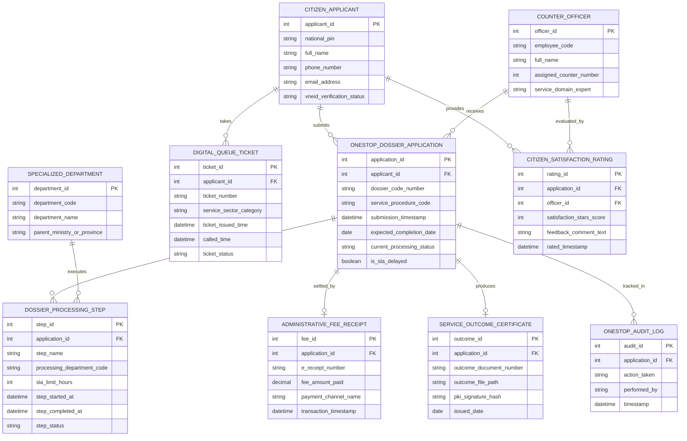

# Conceptual ERD — Citizen Service Center Management System

## Mermaid Code

## Entity Description Table | Bảng mô tả Entity

| # | Entity Name | Vietnamese Name | Description | Key Attributes | Main Relationships |
|---|-------------|-----------------|-------------|----------------|-------------------|
| 1 | CITIZEN_APPLICANT | Công dân / Doanh nghiệp | Thông tin cá nhân, mã định danh VNeID của công dân/doanh nghiệp nộp hồ sơ | applicant_id, national_pin, full_name, phone_number, vneid_verification_status | Submits APPLICATION, takes TICKET |
| 2 | ONESTOP_DOSSIER_APPLICATION | Hồ sơ Thủ tục Hành chính | Thông tin hồ sơ hành chính tiếp nhận tại Một cửa (mã hồ sơ, thủ tục, thời hạn SLA) | application_id, dossier_code_number, expected_completion_date, current_processing_status | Belongs to APPLICANT, settled by FEE |
| 3 | DIGITAL_QUEUE_TICKET | Số Thứ tự Thông minh | Phiếu lấy số thứ tự giao dịch tại Kiosk hoặc đặt lịch hẹn trực tuyến qua VNeID | ticket_id, ticket_number, service_sector_category, ticket_issued_time, ticket_status | Belongs to CITIZEN_APPLICANT |
| 4 | COUNTER_OFFICER | Cán bộ Quầy Một cửa | Thông tin cán bộ tiếp nhận và trả kết quả tại các quầy phục vụ hành chính công | officer_id, employee_code, full_name, assigned_counter_number | Receives APPLICATION, evaluated by RATING |
| 5 | ADMINISTRATIVE_FEE_RECEIPT | Biên lai Thu Phí Lệ phí | Biên lai thanh toán tiền phí/lệ phí dịch vụ công trực tuyến có mã QR gạch nợ | fee_id, e_receipt_number, fee_amount_paid, payment_channel_name | Settles ONESTOP_DOSSIER_APPLICATION |
| 6 | DOSSIER_PROCESSING_STEP | Bước Luân chuyển Hồ sơ | Chi tiết từng bước luân chuyển xử lý hồ sơ liên thông giữa các Sở/Ngành và thời gian SLA | step_id, step_name, processing_department_code, sla_limit_hours, step_status | Belongs to APPLICATION, executed by DEPT |
| 7 | SPECIALIZED_DEPARTMENT | Cơ quan Chuyên môn | Thông tin các Sở/Ngành (Sở KH&ĐT, Sở Xây dựng) chịu trách nhiệm thẩm định | department_id, department_code, department_name, parent_ministry_or_province | Executes DOSSIER_PROCESSING_STEP |
| 8 | SERVICE_OUTCOME_CERTIFICATE | Kết quả Thủ tục Điện tử | Giấy phép, Chứng nhận bản điện tử có chữ ký số PKI trả cho công dân | outcome_id, outcome_document_number, outcome_file_path, pki_signature_hash | Produced for APPLICATION |
| 9 | CITIZEN_SATISFACTION_RATING | Đánh giá Hài lòng Công dân | Kết quả chấm điểm sao hài lòng của công dân đối với thái độ phục vụ của cán bộ | rating_id, satisfaction_stars_score, feedback_comment_text, rated_timestamp | Provided by APPLICANT, evaluates OFFICER |
| 10 | ONESTOP_AUDIT_LOG | Nhật ký Kiểm toán Một cửa | Lưu toàn bộ vết tiếp nhận, xác thực VNeID, luân chuyển liên thông, gạch nợ và trả kết quả | audit_id, action_taken, performed_by, timestamp | Belongs to APPLICATION |

## Relationship Description | Mô tả Quan hệ

| # | From Entity | Cardinality | To Entity | Relationship Label | Business Explanation |
|---|-------------|-------------|-----------|-------------------|----------------------|
| 1 | CITIZEN_APPLICANT | one-to-many | ONESTOP_DOSSIER_APPLICATION | submits | Một công dân có thể nộp nhiều Hồ sơ thủ tục hành chính tại Trung tâm Một cửa |
| 2 | CITIZEN_APPLICANT | one-to-many | DIGITAL_QUEUE_TICKET | takes | Một công dân lấy các số thứ tự thông minh khi đến giao dịch tại Trung tâm |
| 3 | ONESTOP_DOSSIER_APPLICATION | one-to-many | DOSSIER_PROCESSING_STEP | divided_into | Một hồ sơ thủ tục hành chính được chia thành nhiều bước luân chuyển xử lý |
| 4 | ONESTOP_DOSSIER_APPLICATION | one-to-one | ADMINISTRATIVE_FEE_RECEIPT | settled_by | Mỗi hồ sơ được gạch nợ hoàn tất bằng duy nhất một Biên lai thu phí/lệ phí điện tử |
| 5 | ONESTOP_DOSSIER_APPLICATION | one-to-one | SERVICE_OUTCOME_CERTIFICATE | produces | Mỗi hồ sơ hoàn tất sinh ra duy nhất một Kết quả thủ tục hành chính bản điện tử |
| 6 | COUNTER_OFFICER | one-to-many | ONESTOP_DOSSIER_APPLICATION | receives | Một cán bộ quầy Một cửa trực tiếp tiếp nhận nhiều hồ sơ hành chính của công dân |
| 7 | SPECIALIZED_DEPARTMENT | one-to-many | DOSSIER_PROCESSING_STEP | executes | Một cơ quan chuyên môn (Sở/Ngành) thẩm định các bước luân chuyển thuộc lĩnh vực |
| 8 | CITIZEN_APPLICANT | one-to-many | CITIZEN_SATISFACTION_RATING | provides | Công dân gửi các đánh giá mức độ hài lòng về chất lượng phục vụ của Trung tâm |
| 9 | COUNTER_OFFICER | one-to-many | CITIZEN_SATISFACTION_RATING | evaluated_by | Một cán bộ quầy nhận được các lượt chấm điểm hài lòng từ phía công dân |
| 10 | ONESTOP_DOSSIER_APPLICATION | one-to-many | ONESTOP_AUDIT_LOG | tracked_in | Mọi thao tác trên hồ sơ thủ tục hành chính được ghi lại nhật ký kiểm toán bất biến |
