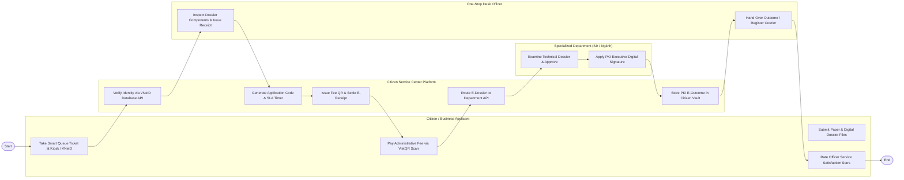

# Swimlane Diagram — Citizen Service Center Management System

## Mermaid Code

## Flow Description | Mô tả luồng

| Lane | Actor | Role in Flow |
|------|-------|-------------|
| 1 | Citizen / Business Applicant | Lấy số thứ tự thông minh tại Kiosk/VNeID, nộp hồ sơ tại Quầy Một cửa, quét mã VietQR nộp lệ phí và chấm điểm hài lòng. |
| 2 | Citizen Service Center Platform | Xác thực VNeID công dân, tính hạn xử lý SLA, xuất mã QR thu phí, luân chuyển hồ sơ điện tử liên thông và lưu kết quả PKI. |
| 3 | One-Stop Desk Officer | Kiểm tra tính hợp lệ thành phần hồ sơ, cấp Giấy tiếp nhận hẹn trả kết quả và trao kết quả bản giấy cho công dân. |
| 4 | Specialized Department (Sở / Ngành) | Thẩm định nội dung chuyên môn hồ sơ, phê duyệt và ký số PKI phát hành Kết quả thủ tục hành chính điện tử. |
