# Action Tree — Citizen Service Center Management System

## Mermaid Code

```mermaid
graph TD
    Root["Citizen Service Center Management System"]

    Root --> M1["Smart Queue Management & Kiosk Intake"]
    Root --> M2["One-Stop Dossier Reception & VNeID Verification"]
    Root --> M3["Inter-Agency Workflow & SLA Tracking"]
    Root --> M4["Electronic Fee Payment & Outcome Delivery"]
    Root --> M5["Satisfaction Rating & Grievance Resolution"]
    Root --> M6["Public Service Center BI & Archival"]

    M1 --> A11["Issue Digital Queue Number Tickets"]
    M1 --> A12["Book Online VNeID Appointments"]
    M1 --> A13["Assign Counter Officer Queues"]
    M1 --> A14["Broadcast LED Counter Call Displays"]

    M2 --> A21["Submit Public Service Applications OneStop"]
    M2 --> A22["Verify VNeID Applicant Identity"]
    M2 --> A23["Inspect Application Dossier Validity"]
    M2 --> A24["Reuse Citizen Data Vault Documents"]

    M3 --> A31["Forward Dossier Specialized Departments"]
    M3 --> A32["Track Application SLA Processing Status"]
    M3 --> A33["Audit OneStop Service SLA Delays"]
    M3 --> A34["Send Automated Apology Letters Overdue"]

    M4 --> A41["Process Administrative Fee Payments VNeID"]
    M4 --> A42["Receive Electronic Outcome Certificates"]
    M4 --> A43["Manage Home Courier Delivery Services"]
    M4 --> A44["Generate E-Receipt Tax Receipts"]

    M5 --> A51["Rate Citizen Satisfaction Levels"]
    M5 --> A52["Dispute Denied Administrative Dossiers"]
    M5 --> A53["Monitor Counter Staffing Performance"]
    M5 --> A54["Resolve Citizen Complaints Hotline"]

    M6 --> A61["Export OneStop Service Center BI"]
    M6 --> A62["Calculate PAR INDEX Reforms Metrics"]
    M6 --> A63["Log System Immutable OneStop Audits"]
    M6 --> A64["Archive Digital Application Records"]
```

## Module Description | Mô tả Module

| # | Module | Description | Actions |
|---|--------|-------------|---------|
| 1 | Smart Queue Management & Kiosk Intake | Lấy số thứ tự thông minh tại máy Kiosk, đặt lịch hẹn trực tuyến qua VNeID, tự động gọi số vào quầy phục vụ rảnh | Issue Digital Queue Number Tickets, Book Online VNeID Appointments, Assign Counter Officer Queues, Broadcast LED Counter Call Displays |
| 2 | One-Stop Dossier Reception & VNeID Verification | Tiếp nhận hồ sơ hành chính, quét mã VNeID xác thực nhân thân, kiểm tra thành phần hồ sơ và tái sử dụng giấy tờ điện tử | Submit Public Service Applications OneStop, Verify VNeID Applicant Identity, Inspect Application Dossier Validity, Reuse Citizen Data Vault Documents |
| 3 | Inter-Agency Workflow & SLA Tracking | Luân chuyển hồ sơ liên thông sang các Sở/Ngành chuyên môn, đôn đốc hạn xử lý SLA và tự động phát Thư xin lỗi nếu trễ hạn | Forward Dossier Specialized Departments, Track Application SLA Processing Status, Audit OneStop Service SLA Delays, Send Automated Apology Letters Overdue |
| 4 | Electronic Fee Payment & Outcome Delivery | Thanh toán phí/lệ phí trực tuyến qua VietQR, nhận Kết quả điện tử ký số PKI và đăng ký chuyển phát kết quả tại nhà | Process Administrative Fee Payments VNeID, Receive Electronic Outcome Certificates, Manage Home Courier Delivery Services, Generate E-Receipt Tax Receipts |
| 5 | Satisfaction Rating & Grievance Resolution | Công dân đánh giá sao hài lòng đối với cán bộ quầy, giám sát hiệu suất công tác và xử lý khiếu nại hồ sơ bị từ chối | Rate Citizen Satisfaction Levels, Dispute Denied Administrative Dossiers, Monitor Counter Staffing Performance, Resolve Citizen Complaints Hotline |
| 6 | Public Service Center BI & Archival | Trích xuất báo cáo Chỉ số Cải cách Hành chính PAR INDEX nộp UBND Tỉnh, kiểm toán bảo mật và lưu trữ hồ sơ vĩnh viễn | Export OneStop Service Center BI, Calculate PAR INDEX Reforms Metrics, Log System Immutable OneStop Audits, Archive Digital Application Records |
