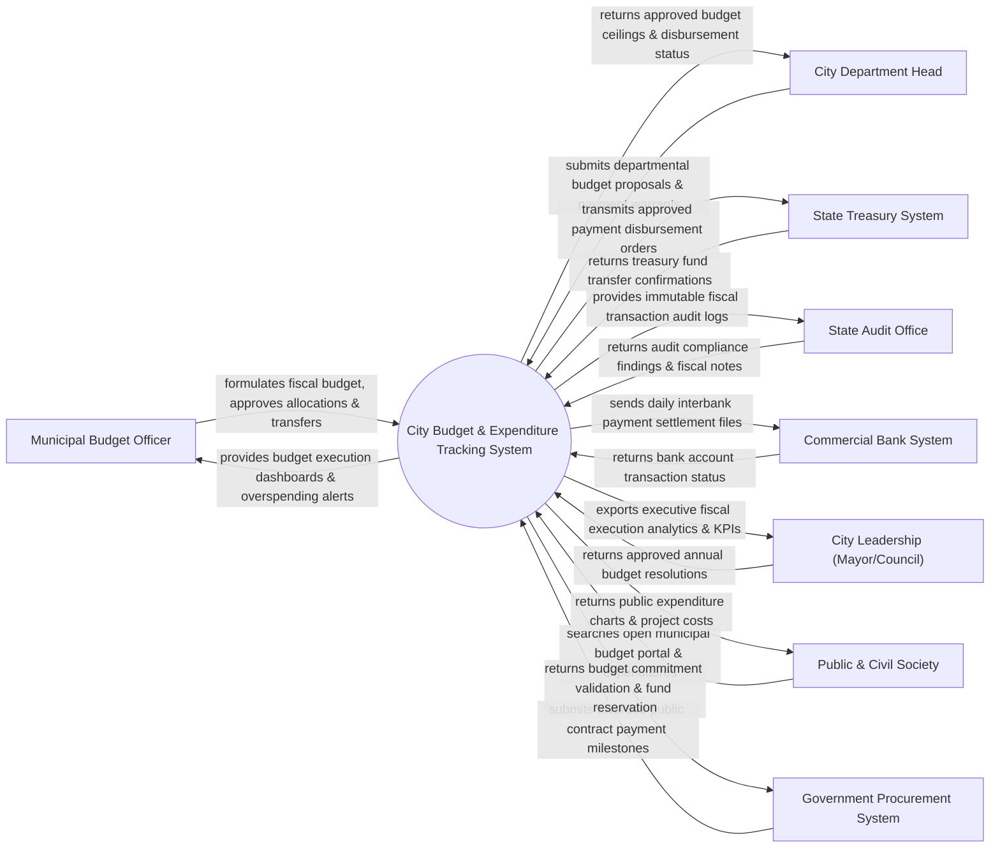

# Context Diagram — City Budget & Expenditure Tracking System

## Mermaid Code

## Actor & Interaction Table | Bảng Actor & Tương tác

| # | Actor | Actor Type | Data Sent TO System | Data Received FROM System | Notes |
|---|-------|------------|---------------------|---------------------------|-------|
| 1 | Municipal Budget Officer | Primary | Fiscal budget formulations, fund reallocations, warrant approvals | Budget execution status, overspending alerts, variance reports | Cán bộ Sở Tài chính / Phòng Tài chính Kế hoạch thành phố |
| 2 | City Department Head | Primary | Annual budget requests, payment voucher orders, project invoices | Approved budget ceilings, fund availability, disbursement status | Thủ trưởng các Sở/Nành/Quận/Huyện dùng ngân sách thành phố |
| 3 | State Treasury System | Supporting | Treasury account balances, fund disbursement confirmations | Approved payment warrants, treasury expenditure orders | Kho bạc Nhà nước thực hiện kiểm soát chi và giải ngân |
| 4 | State Audit Office | Regulatory | Audit inspection schedules, compliance inquiry queries | Full financial transaction ledgers, audit trail records | Cơ quan Kiểm toán Nhà nước kiểm tra tính hợp pháp thu chi |
| 5 | Commercial Bank System | Supporting | Electronic bank transfer status, account transaction statements | Bank payment orders, vendor account payment files | Các ngân hàng thương mại phục vụ tài khoản tiền gửi ngân sách |
| 6 | City Leadership (Mayor/Council) | Primary | Annual budget allocation limits, emergency fund approval directives | Executive BI financial dashboards, budget execution rates | HĐND và UBND Thành phố quyết định dự toán ngân sách |
| 7 | Public & Civil Society | Supporting | Open budget query parameters, public inquiry requests | Public expenditure reports, interactive open budget portal | Công chúng tra cứu công khai ngân sách nhà nước |
| 8 | Government Procurement System | Supporting | Public procurement contract values, payment milestones | Encumbered budget verification, fund reservation confirmation | Hệ thống Mạng Đấu thầu Quốc gia gửi mốc thanh toán |

## System Boundary Description | Mô tả Phạm vi Hệ thống

Hệ thống City Budget & Expenditure Tracking System (Hệ thống Theo dõi Ngân sách và Chi tiêu Thành phố) chịu trách nhiệm quản lý toàn bộ vòng đời quản lý tài chính công của đô thị: Lập dự toán ngân sách hàng năm, phân bổ dự toán cho các đơn vị sử dụng ngân sách, kiểm soát hạn mức chi, phê duyệt lệnh rút dự toán (Payment Warrant), theo dõi chi đầu tư phát triển và công khai ngân sách cho người dân. Hệ thống đảm bảo tuân thủ nghiêm ngặt Luật Ngân sách Nhà nước. Tuy nhiên, hệ thống KHÔNG trực tiếp thu thuế (do Hệ thống Quản lý Thuế đảm nhận) và KHÔNG thay thế ứng dụng kế toán nội bộ chi tiết (MISA/Fast) của từng đơn vị.
