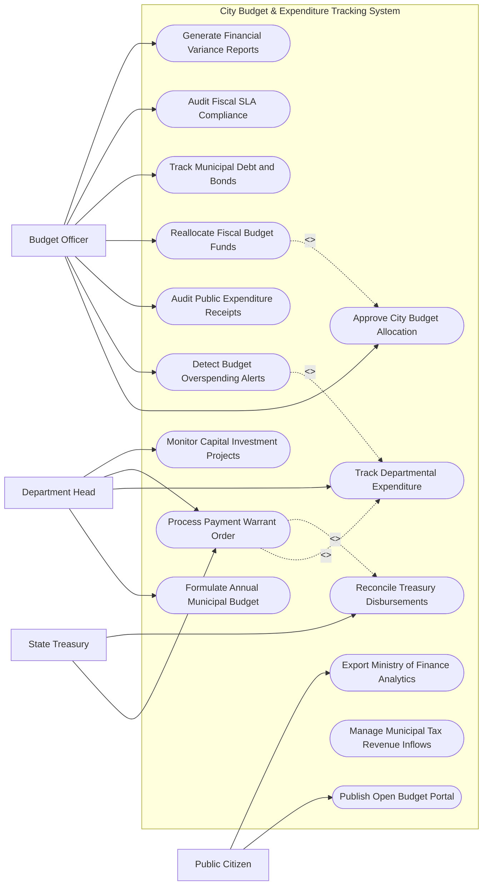

# Use Case Diagram — City Budget & Expenditure Tracking System

## Mermaid Code

## Actor Table | Bảng Actor

| # | Actor | Actor Type | Role Description | Related Use Cases |
|---|-------|------------|------------------|-------------------|
| 1 | Department Head | Primary | Thủ trưởng các đơn vị nộp dự toán, gửi yêu cầu thanh toán rút vốn | UC01, UC03, UC04, UC06 |
| 2 | Budget Officer | Primary | Cán bộ sở tài chính thẩm định dự toán, phân bổ nguồn vốn và kiểm soát chi | UC02, UC07, UC08, UC09, UC12, UC13, UC14 |
| 3 | State Treasury | Secondary / System | Kho bạc Nhà nước thực hiện kiểm soát chi và giải ngân tiền mặt/chuyển khoản | UC04, UC05 |
| 4 | Public Citizen | Secondary | Cư dân đô thị tra cứu công khai minh bạch số liệu thu chi ngân sách | UC10, UC15 |

## Use Case Table | Bảng Use Case

| # | UC ID | Use Case Name | Primary Actor | Secondary Actor | Description | Priority |
|---|-------|---------------|---------------|-----------------|-------------|----------|
| 1 | UC01 | Formulate Annual Municipal Budget | DeptHead | BudgetOfficer | Lập đề xuất dự toán thu chi ngân sách hàng năm của từng đơn vị | High |
| 2 | UC02 | Approve City Budget Allocation | BudgetOfficer | CityLeadership | Thẩm định và giao dự toán ngân sách chính thức cho các cơ quan | High |
| 3 | UC03 | Track Departmental Expenditure | DeptHead | BudgetOfficer | Giám sát tiến độ giải ngân và số dư dự toán còn lại của từng đơn vị | High |
| 4 | UC04 | Process Payment Warrant Order | DeptHead | Treasury | Lập và phê duyệt Lệnh rút dự toán ngân sách gửi Kho bạc giải ngân | High |
| 5 | UC05 | Reconcile Treasury Disbursements | Treasury | BudgetOfficer | Đối soát dữ liệu chi tiền thực tế của Kho bạc với sổ sách tài chính | High |
| 6 | UC06 | Monitor Capital Investment Projects | DeptHead | BudgetOfficer | Theo dõi tiến độ giải ngân vốn đầu tư công cho các công trình hạ tầng | High |
| 7 | UC07 | Detect Budget Overspending Alerts | System | BudgetOfficer | Tự động bật cảnh báo khi đơn vị chi vượt hạn mức dự toán được giao | High |
| 8 | UC08 | Audit Public Expenditure Receipts | BudgetOfficer | StateAudit | Kiểm tra tính hợp lệ của hóa đơn, chứng từ chi tiêu công | High |
| 9 | UC09 | Reallocate Fiscal Budget Funds | BudgetOfficer | CityLeadership | Điều chỉnh, điều chuyển dự toán giữa các mục chi hoặc các đơn vị | Medium |
| 10 | UC10 | Publish Open Budget Portal | Public | SysAdmin | Công khai minh bạch biểu đồ thu chi ngân sách thành phố cho người dân | Medium |
| 11 | UC11 | Manage Municipal Tax Revenue Inflows | BudgetOfficer | TaxOffice | Ghi nhận số liệu thu ngân sách nhà nước trên địa bàn thành phố | Medium |
| 12 | UC12 | Track Municipal Debt and Bonds | BudgetOfficer | StateTreasury | Quản lý dư nợ vay chính quyền địa phương và lịch trả nợ trái phiếu đô thị | Medium |
| 13 | UC13 | Audit Fiscal SLA Compliance | BudgetOfficer | - | Kiểm toán thời gian xử lý hồ sơ rút vốn và thanh toán chi nộp | Medium |
| 14 | UC14 | Generate Financial Variance Reports | BudgetOfficer | CityLeadership | Tổng hợp báo cáo phân tích chênh lệch giữa dự toán và thực chi | Medium |
| 15 | UC15 | Export Ministry of Finance Analytics | SysAdmin | MoF | Trích xuất báo cáo tài chính công nộp Bộ Tài chính theo chuẩn quy định | Low |

## Use Case Specification | Đặc tả Use Case

---

### UC01 — Formulate Annual Municipal Budget

| Field | Detail |
|-------|--------|
| **UC ID** | UC01 |
| **Use Case Name** | Formulate Annual Municipal Budget |
| **Actor(s)** | Primary: Department Head / Secondary: Municipal Budget Officer |
| **Description** | Các đơn vị sử dụng ngân sách lập đề xuất dự toán thu chi cho năm tài chính tiếp theo dựa trên trần ngân sách gợi ý. |
| **Precondition** | 1. Sở Tài chính đã phát hành hướng dẫn lập dự toán và số trần ngân sách dự kiến (Budget Ceiling). |
| **Main Flow** | 1. DeptHead đăng nhập Phân hệ Lập Dự toán Ngân sách.   2. System hiển thị biểu mẫu lập dự toán thu chi theo Mục lục Ngân sách Nhà nước (Chương, Loại, Khoản, Mục, Tiểu mục).   3. DeptHead nhập số liệu đề xuất chi thường xuyên (lương, hoạt động chuyên môn) và chi đầu tư.   4. DeptHead thuyết minh chi tiết cho các khoản chi lớn hoặc chương trình mới.   5. System tự động kiểm tra tổng dự toán đề xuất vs Số trần ngân sách được giao.   6. DeptHead ký số và gửi Báo cáo đề xuất dự toán về Sở Tài chính.   7. System cấp Mã đề xuất dự toán và lưu vào cơ sở dữ liệu thẩm định. |
| **Alternative Flow** | **AF1** — Đề xuất ngân sách vượt trần: DeptHead lập văn bản giải trình đặc biệt cho phần vượt trần, System đánh dấu "Đề xuất ưu tiên xét duyệt bổ sung". |
| **Exception Flow** | **EX1** — Nhập sai chỉ tiêu mục lục ngân sách: System báo lỗi định khoản không hợp lệ, yêu cầu chọn lại đúng mã tiểu mục quy định. |
| **Postcondition** | Đề xuất dự toán ngân sách năm mới được ghi nhận, sẵn sàng cho khâu thẩm định (UC02). |
| **Business Rule** | **BR1**: Dự toán ngân sách lập ra phải cân đối thu chi và tuân thủ đúng trần ngân sách do UBND Thành phố phê duyệt. |

---

### UC02 — Approve City Budget Allocation

| Field | Detail |
|-------|--------|
| **UC ID** | UC02 |
| **Use Case Name** | Approve City Budget Allocation |
| **Actor(s)** | Primary: Municipal Budget Officer / Secondary: City Leadership |
| **Description** | Sở Tài chính thẩm định dự toán các đơn vị, trình HĐND Thành phố thông qua và phát hành Quyết định giao dự toán chính thức. |
| **Precondition** | 1. Đã tiếp nhận đầy đủ đề xuất dự toán của các đơn vị (UC01).   2. HĐND Thành phố đã ban hành Nghị quyết phê duyệt ngân sách năm. |
| **Main Flow** | 1. BudgetOfficer mở danh sách đề xuất dự toán của các sở, ban, ngành, quận, huyện.   2. BudgetOfficer rà soát tính hợp lý, căn cứ pháp lý và định mức chi tiêu của từng khoản mục.   3. BudgetOfficer nhập số tiền dự toán được duyệt chính thức cho từng mục chi.   4. System tổng hợp thành Bảng giao dự toán ngân sách toàn thành phố.   5. UBND Thành phố thực hiện ký số ban hành Quyết định giao dự toán ngân sách.   6. System tự động phân bổ hạn mức dự toán (Budget Allocation Limit) vào tài khoản của từng đơn vị trên hệ thống.   7. System gửi Thông báo giao dự toán điện tử cho các đơn vị. |
| **Alternative Flow** | **AF1** — Cắt giảm dự toán: BudgetOfficer điều chỉnh giảm số tiền chi chưa cấp thiết, nhập lý do cắt giảm để gửi thông báo cho đơn vị. |
| **Exception Flow** | **EX1** — Quyết định giao dự toán trễ so với đầu năm tài chính: System cấp hạn mức tạm cấp (1/12 dự toán năm trước) để đảm bảo đơn vị duy trì bộ máy. |
| **Postcondition** | Hạn mức ngân sách chính thức có hiệu lực, đơn vị bắt đầu được phép rút dự toán chi tiêu (UC04). |
| **Business Rule** | **BR1**: Quyết định giao dự toán ngân sách phải được hoàn thành trước ngày 31 tháng 12 hàng năm. |

---

### UC03 — Track Departmental Expenditure

| Field | Detail |
|-------|--------|
| **UC ID** | UC03 |
| **Use Case Name** | Track Departmental Expenditure |
| **Actor(s)** | Primary: Department Head, Municipal Budget Officer / Secondary: None |
| **Description** | Theo dõi thời gian thực tỷ lệ giải ngân, số tiền đã cam kết chi và số dư dự toán còn lại của từng khoản mục ngân sách. |
| **Precondition** | 1. Đơn vị đã được giao dự toán ngân sách chính thức (UC02). |
| **Main Flow** | 1. DeptHead hoặc BudgetOfficer truy cập Bảng điều khiển Theo dõi Ngân sách.   2. System hiển thị tổng quan: Dự toán được giao, Số đã chi (Disbursed), Số đã cam kết chi (Encumbered), Số dư còn lại (Available Balance).   3. DeptHead chọn xem chi tiết theo từng Tiểu mục chi (Ví dụ: Chi điện nước, chi văn phòng phẩm, chi sửa chữa).   4. System hiển thị danh sách các Lệnh rút dự toán (UC04) và hợp đồng liên quan.   5. System tính toán Tỷ lệ phần trăm giải ngân (Disbursement Rate %) so với tiến độ thời gian trong năm.   6. Nếu tốc độ giải ngân quá chậm hoặc quá nhanh: System hiển thị cảnh báo màu vàng/đỏ (UC07). |
| **Alternative Flow** | **AF1** — Xem theo tiến độ dự án đầu tư công: System cho phép lọc ngân sách theo từng dự án xây dựng hạ tầng cụ thể (UC06). |
| **Exception Flow** | **EX1** — Sai lệch dữ liệu giữa hệ thống và Kho bạc: System bật nút "Yêu cầu đối soát Kho bạc" (UC05) để cập nhật lại số dư thực tế. |
| **Postcondition** | Giúp lãnh đạo đơn vị và cán bộ tài chính nắm chắc tình hình chi tiêu, tránh nợ nần hoặc nghẽn giải ngân. |
| **Business Rule** | **BR1**: Số dư khả dụng (Available Balance) = Dự toán được giao - (Số đã chi + Số đã cam kết chi). |

---

### UC04 — Process Payment Warrant Order

| Field | Detail |
|-------|--------|
| **UC ID** | UC04 |
| **Use Case Name** | Process Payment Warrant Order |
| **Actor(s)** | Primary: Department Head / Secondary: State Treasury |
| **Description** | Đơn vị sử dụng ngân sách lập Lệnh rút dự toán (Giấy rút dự toán ngân sách) gửi Kho bạc Nhà nước để giải ngân tiền. |
| **Precondition** | 1. Khoản chi có trong dự toán được giao và còn đủ số dư khả dụng (UC03).   2. Có đầy đủ hóa đơn, chứng từ, hợp đồng hợp lệ. |
| **Main Flow** | 1. DeptHead (hoặc Kế toán trưởng) lập Giấy rút dự toán ngân sách nhà nước điện tử.   2. DeptHead chọn tiểu mục chi, nhập số tiền, tên đơn vị thụ hưởng và số tài khoản ngân hàng nhận tiền.   3. DeptHead tải lên các chứng từ kèm theo: Hóa đơn GTGT điện tử, Biên bản nghiệm thu, Hợp đồng.   4. DeptHead và Chủ tài khoản ký số điện tử bằng USB Token lên Giấy rút dự toán.   5. System kiểm tra tự động: Số dư khả dụng >= Số tiền rút.   6. System tự động mã hóa và truyền Giấy rút dự toán sang Hệ thống Kho bạc Nhà nước (TABMIS/VCS).   7. State Treasury thực hiện kiểm soát chi, chuyển tiền cho đơn vị thụ hưởng và trả về Thông báo hoàn thành giải ngân.   8. System tự động gạch trừ số dư dự toán của đơn vị. |
| **Alternative Flow** | **AF1** — Rút tạm ứng: Đơn vị chọn "Rút tạm ứng", nộp hồ sơ mở tài khoản tạm ứng. Sau khi hoàn thành công việc nộp chứng từ thanh toán tạm ứng. |
| **Exception Flow** | **EX1** — Số tiền rút vượt quá số dư dự toán còn lại: System từ chối lập lệnh, bật cảnh báo "Chi vượt dự toán" (UC07) và khóa chức năng ký số.   **EX2** — Kho bạc từ chối thanh toán do thiếu chứng từ: System chuyển hồ sơ về trạng thái "Bị Kho bạc trả lại", gửi email thông báo lý do cho đơn vị bổ sung. |
| **Postcondition** | Tiền được giải ngân từ Kho bạc tới nhà cung cấp/người thụ hưởng, sổ nợ dự toán được cập nhật chính xác. |
| **Business Rule** | **BR1**: Mọi Lệnh rút dự toán bắt buộc phải có chữ ký số hợp lệ của Kế toán trưởng và Chủ tài khoản đơn vị. |

---

### UC07 — Detect Budget Overspending Alerts

| Field | Detail |
|-------|--------|
| **UC ID** | UC07 |
| **Use Case Name** | Detect Budget Overspending Alerts |
| **Actor(s)** | Primary: System / Secondary: Municipal Budget Officer |
| **Description** | Hệ thống tự động phân tích tốc độ chi tiêu, phát hiện nguy cơ chi vượt dự toán hoặc chi sai mục đích để gửi cảnh báo ngăn chặn. |
| **Precondition** | 1. Dữ liệu chi tiêu được cập nhật liên tục từ các Lệnh rút dự toán (UC04). |
| **Main Flow** | 1. System chạy thuật toán kiểm tra hạn mức ngân sách định kỳ (Real-time Budget Enforcement Engine).   2. System so sánh Số dư khả dụng với số tiền các lệnh chi đang chờ duyệt.   3. System tính toán Tỷ lệ chi tiêu theo quý (Ví dụ: Mới hết Quý 1 nhưng đã chi hết 80% dự toán cả năm của một tiểu mục).   4. System bật Cảnh báo mức Vàng (Warning) cho Kế toán đơn vị khi số dư khả dụng < 10%.   5. System bật Cảnh báo mức Đỏ (Alert) và tự động khóa tính năng lập Giấy rút dự toán đối với tiểu mục đã hết 100% dự toán.   6. System tự động gửi báo cáo danh sách các đơn vị có nguy cơ chi vượt dự toán tới Sở Tài chính. |
| **Alternative Flow** | **AF1** — Đơn vị nộp đơn xin bổ sung dự toán: DeptHead nộp yêu cầu điều chỉnh dự toán (UC09) để giải thế khóa chi vượt dự toán. |
| **Exception Flow** | **EX1** — Chi cho các trường hợp khẩn cấp (Thiên tai, dịch bệnh): Chánh án/Chủ tịch UBND bật chế độ "Ghi đè hạn mức khẩn cấp" để cho phép chi vượt trần tạm thời. |
| **Postcondition** | Ngăn chặn tuyệt đối tình trạng chi khống, chi vượt hạn mức ngân sách nhà nước được giao. |
| **Business Rule** | **BR1**: Hệ thống không cho phép phê duyệt bất kỳ lệnh chi nào vượt quá 100% hạn mức dự toán tiểu mục được duyệt (trừ khi có quyết định bổ sung). |
