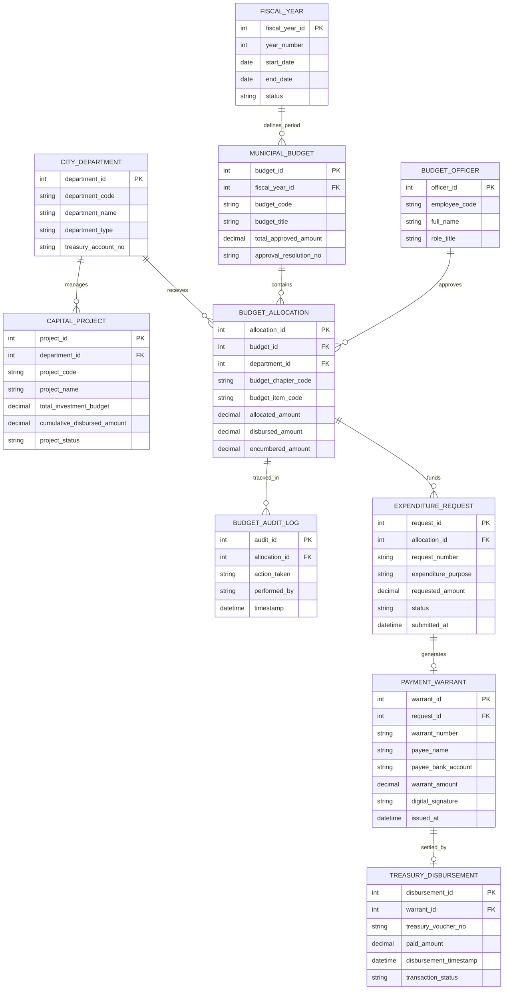

# Conceptual ERD — City Budget & Expenditure Tracking System

## Mermaid Code

## Entity Description Table | Bảng mô tả Entity

| # | Entity Name | Vietnamese Name | Description | Key Attributes | Main Relationships |
|---|-------------|-----------------|-------------|----------------|-------------------|
| 1 | FISCAL_YEAR | Năm Tài chính | Thời gian năm tài chính ngân sách (từ 01/01 đến 31/12) | fiscal_year_id, year_number, start_date, end_date | Defines period for MUNICIPAL_BUDGET |
| 2 | CITY_DEPARTMENT | Đơn vị Sử dụng Ngân sách | Cơ quan, đơn vị hành chính sự nghiệp thụ hưởng ngân sách thành phố | department_id, department_code, department_name, treasury_account_no | Receives BUDGET_ALLOCATION, manages CAPITAL_PROJECT |
| 3 | MUNICIPAL_BUDGET | Ngân sách Thành phố Tổng thể | Quyết toán ngân sách địa phương tổng thể được HĐND thông qua | budget_id, budget_code, total_approved_amount, approval_resolution_no | Belongs to FISCAL_YEAR, contains BUDGET_ALLOCATION |
| 4 | BUDGET_ALLOCATION | Phân bổ Dự toán Ngân sách | Chi tiết hạn mức ngân sách được giao theo từng mục lục ngân sách | allocation_id, budget_chapter_code, budget_item_code, allocated_amount | Belongs to MUNICIPAL_BUDGET, CITY_DEPARTMENT |
| 5 | EXPENDITURE_REQUEST | Yêu cầu Chi ngân sách | Đề nghị rút dự toán chi thường xuyên hoặc chi đầu tư của đơn vị | request_id, request_number, expenditure_purpose, requested_amount | Belongs to BUDGET_ALLOCATION, generates PAYMENT_WARRANT |
| 6 | PAYMENT_WARRANT | Lệnh Rút Dự toán Ngân sách | Giấy rút dự toán ngân sách có chữ ký số gửi Kho bạc giải ngân | warrant_id, warrant_number, payee_name, warrant_amount | Belongs to EXPENDITURE_REQUEST, settled by TREASURY_DISBURSEMENT |
| 7 | TREASURY_DISBURSEMENT | Giao dịch Giải ngân Kho bạc | Nhật ký chứng từ chi tiền thực tế của Kho bạc Nhà nước | disbursement_id, treasury_voucher_no, paid_amount, disbursement_timestamp | Belongs to PAYMENT_WARRANT |
| 8 | CAPITAL_PROJECT | Dự án Đầu tư Công | Quản lý tổng mức đầu tư và tiến độ giải ngân các công trình hạ tầng | project_id, project_code, project_name, total_investment_budget | Managed by CITY_DEPARTMENT |
| 9 | BUDGET_OFFICER | Cán bộ Quản lý Ngân sách | Công chức sở tài chính phụ trách kiểm soát chi và phân bổ ngân sách | officer_id, employee_code, full_name, role_title | Approves BUDGET_ALLOCATION |
| 10 | BUDGET_AUDIT_LOG | Nhật ký Kiểm toán Ngân sách | Lưu lại toàn bộ lịch sử phân bổ, điều chuyển và điều chỉnh dự toán | audit_id, action_taken, performed_by, timestamp | Belongs to BUDGET_ALLOCATION |

## Relationship Description | Mô tả Quan hệ

| # | From Entity | Cardinality | To Entity | Relationship Label | Business Explanation |
|---|-------------|-------------|-----------|-------------------|----------------------|
| 1 | FISCAL_YEAR | one-to-many | MUNICIPAL_BUDGET | defines_period | Một năm tài chính quy định khung ngân sách tổng thể của thành phố |
| 2 | MUNICIPAL_BUDGET | one-to-many | BUDGET_ALLOCATION | contains | Ngân sách thành phố chia thành nhiều khoản phân bổ dự toán chi tiết |
| 3 | CITY_DEPARTMENT | one-to-many | BUDGET_ALLOCATION | receives | Một đơn vị nhận các hạn mức phân bổ dự toán theo từng tiểu mục chi |
| 4 | BUDGET_ALLOCATION | one-to-many | EXPENDITURE_REQUEST | funds | Một hạn mức dự toán tài trợ cho nhiều đề nghị yêu cầu rút vốn chi tiêu |
| 5 | EXPENDITURE_REQUEST | one-to-one | PAYMENT_TIMELINE / WARRANT | generates | Mỗi đề nghị chi tiền hợp lệ sinh ra một Lệnh rút dự toán gửi Kho bạc |
| 6 | PAYMENT_WARRANT | one-to-one | TREASURY_DISBURSEMENT | settled_by | Mỗi lệnh rút dự toán được Kho bạc hạch toán bằng một chứng từ giải ngân |
| 7 | CITY_DEPARTMENT | one-to-many | CAPITAL_PROJECT | manages | Một cơ quan chủ đầu tư quản lý nhiều dự án công trình đầu tư công |
| 8 | BUDGET_OFFICER | one-to-many | BUDGET_ALLOCATION | approves | Một cán bộ ngân sách thẩm định và duyệt phân bổ cho nhiều đơn vị |
| 9 | BUDGET_ALLOCATION | one-to-many | BUDGET_AUDIT_LOG | tracked_in | Mọi thay đổi về dự toán đều được ghi lại nhật ký kiểm toán không thể sửa |
