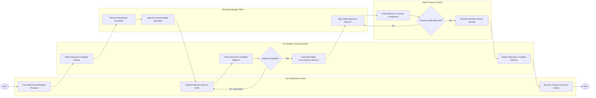

# Swimlane Diagram — City Budget & Expenditure Tracking System

## Mermaid Code

## Flow Description | Mô tả luồng

| Lane | Actor | Role in Flow |
|------|-------|-------------|
| 1 | City Department Head | Lập đề xuất dự toán ngân sách năm, tạo Lệnh rút dự toán chi tiêu kèm chứng từ hóa đơn và nhận báo nợ/có từ Kho bạc. |
| 2 | City Budget Tracking System | Kiểm tra hạn mức trần dự toán, đối soát số dư khả dụng thời gian thực, ghi nhận cam kết chi và tự động gạch trừ số dư. |
| 3 | Municipal Budget Officer | Thẩm định dự toán đề xuất của đơn vị, giao dự toán chính thức và ký số duyệt lệnh rút dự toán chuyển Kho bạc. |
| 4 | State Treasury System | Kiểm soát tính hợp pháp của hóa đơn chứng từ chi tiêu công và thực hiện lệnh chuyển tiền giải ngân cho người thụ hưởng. |
