# Action Tree — City Budget & Expenditure Tracking System

## Mermaid Code

```mermaid
graph TD
    Root["City Budget & Expenditure Tracking System"]

    Root --> M1["Fiscal Planning & Formulation"]
    Root --> M2["Allocation & Distribution"]
    Root --> M3["Expenditure Warrant Approval"]
    Root --> M4["Treasury Disbursement & Settlement"]
    Root --> M5["Capital Investment Tracking"]
    Root --> M6["Open Budget & Fiscal Audit"]

    M1 --> A11["Formulate Annual Department Proposals"]
    M1 --> A12["Set Fiscal Ceiling Guidelines"]
    M1 --> A13["Consolidate Citywide Budget Request"]
    M1 --> A14["Submit Budget Resolution to Council"]

    M2 --> A21["Approve Annual Budget Allocations"]
    M2 --> A22["Distribute Limits to Department Accounts"]
    M2 --> A23["Reallocate Mid-Year Budget Funds"]
    M2 --> A24["Grant Emergency Contingency Funds"]

    M3 --> A31["Submit Payment Warrant Orders"]
    M3 --> A32["Check Real-time Available Balances"]
    M3 --> A33["Detect Overspending Real-time Alerts"]
    M3 --> A34["Apply PKI Digital Signatures Warrants"]

    M4 --> A41["Transmit Warrants to State Treasury"]
    M4 --> A42["Reconcile Treasury Bank Disbursements"]
    M4 --> A43["Process Interbank Direct Transfers"]
    M4 --> A44["Issue Digital Treasury Receipts"]

    M5 --> A51["Track Infrastructure Project Budgets"]
    M5 --> A52["Monitor Milestone Disbursement Rates"]
    M5 --> A53["Audit Contractor Payment Invoices"]
    M5 --> A54["Track Municipal Debt Bonds"]

    M6 --> A61["Publish Open Municipal Budget Portal"]
    M6 --> A62["Generate Ministry Finance Reports"]
    M6 --> A63["Log Immutable Audit Ledger Records"]
    M6 --> A64["Export State Audit Office Analytics"]
```

## Module Description | Mô tả Module

| # | Module | Description | Actions |
|---|--------|-------------|---------|
| 1 | Fiscal Planning & Formulation | Lập dự toán ngân sách hàng năm, quy định hạn mức trần dự kiến và trình HĐND Thành phố phê duyệt | Formulate Annual Department Proposals, Set Fiscal Ceiling Guidelines, Consolidate Citywide Budget Request, Submit Budget Resolution to Council |
| 2 | Allocation & Distribution | Giao dự toán ngân sách chính thức cho các cơ quan đơn vị, điều chuyển kinh phí và cấp dự phòng tài chính | Approve Annual Budget Allocations, Distribute Limits to Department Accounts, Reallocate Mid-Year Budget Funds, Grant Emergency Contingency Funds |
| 3 | Expenditure Warrant Approval | Tiếp nhận lệnh rút dự toán, kiểm soát số dư khả dụng thời gian thực, cảnh báo chi vượt trần và ký số điện tử | Submit Payment Warrant Orders, Check Real-time Available Balances, Detect Overspending Real-time Alerts, Apply PKI Digital Signatures Warrants |
| 4 | Treasury Disbursement & Settlement | Truyền lệnh rút dự toán sang Kho bạc Nhà nước, đối soát chứng từ giải ngân và thanh toán liên ngân hàng | Transmit Warrants to State Treasury, Reconcile Treasury Bank Disbursements, Process Interbank Direct Transfers, Issue Digital Treasury Receipts |
| 5 | Capital Investment Tracking | Theo dõi hạn mức vốn đầu tư công cho các dự án xây dựng hạ tầng đô thị và tiến độ giải ngân theo mốc | Track Infrastructure Project Budgets, Monitor Milestone Disbursement Rates, Audit Contractor Payment Invoices, Track Municipal Debt Bonds |
| 6 | Open Budget & Fiscal Audit | Công khai ngân sách nhà nước trên cổng thông tin, phục vụ kiểm toán nhà nước và trích xuất báo cáo Bộ Tài chính | Publish Open Municipal Budget Portal, Generate Ministry Finance Reports, Log Immutable Audit Ledger Records, Export State Audit Office Analytics |
