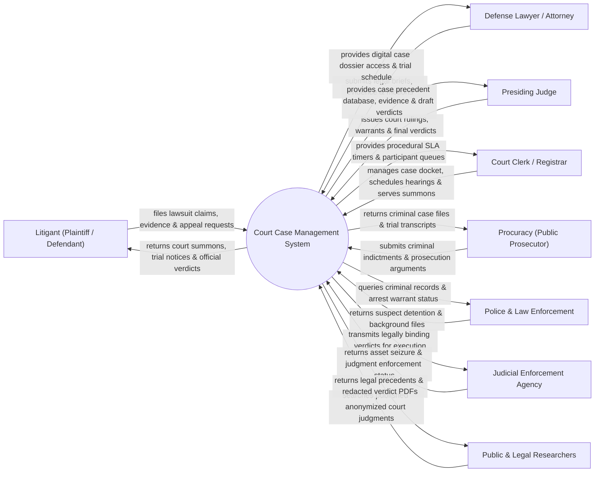

# Context Diagram — Court Case Management System

## Mermaid Code

## Actor & Interaction Table | Bảng Actor & Tương tác

| # | Actor | Actor Type | Data Sent TO System | Data Received FROM System | Notes |
|---|-------|------------|---------------------|---------------------------|-------|
| 1 | Litigant (Plaintiff / Defendant) | Primary | Lawsuit petitions, evidence documents, fee receipts, appeal petitions | Court summons, hearing schedule, official verdict judgment | Đương sự (Nguyên đơn, Bị đơn, Người có quyền lợi nghĩa vụ liên quan) |
| 2 | Defense Lawyer / Attorney | Primary | Defense briefs, legal motions, evidence submissions | Digital case file access, witness list, hearing notifications | Luật sư bào chữa / người bảo vệ quyền lợi hợp pháp |
| 3 | Presiding Judge | Primary | Trial rulings, court orders, signed verdicts, sentence decisions | Case evidence dossier, legal precedents, trial transcripts | Thẩm phán chủ tọa phiên tòa điều hành xét xử |
| 4 | Court Clerk / Registrar | Primary | Case registration, summons issuance, hearing scheduling, trial minutes | Procedural SLA alerts, participant status, docket queue | Thư ký tòa án thực hiện các thủ tục tố tụng hành chính |
| 5 | Procuracy (Public Prosecutor) | Primary | Criminal indictments (Cáo trạng), prosecution evidence | Criminal case files, hearing transcripts, appeal notices | Viện Kiểm sát Nhân dân thực hiện quyền công tố |
| 6 | Police & Law Enforcement | Supporting | Criminal investigation dossiers, arrest warrant execution status | Case filing confirmation, court warrants, subpoena requests | Cơ quan Điều tra Công an chuyển hồ sơ vụ án hình sự |
| 7 | Judicial Enforcement Agency | Supporting | Judgment enforcement updates, asset seizure reports | Enforceable civil/criminal court verdicts, court orders | Cơ quan Thi hành án Dân sự thực thi bản án đã có hiệu lực |
| 8 | Public & Legal Researchers | Supporting | Judgment search parameters, precedent query terms | Anonymized published court judgments, legal case law | Công chúng và nhà nghiên cứu tra cứu bản án công khai |

## System Boundary Description | Mô tả Phạm vi Hệ thống

Hệ thống Court Case Management System (Hệ thống Quản lý Hồ sơ Vụ án Tòa án / Tòa án Điện tử) chịu trách nhiệm quản lý toàn bộ quy trình tố tụng tư pháp từ khâu tiếp nhận đơn khởi kiện, thụ lý vụ án, phân công Thẩm phán ngẫu nhiên, quản lý chứng cứ số, lên lịch và tổ chức phiên tòa (kể cả phiên tòa trực tuyến), ban hành bản án ký số, xử lý kháng cáo/kháng nghị đến công khai bản án trên Cổng thông tin Tòa án. Tuy nhiên, hệ thống KHÔNG thay thế quyền phán quyết độc lập của Thẩm phán tại phiên tòa và KHÔNG trực tiếp thực hiện cưỡng chế thi hành án vật lý (do Cơ quan Thi hành án đảm nhận).
