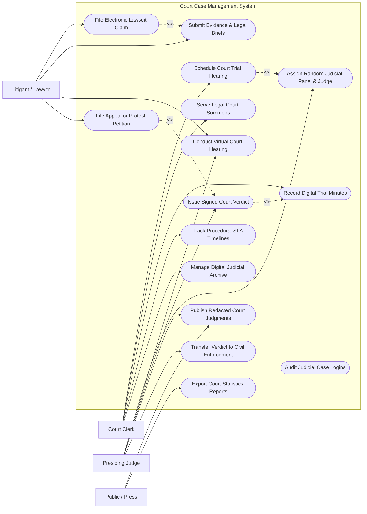

# Use Case Diagram — Court Case Management System

## Mermaid Code

## Actor Table | Bảng Actor

| # | Actor | Actor Type | Role Description | Related Use Cases |
|---|-------|------------|------------------|-------------------|
| 1 | Litigant / Lawyer | Primary | Đương sự hoặc luật sư nộp đơn khởi kiện, nộp chứng cứ và tham gia phiên tòa | UC01, UC05, UC06, UC09 |
| 2 | Court Clerk | Primary | Thư ký tòa án thụ lý vụ án, tống đạt giấy triệu tập, ghi biên bản phiên tòa | UC03, UC04, UC07, UC10, UC11 |
| 3 | Presiding Judge | Primary | Thẩm phán điều hành phiên tòa, ra bản án quyết định và công khai bản án | UC02, UC06, UC08, UC12, UC13 |
| 4 | Public / Press | Secondary | Công chúng tra cứu bản án công khai và báo cáo thống kê ngành tòa án | UC12, UC15 |

## Use Case Table | Bảng Use Case

| # | UC ID | Use Case Name | Primary Actor | Secondary Actor | Description | Priority |
|---|-------|---------------|---------------|-----------------|-------------|----------|
| 1 | UC01 | File Electronic Lawsuit Claim | Litigant | VNeID | Nộp đơn khởi kiện dân sự, hành chính, thương mại trực tuyến | High |
| 2 | UC02 | Assign Random Judicial Panel & Judge | Judge | - | Phân công Thẩm phán chủ tọa và Hội đồng xét xử tự động ngẫu nhiên | High |
| 3 | UC03 | Schedule Court Trial Hearing | Clerk | - | Tự động xếp lịch phiên tòa, phòng xử án và phân bổ thời gian | High |
| 4 | UC04 | Serve Legal Court Summons | Clerk | Litigant | Tống đạt giấy triệu tập, thông báo tố tụng điện tử có xác nhận | High |
| 5 | UC05 | Submit Evidence & Legal Briefs | Litigant | Clerk | Nộp các tài liệu chứng cứ số hóa và luận cứ bảo vệ quyền lợi | High |
| 6 | UC06 | Conduct Virtual Court Hearing | Judge, Litigant | Clerk | Tổ chức phiên tòa trực tuyến với kết nối video bảo mật | High |
| 7 | UC07 | Record Digital Trial Minutes | Clerk | System | Ghi nhận biên bản phiên tòa điện tử và thu âm/ghi hình tự động | Medium |
| 8 | UC08 | Issue Signed Court Verdict | Judge | - | Ban hành bản án, quyết định tố tụng có chữ ký số của Thẩm phán | High |
| 9 | UC09 | File Appeal or Protest Petition | Litigant | Procuracy | Nộp đơn kháng cáo (của đương sự) hoặc kháng nghị (của Viện kiểm sát) | High |
| 10 | UC10 | Track Procedural SLA Timelines | Clerk | Judge | Cảnh báo hạn tố tụng (chuẩn bị xét xử, thời hạn tạm giam) | High |
| 11 | UC11 | Manage Digital Judicial Archive | Clerk | - | Lưu trữ và bảo quản hồ sơ vụ án số hóa không thể sửa đổi | Medium |
| 12 | UC12 | Publish Redacted Court Judgments | Judge | Public | Mã hóa ẩn danh thông tin cá nhân và công khai bản án trên Cổng Tòa án | Medium |
| 13 | UC13 | Transfer Verdict to Civil Enforcement | Judge | JudicialEnforcement | Chuyển bản án đã có hiệu lực sang Cơ quan Thi hành án Dân sự | High |
| 14 | UC14 | Audit Judicial Case Logins | SysAdmin | - | Kiểm toán nhật ký truy cập hồ sơ vụ án chống can thiệp trái phép | Medium |
| 15 | UC15 | Export Court Statistics Reports | SysAdmin | Public | Trích xuất báo cáo tỷ lệ giải quyết án và kết quả xét xử toàn ngành | Low |

## Use Case Specification | Đặc tả Use Case

---

### UC01 — File Electronic Lawsuit Claim

| Field | Detail |
|-------|--------|
| **UC ID** | UC01 |
| **Use Case Name** | File Electronic Lawsuit Claim |
| **Actor(s)** | Primary: Litigant / Lawyer / Secondary: VNeID System |
| **Description** | Nguyên đơn hoặc Luật sư nộp đơn khởi kiện vụ án (Dân sự, Kinh doanh thương mại, Hành chính) trực tuyến qua Cổng Tòa án điện tử. |
| **Precondition** | 1. Người nộp đơn đã được xác thực danh tính qua VNeID hoặc Chữ ký số công cộng. |
| **Main Flow** | 1. Litigant truy cập Cổng Dịch vụ Tòa án Điện tử Quốc gia.   2. Select "Nộp đơn khởi kiện trực tuyến".   3. Litigant chọn loại hình vụ án (Dân sự, Hôn nhân gia đình, Kinh doanh thương mại, Hành chính).   4. Litigant điền thông tin Nguyên đơn, Bị đơn, Người liên quan và tóm tắt Nội dung khởi kiện, Yêu cầu khởi kiện.   5. Litigant tải lên các chứng cứ kèm theo (Hợp đồng, giấy nợ, bản sao CCCD) dưới dạng PDF/hình ảnh.   6. Litigant ký số điện tử lên đơn khởi kiện.   7. System tự động tính tiền Tạm ứng án phí và sinh thông báo nộp tiền.   8. System cấp Mã vụ án tạm thời (Draft Case Code) và gửi xác nhận tiếp nhận đơn cho Litigant. |
| **Alternative Flow** | **AF1** — Nộp đơn trực tiếp tại Tòa án: Litigant nộp đơn giấy tại Tổ Tiếp nhận đơn, Thư ký tòa án quét và nhập thông tin lên hệ thống. |
| **Exception Flow** | **EX1** — Đơn khởi kiện không thuộc thẩm quyền của Tòa án: System đưa ra gợi ý Tòa án đúng thẩm quyền dựa trên địa chỉ bị đơn, Litigant có thể chọn chuyển đơn sang Tòa án khác. |
| **Postcondition** | Đơn khởi kiện được lưu trữ ở trạng thái "Đã nộp - Chờ phân công Thẩm phán xem xét thụ lý". |
| **Business Rule** | **BR1**: Thời hạn xử lý đơn khởi kiện ban đầu của Tòa án là 03 ngày làm việc kể từ khi nhận đơn điện tử. |

---

### UC02 — Assign Random Judicial Panel & Judge

| Field | Detail |
|-------|--------|
| **UC ID** | UC02 |
| **Use Case Name** | Assign Random Judicial Panel & Judge |
| **Actor(s)** | Primary: Presiding Judge (Chánh án) / Secondary: None |
| **Description** | Hệ thống tự động phân công ngẫu nhiên Thẩm phán chủ tọa và Hội đồng xét xử dựa trên thuật toán minh bạch chống tiêu cực. |
| **Precondition** | 1. Vụ án đã được thụ lý chính thức và công dân đã nộp tiền tạm ứng án phí. |
| **Main Flow** | 1. Chánh án Tòa án bấm lệnh "Phân công Thẩm phán thụ lý vụ án".   2. System kích hoạt thuật toán phân công ngẫu nhiên (Random Judicial Assignment Algorithm).   3. System lọc danh sách Thẩm phán thuộc Tòa chuyên trách, đáp ứng tiêu chuẩn: Không bị trùng lịch xử, không có quan hệ thân thích với đương sự, không nợ án quá hạn.   4. System chọn ngẫu nhiên 01 Thẩm phán chủ tọa và các Hội thẩm nhân dân (đối với sơ thẩm).   5. System xuất Quyết định phân công Thẩm phán giải quyết vụ án có ký số.   6. System tự động thông báo quyết định tới Thẩm phán được phân công và gửi cho các đương sự. |
| **Alternative Flow** | **AF1** — Thẩm phán từ chối thụ lý do có xung đột lợi ích (Conflict of Interest): Thẩm phán nộp đơn xin từ chối, Chánh án phê duyệt, System chạy lại thuật toán phân công ngẫu nhiên Thẩm phán khác. |
| **Exception Flow** | **EX1** — Tất cả Thẩm phán thuộc tòa đều bận/xung đột lợi ích: System đưa ra cảnh báo báo cáo Tòa án cấp trên để rút hồ sơ hoặc chỉ định Tòa án khác xét xử. |
| **Postcondition** | Thẩm phán chủ tọa được xác định chính thức, hồ sơ vụ án được chuyển giao cho Thẩm phán bắt đầu giai đoạn chuẩn bị xét xử. |
| **Business Rule** | **BR1**: Thuật toán phân công Thẩm phán bắt buộc phải đảm bảo tính ngẫu nhiên 100% và không thể can thiệp thủ công kết quả. |

---

### UC03 — Schedule Court Trial Hearing

| Field | Detail |
|-------|--------|
| **UC ID** | UC03 |
| **Use Case Name** | Schedule Court Trial Hearing |
| **Actor(s)** | Primary: Court Clerk / Secondary: Presiding Judge |
| **Description** | Thư ký tòa án chọn thời gian, phòng xử án và tự động xếp lịch phiên tòa tránh trùng lặp lịch làm việc của các thành viên. |
| **Precondition** | 1. Vụ án đã hoàn thành giai đoạn chuẩn bị xét xử và có Quyết định đưa vụ án ra xét xử. |
| **Main Flow** | 1. Clerk mở phân hệ "Lịch xét xử vụ án".   2. System hiển thị các phòng xử án trống và lịch làm việc khả dụng của Thẩm phán, Thư ký, Viện kiểm sát và Luật sư.   3. Clerk chọn Ngày giờ xét xử và Phòng xử án (trực tiếp hoặc trực tuyến).   4. System tự động kiểm tra trùng lịch (Conflict Check).   5. System tạo Quyết định đưa vụ án ra xét xử và tự động sinh Giấy triệu tập (UC04) cho các bên tham gia tố tụng.   6. Clerk phát hành lịch xét xử và cập nhật lên Cổng Lịch xét xử công khai của Tòa án. |
| **Alternative Flow** | **AF1** — Hoãn phiên tòa: Khi có lý do xin hoãn hợp lệ, Clerk chọn "Hoãn phiên tòa", nhập lý do. System hủy lịch cũ và mở lại giao diện chọn lịch xét xử mới. |
| **Exception Flow** | **EX1** — Phòng xử án bị quá tải trùng lịch đột xuất: System cảnh báo trùng phòng, tự động gợi ý phòng xử án khác hoặc chuyển sang hình thức Xét xử trực tuyến (UC06). |
| **Postcondition** | Lịch phiên tòa được chốt chính thức, giấy triệu tập được tống đạt tới các đương sự. |
| **Business Rule** | **BR1**: Thời gian từ khi ban hành quyết định đưa vụ án ra xét xử đến ngày mở phiên tòa phải tuân thủ đúng thời hạn của Luật Tố tụng. |

---

### UC08 — Issue Signed Court Verdict

| Field | Detail |
|-------|--------|
| **UC ID** | UC08 |
| **Use Case Name** | Issue Signed Court Verdict |
| **Actor(s)** | Primary: Presiding Judge / Secondary: Court Clerk |
| **Description** | Thẩm phán chủ tọa soạn thảo, ký số pháp lý và ban hành Bản án/Quyết định tố tụng chính thức của Tòa án. |
| **Precondition** | 1. Phiên tòa xét xử đã kết thúc và Hội đồng xét xử đã tuyên án xong. |
| **Main Flow** | 1. Judge mở giao diện "Soạn thảo Bản án" trên hệ thống.   2. System cung cấp biểu mẫu chuẩn bản án tố tụng và trích xuất dữ liệu biên bản phiên tòa (UC07).   3. Judge nhập nội dung nhận định của Tòa án, căn cứ pháp luật và quyết định của Hội đồng xét xử.   4. Các thành viên Hội đồng xét xử rà soát và duyệt bản thảo.   5. Judge cắm USB Token/Chứng thư số chuyên dùng tư pháp và thực hiện Ký số điện tử vào file Bản án PDF.   6. System cấp Mã bản án quốc gia duy nhất và khóa vĩnh viễn không cho sửa đổi tệp bản án.   7. System tự động gửi bản án điện tử cho các đương sự và Viện kiểm sát qua Cổng Tòa án. |
| **Alternative Flow** | **AF1** — Sửa chữa, bổ sung bản án (Lỗi chính tả/số liệu toán học): Judge lập Quyết định sửa chữa bổ sung bản án, ký số đính kèm vào bản án gốc. |
| **Exception Flow** | **EX1** — Lỗi ký số Thẩm phán: System hủy lệnh ban hành, báo lỗi chứng thư số hết hạn và yêu cầu Thẩm phán gia hạn chứng thư số. |
| **Postcondition** | Bản án có hiệu lực tố tụng chính thức, bắt đầu tính thời hạn kháng cáo/kháng nghị (UC09). |
| **Business Rule** | **BR1**: Bản án điện tử ký số có giá trị pháp lý tương đương bản án giấy có đóng dấu đỏ của Tòa án. |

---

### UC09 — File Appeal or Protest Petition

| Field | Detail |
|-------|--------|
| **UC ID** | UC09 |
| **Use Case Name** | File Appeal or Protest Petition |
| **Actor(s)** | Primary: Litigant, Procuracy / Secondary: Court Clerk |
| **Description** | Đương sự nộp Đơn kháng cáo hoặc Viện kiểm sát ban hành Quyết định kháng nghị đối với bản án chưa có hiệu lực pháp luật. |
| **Precondition** | 1. Bản án sơ thẩm đã được ban hành (UC08).   2. Thời hạn kháng cáo/kháng nghị vẫn còn hiệu lực (15 ngày đối với kháng cáo, 15-30 ngày đối với kháng nghị). |
| **Main Flow** | 1. Litigant hoặc Procuracy đăng nhập Cổng Tòa án điện tử.   2. Select vụ án cần kháng cáo/kháng nghị.   3. Applicant điền nội dung kháng cáo một phần hoặc toàn bộ bản án sơ thẩm và lý do không đồng ý.   4. Applicant ký số và nộp đơn qua hệ thống.   5. System kiểm tra thời hạn tính từ ngày nhận bản án (SLA Timer).   6. System xác nhận "Nộp đơn kháng cáo trong thời hạn hợp lệ".   7. System tự động chuyển trạng thái vụ án sang "Đang có kháng cáo - Chờ chuyển Tòa án cấp phúc thẩm". |
| **Alternative Flow** | **AF1** — Rút đơn kháng cáo: Trong quá trình chờ xử lý, Litigant nộp Đơn rút kháng cáo. System cập nhật hủy kháng cáo, bản án sơ thẩm chính thức có hiệu lực. |
| **Exception Flow** | **EX1** — Kháng cáo quá thời hạn quy định: System tự động đánh dấu "Kháng cáo quá hạn", yêu cầu Litigant nộp văn bản giải trình lý do bất khả kháng để Hội đồng xét xử xem xét. |
| **Postcondition** | Vụ án được chuẩn bị hồ sơ để chuyển lên Tòa án cấp trên xét xử phúc thẩm. |
| **Business Rule** | **BR1**: Việc nộp đơn kháng cáo hợp lệ sẽ tạm dừng việc thi hành phần bản án bị kháng cáo. |
