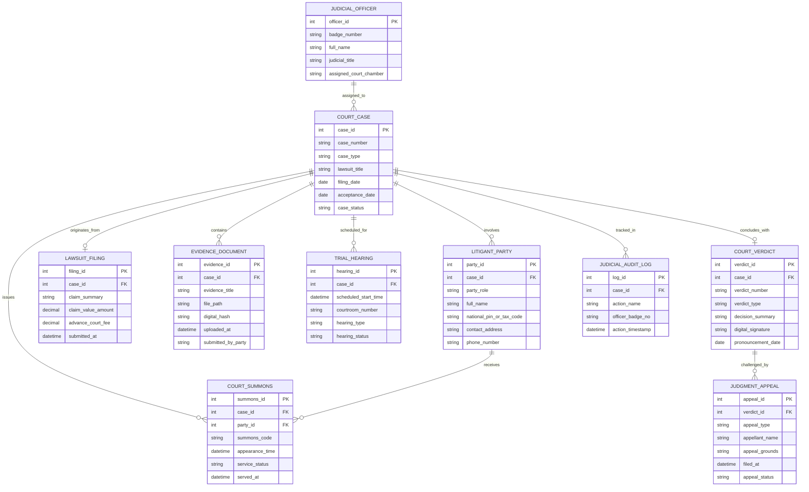

# Conceptual ERD — Court Case Management System

## Mermaid Code

## Entity Description Table | Bảng mô tả Entity

| # | Entity Name | Vietnamese Name | Description | Key Attributes | Main Relationships |
|---|-------------|-----------------|-------------|----------------|-------------------|
| 1 | COURT_CASE | Vụ án Tòa án | Thông tin tổng thể vụ án (dân sự, hình sự, hành chính, thương mại) | case_id, case_number, case_type, case_status | Involves LITIGANT_PARTY, concludes with COURT_VERDICT |
| 2 | LITIGANT_PARTY | Đương sự Vụ án | Thông tin các bên tham gia tố tụng (Nguyên đơn, Bị đơn, Bị cáo) | party_id, party_role, full_name, national_pin_or_tax_code | Belongs to COURT_CASE, receives COURT_SUMMONS |
| 3 | LAWSUIT_FILING | Đơn Khởi kiện | Thông tin nội dung đơn kiện, giá trị tranh chấp và tiền tạm ứng án phí | filing_id, claim_summary, claim_value_amount, advance_court_fee | Belongs to COURT_CASE |
| 4 | JUDICIAL_OFFICER | Cán bộ Tư pháp | Thông tin Thẩm phán, Hội thẩm nhân dân và Thư ký tòa án | officer_id, badge_number, full_name, judicial_title | Assigned to COURT_CASE |
| 5 | EVIDENCE_DOCUMENT | Chứng cứ Vụ án | Danh mục các tài liệu văn bản, tệp âm thanh/video chứng cứ số hóa | evidence_id, evidence_title, file_path, digital_hash | Belongs to COURT_CASE |
| 6 | TRIAL_HEARING | Phiên tòa Xét xử | Lịch trình và thông tin phòng xử án của phiên tòa | hearing_id, scheduled_start_time, courtroom_number, hearing_type | Belongs to COURT_CASE |
| 7 | COURT_VERDICT | Bản án / Quyết định Tòa án | Văn bản bản án chính thức có ký số của Thẩm phán chủ tọa | verdict_id, verdict_number, decision_summary, digital_signature | Belongs to COURT_CASE, challenged by JUDGMENT_APPEAL |
| 8 | JUDGMENT_APPEAL | Đơn Kháng cáo / Kháng nghị | Hồ sơ kháng cáo của đương sự hoặc kháng nghị của Viện kiểm sát | appeal_id, appeal_type, appellant_name, appeal_grounds | Belongs to COURT_VERDICT |
| 9 | COURT_SUMMONS | Giấy Triệu tập Tố tụng | Giấy triệu tập đương sự, người làm chứng đến tham gia phiên tòa | summons_id, summons_code, appearance_time, service_status | Belongs to COURT_CASE, LITIGANT_PARTY |
| 10 | JUDICIAL_AUDIT_LOG | Nhật ký Kiểm toán Tư pháp | Ghi lại lịch sử xem, sửa, phê duyệt và ký số trên hồ sơ vụ án | log_id, action_name, officer_badge_no, action_timestamp | Belongs to COURT_CASE |

## Relationship Description | Mô tả Quan hệ

| # | From Entity | Cardinality | To Entity | Relationship Label | Business Explanation |
|---|-------------|-------------|-----------|-------------------|----------------------|
| 1 | COURT_CASE | one-to-many | LITIGANT_PARTY | involves | Một vụ án bao gồm nhiều đương sự tham gia với các vai trò tố tụng |
| 2 | COURT_CASE | one-to-one | LAWSUIT_FILING | originates_from | Một vụ án dân sự/hành chính khởi nguồn từ một đơn khởi kiện duy nhất |
| 3 | COURT_CASE | one-to-many | EVIDENCE_DOCUMENT | contains | Một vụ án chứa nhiều tài liệu chứng cứ do các bên nộp |
| 4 | COURT_CASE | one-to-many | TRIAL_HEARING | scheduled_for | Một vụ án có thể trải qua nhiều phiên hòa giải và phiên tòa xét xử |
| 5 | COURT_CASE | one-to-one | COURT_VERDICT | concludes_with | Một vụ án ở một cấp xét xử kết thúc bằng một bản án chính thức |
| 6 | COURT_VERDICT | one-to-many | JUDGMENT_APPEAL | challenged_by | Một bản án sơ thẩm có thể bị kháng cáo/kháng nghị bởi nhiều bên |
| 7 | COURT_CASE | one-to-many | COURT_SUMMONS | issues | Một vụ án phát hành nhiều giấy triệu tập tới các thành viên tham gia |
| 8 | LITIGANT_PARTY | one-to-many | COURT_SUMMONS | receives | Một đương sự nhận các giấy triệu tập tố tụng cho phiên tòa |
| 9 | JUDICIAL_OFFICER | one-to-many | COURT_CASE | assigned_to | Một Thẩm phán được phân công giải quyết nhiều vụ án khác nhau |
| 10 | COURT_CASE | one-to-many | JUDICIAL_AUDIT_LOG | tracked_in | Mọi thao tác truy cập hồ sơ vụ án đều ghi lại nhật ký kiểm toán tư pháp |
